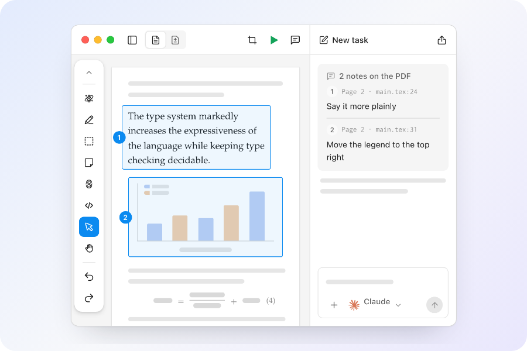
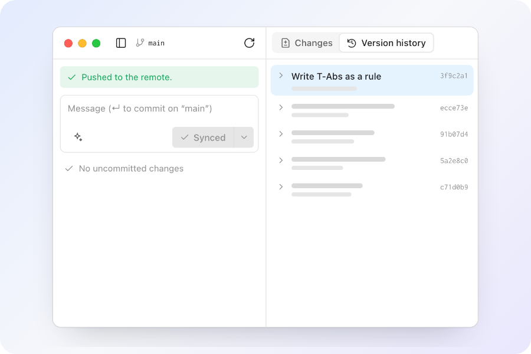

 **Next-Generation AI LaTeX Editor**

<h3>Don't&nbsp;read&nbsp;or&nbsp;write&nbsp;<code>.tex</code>&emsp; Just&nbsp;work&nbsp;on&nbsp;the&nbsp;</h3>

<a href="https://papilot.ai"><b>papilot.ai</b></a>&emsp;<a href="https://papilot.ai/demo">Online demo</a>&emsp;<a href="#get-started">Get started</a>&emsp;<a href="#agents">Agents</a>&emsp;<a href="#how-it-works">How it works</a>

<!-- BEGIN BADGES -->

<!-- END BADGES -->

<a href="README.md">English</a>&emsp;<a href="docs/readme/README.zh-CN.md">简体中文</a>&emsp;<a href="docs/readme/README.zh-Hant.md">繁體中文</a>&emsp;<a href="docs/readme/README.ja.md">日本語</a>&emsp;<a href="docs/readme/README.ko.md">한국어</a>&emsp;<a href="docs/readme/README.de.md">Deutsch</a>&emsp;<a href="docs/readme/README.fr.md">Français</a>&emsp;<a href="docs/readme/README.es.md">Español</a>&emsp;<a href="docs/readme/README.pt.md">Português</a>&emsp;<a href="docs/readme/README.it.md">Italiano</a>&emsp;<a href="docs/readme/README.sv.md">Svenska</a>

<a href="https://papilot.ai">
<picture>
  <source media="(prefers-color-scheme: dark) and (max-width: 600px)" srcset="docs/assets/readme-showcase/hero-compact-dark.png">
  <source media="(prefers-color-scheme: dark)" srcset="docs/assets/readme-showcase/hero-dark.png">
  <source media="(max-width: 600px)" srcset="docs/assets/readme-showcase/hero-compact.png">
  
</picture>
</a>

## Why Papilot

<table>
<tr>
<td width="50%" valign="top">
<picture><source media="(prefers-color-scheme: dark)" srcset="docs/assets/readme-showcase/why-annotate-dark.png"></picture> 
<b>Point at the page</b> 
Select a sentence, or box an equation or a figure, and write what should change. Your agent gets the exact source lines, whichever file they are in.
</td>
<td width="50%" valign="top">
<picture><source media="(prefers-color-scheme: dark)" srcset="docs/assets/readme-showcase/why-review-dark.png"></picture> 
<b>Review every change typeset</b> 
Each edit comes back as a before-and-after on the PDF. Accept, reject or comment on it; nothing reaches your paper until you accept it.
</td>
</tr>
<tr>
<td width="50%" valign="top">
<picture><source media="(prefers-color-scheme: dark)" srcset="docs/assets/readme-showcase/why-overleaf-dark.png"></picture> 
<b><picture><source media="(prefers-color-scheme: dark)" srcset="docs/assets/readme-icons/overleaf-dark.svg"></picture>&nbsp;Live sync with Overleaf</b> 
Coauthors keep writing in Overleaf. Your accepted changes reach them in about a second, and theirs land in your files and PDF with their names on them.
</td>
<td width="50%" valign="top">
<picture><source media="(prefers-color-scheme: dark)" srcset="docs/assets/readme-showcase/why-agents-dark.png"></picture> 
<b>Any agent, any model</b> 
Pick a model from any connected agent below the chat. Switch to another agent and Papilot reruns your request with it.
</td>
</tr>
<tr>
<td width="50%" valign="top">
<picture><source media="(prefers-color-scheme: dark)" srcset="docs/assets/readme-showcase/why-record-dark.png"></picture> 
<b>Every change on the record</b> 
Each task runs in its own Git worktree, away from your files. Committing accepted changes is a separate step, and every change stays in your Git history.
</td>
<td width="50%" valign="top">
<picture><source media="(prefers-color-scheme: dark)" srcset="docs/assets/readme-showcase/why-phone-dark.png"></picture> 
<b>Review from your phone</b> 
Open Papilot on your phone or tablet over <a href="docs/guide.md#remote-access-with-tailscale">Tailscale</a>, then read the PDF, mark it up and accept changes away from your desk.
</td>
</tr>
<tr>
<td colspan="2" valign="top">
<picture><source media="(prefers-color-scheme: dark)" srcset="docs/assets/readme-showcase/why-universe-dark.png"></picture> 
<b>Start from a template</b> 
<a href="https://papilot.ai/universe/">Papilot Universe</a> has theses, journal and conference kits, slides, posters, CVs and books, and points more than 400 conferences to the template their call for papers asks for. Choose one and Papilot creates the paper, ready to compile.
</td>
</tr>
</table>

## Get started

<a href="https://papilot.ai/#download"><picture><source media="(prefers-color-scheme: dark) and (max-width: 600px)" srcset="docs/assets/readme-downloads/mac-compact-dark.png"><source media="(prefers-color-scheme: dark)" srcset="docs/assets/readme-downloads/mac-dark.png"><source media="(max-width: 600px)" srcset="docs/assets/readme-downloads/mac-compact.png"></picture></a>
<a href="https://papilot.ai/#download"><picture><source media="(prefers-color-scheme: dark) and (max-width: 600px)" srcset="docs/assets/readme-downloads/windows-compact-dark.png"><source media="(prefers-color-scheme: dark)" srcset="docs/assets/readme-downloads/windows-dark.png"><source media="(max-width: 600px)" srcset="docs/assets/readme-downloads/windows-compact.png"></picture></a>
<a href="https://papilot.ai/#download"><picture><source media="(prefers-color-scheme: dark) and (max-width: 600px)" srcset="docs/assets/readme-downloads/linux-compact-dark.png"><source media="(prefers-color-scheme: dark)" srcset="docs/assets/readme-downloads/linux-dark.png"><source media="(max-width: 600px)" srcset="docs/assets/readme-downloads/linux-compact.png"></picture></a>
<a href="docs/guide.md#install-and-run"><picture><source media="(prefers-color-scheme: dark) and (max-width: 600px)" srcset="docs/assets/readme-downloads/terminal-compact-dark.png"><source media="(prefers-color-scheme: dark)" srcset="docs/assets/readme-downloads/terminal-dark.png"><source media="(max-width: 600px)" srcset="docs/assets/readme-downloads/terminal-compact.png"></picture></a>

Free and open source. Needs Git, a TeX distribution and a signed-in <a href="#agents">agent</a>.

## Works with your agent

  <a href="docs/guide.md#agents">
    <picture>
      <source media="(prefers-color-scheme: dark) and (max-width: 600px)" srcset="docs/assets/readme-agents/grid-compact-dark.png">
      <source media="(prefers-color-scheme: dark)" srcset="docs/assets/readme-agents/grid-dark.png">
      <source media="(max-width: 600px)" srcset="docs/assets/readme-agents/grid-compact.png">
      
    </picture>
  </a>

Bring the login or API key you already have, or use the built-in Papilot Writer. <a href="docs/guide.md#agents">Setup</a>

## How it works

  <picture>
    <source media="(prefers-color-scheme: dark) and (max-width: 600px)" srcset="docs/assets/readme-showcase/flow-compact-dark.png">
    <source media="(prefers-color-scheme: dark)" srcset="docs/assets/readme-showcase/flow-dark.png">
    <source media="(max-width: 600px)" srcset="docs/assets/readme-showcase/flow-compact.png">
    
  </picture>

## Community

<a href="https://github.com/PapilotAI/papilot/issues/new/choose"><picture><source media="(prefers-color-scheme: dark) and (max-width: 600px)" srcset="docs/assets/readme-community/issue-compact-dark.png"><source media="(prefers-color-scheme: dark)" srcset="docs/assets/readme-community/issue-dark.png"><source media="(max-width: 600px)" srcset="docs/assets/readme-community/issue-compact.png"></picture></a>
<a href="https://github.com/PapilotAI/papilot/discussions"><picture><source media="(prefers-color-scheme: dark) and (max-width: 600px)" srcset="docs/assets/readme-community/discussion-compact-dark.png"><source media="(prefers-color-scheme: dark)" srcset="docs/assets/readme-community/discussion-dark.png"><source media="(max-width: 600px)" srcset="docs/assets/readme-community/discussion-compact.png"></picture></a>
<a href="https://discord.gg/WdgZDDAvwj"><picture><source media="(prefers-color-scheme: dark) and (max-width: 600px)" srcset="docs/assets/readme-community/discord-compact-dark.png"><source media="(prefers-color-scheme: dark)" srcset="docs/assets/readme-community/discord-dark.png"><source media="(max-width: 600px)" srcset="docs/assets/readme-community/discord-compact.png"></picture></a>
<a href=".github/CONTRIBUTING.md"><picture><source media="(prefers-color-scheme: dark) and (max-width: 600px)" srcset="docs/assets/readme-community/contribute-compact-dark.png"><source media="(prefers-color-scheme: dark)" srcset="docs/assets/readme-community/contribute-dark.png"><source media="(max-width: 600px)" srcset="docs/assets/readme-community/contribute-compact.png"></picture></a>

Papilot ships often: see the [changelog](CHANGELOG.md).

## Contributors

  <a href="https://github.com/PapilotAI/papilot/graphs/contributors">
    <picture>
      <source media="(max-width: 600px)" srcset="https://papilot.ai/readme-contributors/compact.svg">
      
    </picture>
  </a>

## Star History

If Papilot saves you time, a star helps other researchers find it.

<a href="https://www.star-history.com/?repos=papilotai%2Fpapilot&type=date&legend=bottom-right">
 <picture>
   <source media="(prefers-color-scheme: dark)" srcset="https://api.star-history.com/chart?repos=papilotai/papilot&type=date&theme=dark&legend=bottom-right" />
   <source media="(prefers-color-scheme: light)" srcset="https://api.star-history.com/chart?repos=papilotai/papilot&type=date&legend=bottom-right" />
   
 </picture>
</a>

---

<a href="LICENSE">MIT</a> © 2026 PapilotAI. Thanks to our friends at <a href="https://linux.do/">LINUX DO</a>.

