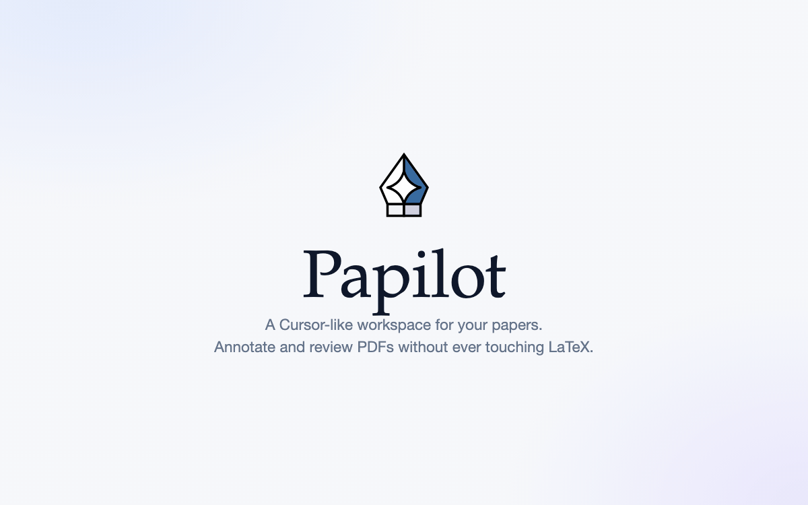
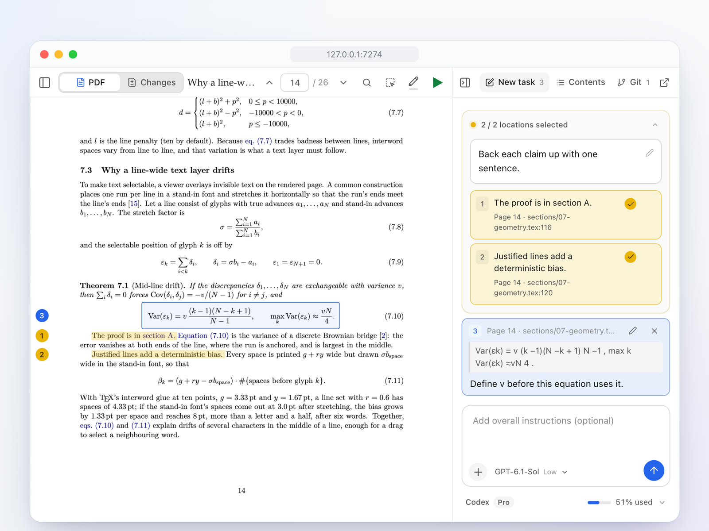
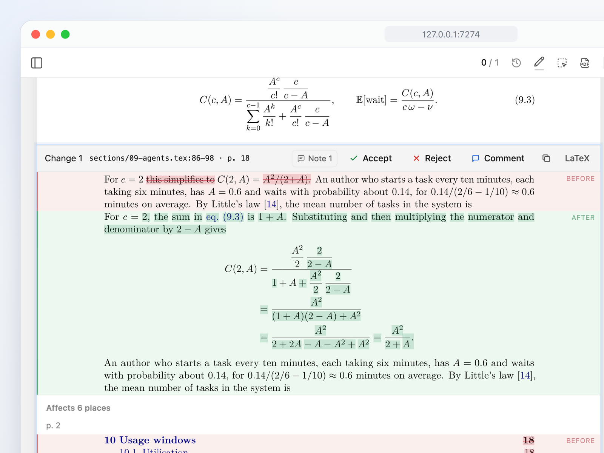
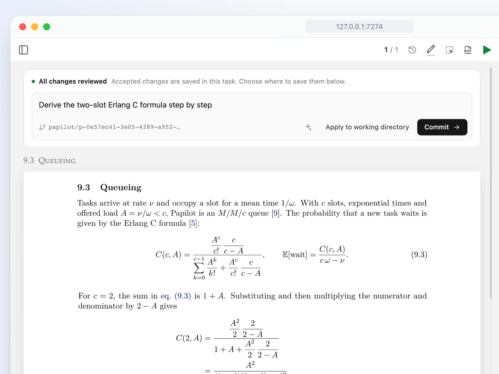
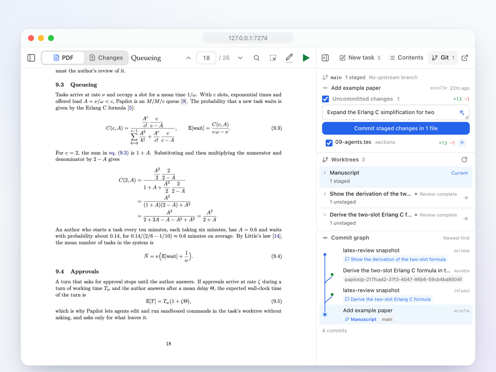
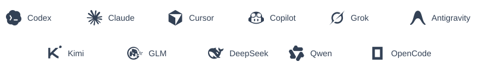

<div align="center">

<h1>
  
  
</h1>

<p><b>Revise LaTeX papers with AI, and review the changes on the PDF.</b></p>

<p><a href="https://papilot.ai">Website</a> · <a href="docs/guide.md">Documentation</a> · English · <a href="README.zh-CN.md">简体中文</a></p>

[](https://github.com/PapilotAI/papilot/actions/workflows/ci.yml)
[](https://www.npmjs.com/package/papilot)
[](LICENSE)

<p></p>

</div>

Papilot is a local workspace for writing and revising LaTeX papers with AI agents. Mark up passages and equations on the PDF, let an agent edit a separate copy of the source, then review the typeset changes and choose which ones to keep.

## Features

<table>
<tr>
<td width="50%" valign="top">
<a href="docs/assets/readme-note.jpg"></a>
<h3>Annotate the PDF</h3>
Select a sentence or box an equation and say what should change. Group related notes by color to give several passages one instruction.
</td>
<td width="50%" valign="top">
<a href="docs/assets/readme-review.jpg"></a>
<h3>Review each change</h3>
Compare the typeset pages before and after, including changes elsewhere such as renumbered equations. Accept, reject, or comment on each edit, and undo decisions as you review.
</td>
</tr>
<tr>
<td width="50%" valign="top">
<a href="docs/assets/readme-deliver.jpg"></a>
<h3>Choose where edits go</h3>
Each new task works on its own copy of the paper. Once reviewed, apply accepted edits to your working directory or commit them to a separate <code>papilot/…</code> branch.
</td>
<td width="50%" valign="top">
<a href="docs/assets/readme-git.jpg"></a>
<h3>Work with Git</h3>
Stage and commit files, pull, and push from the workspace. An agent can draft commit messages and help resolve merge conflicts; the commit graph shows each task’s worktree.
</td>
</tr>
</table>

- **[Skills](docs/guide.md#skills) and [attachments](docs/guide.md#task-attachments):** Run `/` skills to polish prose, proofread, or check math, define custom skills in Settings, and attach reference files or images to tasks and messages.
- **Reading and workspace:** Navigate manuscripts with the PDF table of contents and full-text search, with light and dark themes and an English or Chinese interface.

## Quick start

Papilot requires **Node.js 22.22+**, **Git**, and a full **TeX** distribution with `latexmk` and `synctex` ([MacTeX](https://www.tug.org/mactex/) or [TeX Live](https://www.tug.org/texlive/)). Revising a paper also requires at least one configured [agent](#agents).

```sh
npm install -g papilot
papilot demo
```

Open [http://127.0.0.1:7274](http://127.0.0.1:7274) and select **Manuscript** in the sidebar to explore the bundled example paper.

To work on your own manuscript, run `papilot` and choose **Add paper…** to open a local LaTeX folder or ZIP archive. Papilot looks for the main `.tex` file, prepares Git history when needed, and attempts compilation. If the main file is ambiguous or the build fails, the import dialog helps you choose a file or fix the problem.

Check your setup in **Settings → Runtime**, under **Agents** or **LaTeX**. Run `papilot doctor` for environment checks, or `papilot doctor --repo /path/to/paper` to check a manuscript too ([diagnostics](docs/guide.md#diagnostics)).

## Agents

<!-- BEGIN AGENT ICONS -->
<p align="center">
  <a href="docs/guide.md#agents">
    <picture>
      <source media="(prefers-color-scheme: dark) and (max-width: 600px)" srcset="docs/assets/readme-agents/compact-dark.svg">
      <source media="(prefers-color-scheme: dark)" srcset="docs/assets/readme-agents/desktop-dark.svg">
      <source media="(max-width: 600px)" srcset="docs/assets/readme-agents/compact.svg">
      
    </picture>
  </a>
</p>
<!-- END AGENT ICONS -->

You can choose an agent and model for each task. Depending on the integration, Papilot runs agents using their local CLI sign-in or provider API credentials you supply, without storing your keys.

Open **Settings → Runtime → Agents** to check status, models, and setup instructions (such as `papilot codex login`). Click **Reconnect** after installing or signing in to an agent while Papilot is running, or restart `papilot` after changing environment variables. See the [agent guide](docs/guide.md#agents) for per-agent requirements and capabilities.

## Documentation and community

- **Documentation:** Read the [User Guide](docs/guide.md) for workspace workflows, configuration, [in-app updates](docs/guide.md#updates), [remote access with Tailscale](docs/guide.md#remote-access-with-tailscale), and [passkey sharing for collaborators](docs/guide.md#collaborators).
- **Design and history:** Explore [`examples/papilot-paper`](examples/papilot-paper) for the formal design paper and proofs, and check the [Changelog](CHANGELOG.md) for release notes.
- **Community and support:** Ask questions in [Discussions](https://github.com/PapilotAI/papilot/discussions), report bugs in [Issues](https://github.com/PapilotAI/papilot/issues), or read [CONTRIBUTING.md](CONTRIBUTING.md) to contribute.

---

[MIT](LICENSE) © 2026 PapilotAI

Friends: [LINUX DO](https://linux.do/).
