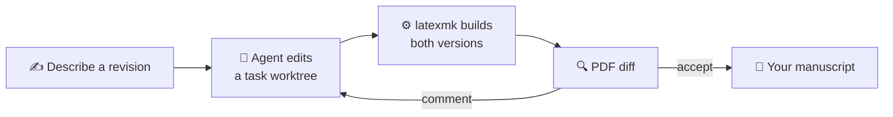

<div align="center">

<picture>
  <source media="(prefers-color-scheme: dark)" srcset="docs/assets/logo-dark.svg">
  
</picture>

<h1>Papilot</h1>

<p><b>Revise LaTeX papers with an AI agent. Review every change as a PDF diff.</b></p>

<p>English · <a href="README.zh-CN.md">简体中文</a></p>

[](https://github.com/cu1ch3n/papilot/actions/workflows/ci.yml)
[](https://www.npmjs.com/package/papilot)
[](LICENSE)
[](https://nodejs.org)
[](https://www.typescriptlang.org)
[](https://react.dev)
[](https://www.latex-project.org)
[](https://github.com/cu1ch3n/papilot/pulls)

[](#-agents)
[](#-agents)
[](#-agents)

<br>


</div>

<br>

Papilot is a workspace that runs on your own computer. Describe a revision, and an agent edits your paper in its own Git worktree. Papilot compiles the result and shows you **what changed in the typeset PDF**. You accept, reject or comment on each change. Nothing reaches your manuscript until you accept it.

## ✨ Features

|  |  |
| --- | --- |
| 🌳 **Isolated tasks** | Every task edits its own Git worktree, and up to two run at once. |
| 🔍 **Typeset diffs** | Changes show as before and after snippets of the PDF, and the LaTeX source is one click away. |
| ✅ **You decide** | Accept, reject or comment on each change. Accept all and Reject all touch only the changes you haven't decided yet. Every decision can be undone. |
| 🤖 **Your agent** | Codex, Claude or Antigravity, each with your own login. Papilot remembers your model and reasoning effort. |
| 📖 **A real PDF reader** | pdf.js with contents, search and sharp zoom. Selecting text picks exactly the printed words. |
| 📝 **Notes on the page** | Select text or mark an equation, and SyncTeX sends the agent the exact LaTeX lines. |
| 🌿 **Git built in** | Diff files, commit the ones you choose, then fetch, pull or push. |
| 📱 **Anywhere** | Runs on your computer, and you can open it from your phone over Tailscale. |

## 🚀 Quick start

```sh
npm install -g papilot
papilot demo
```

Open **http://127.0.0.1:4317**. The demo adds an example paper to revise: a 26-page LaTeX paper about Papilot itself, full of equations. When you are ready, run `papilot` and choose **Add paper** to add any LaTeX project in a Git repository.

> [!NOTE]
> You need **Node.js 22.22+**, **Git**, a **TeX** distribution with `latexmk`, and one signed-in agent.

## 🤖 Agents

| Agent | Sign in once | How Papilot runs it |
| --- | --- | --- |
| **Codex** | `npx @openai/codex login` | Through the Codex app server, in its workspace sandbox. Your plan's usage appears on the new-task page. |
| **Claude** | Set `ANTHROPIC_API_KEY` | Through the Claude Agent SDK. The SDK does not accept a Pro or Max subscription login. |
| **Antigravity** | Sign in to `agy` | `agy -p`, one process per turn, editing files only. If your region needs it, set `PAPILOT_AGY_PROXY`. |

Papilot never reads, stores or forwards your credentials. An agent that isn't installed or signed in shows as unavailable.

## 🧭 How it works



The review engine builds the paper before and after the agent's edits, finds what changed in the PDF, and links each change to its LaTeX lines. Accepted changes are merged into the manuscript's working tree, and you commit them whenever you like.

<details>
<summary><b>⚙️ Options and remote access</b></summary>

<br>

```sh
papilot --port 4400            # another local port
papilot --data ~/papilot-data  # keep state somewhere else (default ~/.papilot)
papilot service install        # macOS: start after login, restart if it exits
```

Papilot listens only on `127.0.0.1`. To use it from another device, publish it on your tailnet with Tailscale Serve and set `PAPILOT_PUBLIC_ORIGIN` and `PAPILOT_TAILSCALE_LOGIN`. Papilot then checks the host, the browser origin and the Tailscale identity of every request. The [guide](docs/guide.md#remote-access-with-tailscale) has the steps.

</details>

<details>
<summary><b>🛠️ Develop</b></summary>

<br>

```sh
git clone https://github.com/cu1ch3n/papilot && cd papilot
npm ci && npm run setup:review
npm run build && npm start
```

Run `npm run typecheck`, `npm test` and `npm run test:ui` before sending a pull request.

</details>

## 📚 Documentation

The **[guide](docs/guide.md)** covers every part of the workspace, the configuration variables, recovery after restarts, and development. The example paper in [`examples/papilot-paper`](examples/papilot-paper) explains the design in depth, with proofs.

## 📄 License

[MIT](LICENSE) © 2026 Cui Chen. The bundled review engine in [`vendor/latex-review`](vendor/latex-review) is also MIT-licensed.
