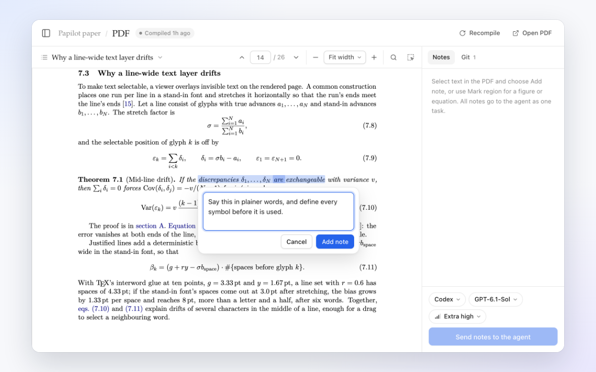
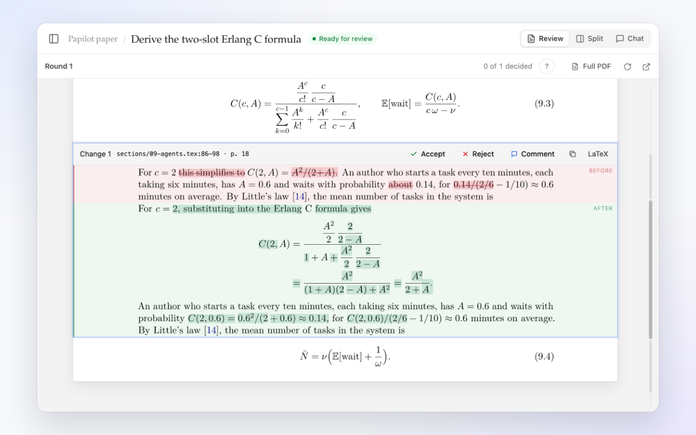
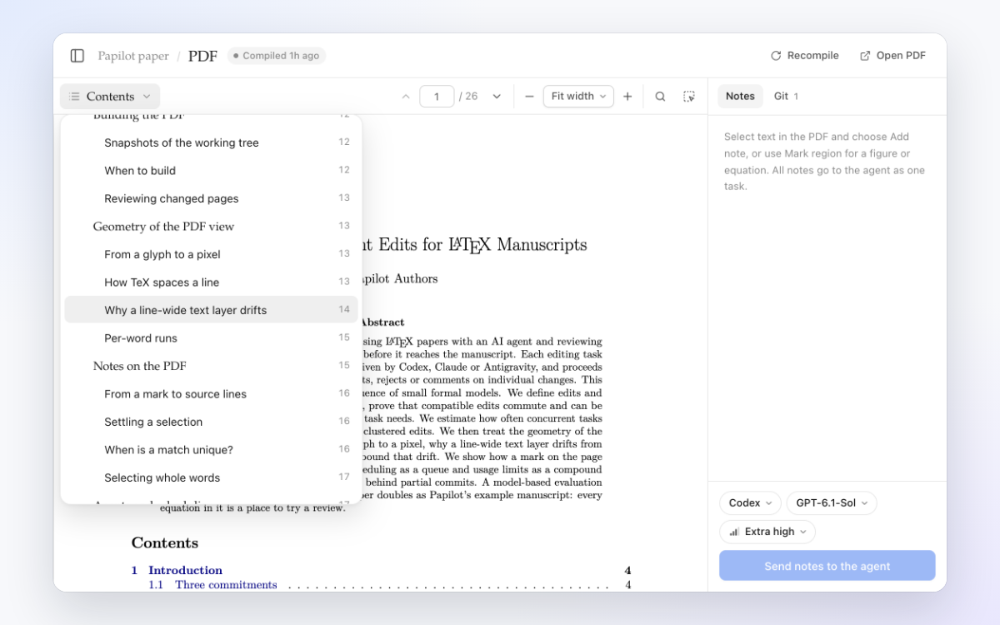
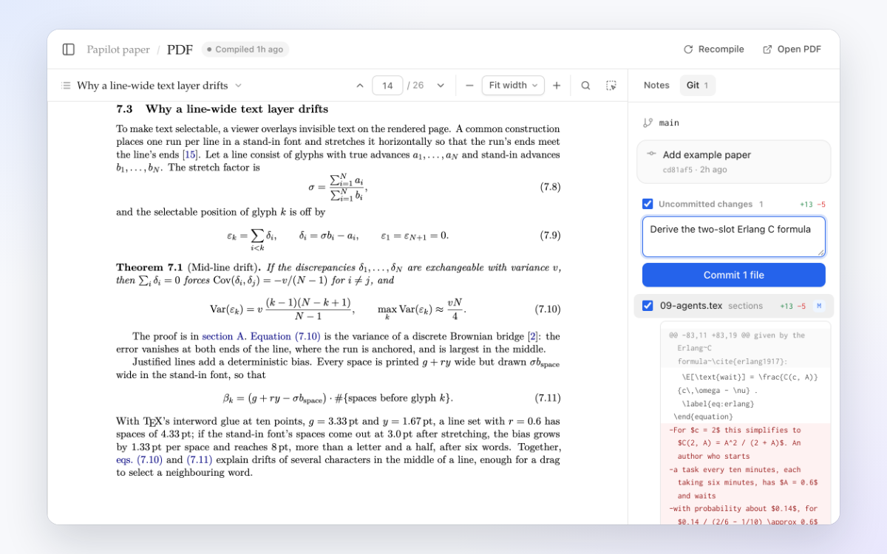

<div align="center">

<picture>
  <source media="(prefers-color-scheme: dark)" srcset="docs/assets/logo-dark.svg">
  
</picture>

<h1>Papilot</h1>

<p><b>A Cursor-like workspace for your papers:<br>annotate and review PDFs directly without ever touching LaTeX.</b></p>

<p>English · <a href="README.zh-CN.md">简体中文</a></p>

[](https://github.com/cu1ch3n/papilot/actions/workflows/ci.yml)
[](https://www.npmjs.com/package/papilot)
[](LICENSE)
[](https://nodejs.org)
[](https://www.typescriptlang.org)
[](https://react.dev)
[](https://www.latex-project.org)
[](https://github.com/cu1ch3n/papilot/pulls)

[](#-agents)
[](#-agents)
[](#-agents)

<br>


</div>

<br>

You read and mark up the PDF the way a supervisor marks up a draft. An AI agent makes the edits in LaTeX, and every change comes back to you as a before-and-after of the typeset page. Nothing touches your paper until you accept it.

## ✨ Features

<table>
<tr>
<td width="50%" valign="top">

<h3>📝 Mark up the PDF</h3>
Select a sentence or circle an equation and say what should change. SyncTeX hands the agent the exact LaTeX lines.
</td>
<td width="50%" valign="top">

<h3>✅ Approve change by change</h3>
Each edit comes back as a typeset diff. Accept, reject or comment on it, and undo any decision.
</td>
</tr>
<tr>
<td width="50%" valign="top">

<h3>📖 Read it like a real PDF</h3>
Jump around with the contents menu, search every page and zoom in sharply. Selecting text picks exactly the printed words.
</td>
<td width="50%" valign="top">

<h3>🌿 Commit when you're happy</h3>
Diff files, commit the ones you choose, then pull and push without leaving the page.
</td>
</tr>
</table>

Also: 🤖 **Codex, Claude or Antigravity**, each with your own login · 🌳 **every task in its own Git worktree**, up to two at once · 📱 **runs on your computer**, and you can open it from your phone.

## 🚀 Quick start

> [!NOTE]
> You need **Node.js 22.22+**, **Git** and a full **TeX** distribution ([MacTeX](https://www.tug.org/mactex/) or [TeX Live](https://www.tug.org/texlive/)). Revising also needs one [signed-in agent](#-agents).

```sh
npm install -g papilot
papilot demo
```

Open **http://127.0.0.1:4317** and choose **PDF** in the sidebar. The demo adds an example paper to revise: a 26-page LaTeX paper about Papilot itself, full of equations. When you are ready, run `papilot` and choose **Add paper** to add any LaTeX project in a Git repository.

## 🤖 Agents

| Agent | Sign in once | How Papilot runs it |
| --- | --- | --- |
| **Codex** | `npx @openai/codex login` | Through the Codex app server, in its workspace sandbox. Your plan's usage appears on the new-task page. |
| **Claude** | Start `papilot` with `ANTHROPIC_API_KEY` set | Through the Claude Agent SDK. The SDK does not accept a Pro or Max subscription login. |
| **Antigravity** | Install Antigravity and sign in to `agy` | `agy -p`, one process per turn, editing files only. If your region needs it, set `PAPILOT_AGY_PROXY`. |

Papilot never reads, stores or forwards your credentials. An agent that isn't installed or signed in shows as unavailable.

<details>
<summary><b>⚙️ Options and remote access</b></summary>

<br>

```sh
papilot --port 4400            # another local port
papilot --data ~/papilot-data  # keep state somewhere else (default ~/.papilot)
papilot service install        # macOS: start after login, restart if it exits
npm uninstall -g papilot       # remove it; your state stays in ~/.papilot until you delete it
```

Papilot listens only on `127.0.0.1`. To use it from another device, publish it on your tailnet with Tailscale Serve and set `PAPILOT_PUBLIC_ORIGIN` and `PAPILOT_TAILSCALE_LOGIN`. Papilot then checks the host, the browser origin and the Tailscale identity of every request. The [guide](docs/guide.md#remote-access-with-tailscale) has the steps.

</details>

<details>
<summary><b>🛠️ Develop</b></summary>

<br>

```sh
git clone https://github.com/cu1ch3n/papilot && cd papilot
npm ci && npm run setup:review
npm run build && npm start
```

Run `npm run typecheck`, `npm test` and `npm run test:ui` before sending a pull request.

</details>

## 📚 Documentation

The **[guide](docs/guide.md)** covers every part of the workspace, the configuration variables, recovery after restarts, and development. The example paper in [`examples/papilot-paper`](examples/papilot-paper) explains the design in depth, with proofs.

## 📄 License

[MIT](LICENSE) © 2026 Cui Chen. The bundled review engine in [`vendor/latex-review`](vendor/latex-review) is also MIT-licensed.
