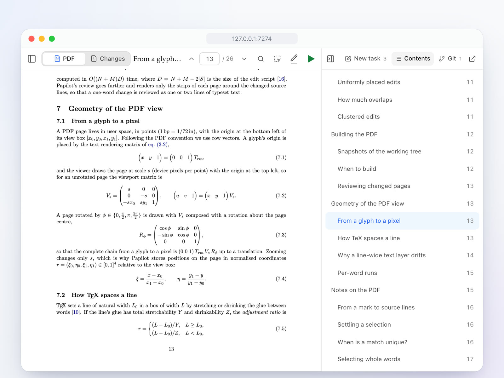

<div align="center">

<h1>
  
  
</h1>

<p><b>A Cursor-like workspace for your papers: annotate and review PDFs directly without ever touching LaTeX.</b></p>

<p>English · <a href="README.zh-CN.md">简体中文</a></p>

[](https://github.com/cu1ch3n/papilot/actions/workflows/ci.yml)
[](https://www.npmjs.com/package/papilot)
[](LICENSE)
[](https://nodejs.org)
[](https://www.typescriptlang.org)
[](https://react.dev)
[](https://www.latex-project.org)
[](https://github.com/cu1ch3n/papilot/pulls)

**Contents:** [Features](#-features) · [Quick start](#-quick-start) · [Agents](#-agents) · [Documentation](#-documentation) · [Community](#-community) · [Friends](#-friends) · [License](#-license)


</div>

You read and mark up the PDF the way a supervisor marks up a draft. An AI agent makes the edits in LaTeX, and every change comes back to you as a before-and-after of the typeset page. Nothing touches your paper until you accept it.

> [!TIP]
> **New in 0.7:** a redesigned workspace, color-grouped notes, files and images in tasks, a skill library, and a choice of where accepted changes go. See the [changelog](CHANGELOG.md).

## ✨ Features

<table>
<tr>
<td width="50%" valign="top">

<h3>📝 Mark up the PDF</h3>
Select a sentence or box an equation and say what should change. SyncTeX hands the agent the exact LaTeX lines. Color related notes into a group and give the whole group one instruction.
</td>
<td width="50%" valign="top">

<h3>✅ Approve change by change</h3>
Each edit comes back as a typeset diff, together with the places it moves elsewhere, such as renumbered equations and the table of contents. Accept, reject or comment, and undo any decision.
</td>
</tr>
<tr>
<td width="50%" valign="top">

<h3>📦 Choose where it goes</h3>
Accepted changes stay inside the task until you finish reviewing. Then apply them to your working directory, or commit them to a separate <code>papilot/…</code> branch with a message the agent writes.
</td>
<td width="50%" valign="top">

<h3>🌿 Git without leaving the page</h3>
Stage files and commit them with a message an agent writes, then pull and push. Every task's worktree shows in the commit graph, and an agent can resolve conflicts when you merge a co-author's changes.
</td>
</tr>
<tr>
<td width="50%" valign="top">

<h3>📖 Read it like a real PDF</h3>
Jump to any section from the contents, search every page and zoom in sharply. Selecting text picks exactly the printed words.
</td>
<td width="50%" valign="top">
<h3>🧰 And more</h3>
<ul>
<li>✨ <b>Skills</b> such as Polish, Proofread and Check math, one <code>/</code> away. Write your own in Settings.</li>
<li>📎 <b>Files and images</b> attached to any task or message</li>
<li>🤖 <b>Codex, Claude, Cursor, Kimi Code, GLM, DeepSeek, Qwen Code, OpenCode or Antigravity</b>: whichever is on your computer, with your own login</li>
<li>🌳 <b>A Git worktree for every task</b>, up to two running at once</li>
<li>🌗 <b>Light and dark</b>, in English or Chinese</li>
<li>📱 <b>Runs on your computer</b>, and you can open it from your phone</li>
</ul>
</td>
</tr>
</table>

## 🚀 Quick start

> [!NOTE]
> You need **Node.js 22.22+**, **Git** and a full **TeX** distribution ([MacTeX](https://www.tug.org/mactex/) or [TeX Live](https://www.tug.org/texlive/)). Revising also needs one [signed-in agent](#-agents).

```sh
npm install -g papilot
papilot demo
```

Open **http://127.0.0.1:7274** and choose **Manuscript** in the sidebar. The demo adds an example paper to revise: a 26-page LaTeX paper about Papilot itself, full of equations. When you are ready, run `papilot` and choose **Add paper…** from the paper menu to select a LaTeX folder or drop a ZIP. Papilot identifies the main file, prepares Git history and tries compilation, with help for any errors during import.

## 🤖 Agents

| Agent | Sign in once | How Papilot runs it |
| --- | --- | --- |
| **Codex** | `papilot codex login` | Through the Codex app server, in its workspace sandbox. Papilot uses your `codex` if you have one, or installs it on first start. |
| **Claude** | Install [Claude Code](https://code.claude.com) and run `claude auth login`, or start `papilot` with `ANTHROPIC_API_KEY` set | With Claude Code installed, runs `claude -p` on your own login (your Claude plan or a key), in Claude Code's sandbox. Without it, through the Claude Agent SDK, which needs an API key. |
| **Cursor** | Start `papilot` with `CURSOR_API_KEY` set | Through the Cursor SDK, downloaded the first time, in Cursor's sandbox. The SDK does not use the Cursor app or CLI login. |
| **Kimi Code** | Install [Kimi Code CLI](https://www.kimi.com/code/docs/en/kimi-code-cli/guides/getting-started) and run `kimi login` | Runs `kimi acp` with your local configuration; streams replies, resumes sessions and forwards tool approvals. |
| **GLM** | Start `papilot` with `ZHIPU_API_KEY` (or `ZAI_API_KEY`) set | Claude Code on Zhipu's Anthropic-compatible endpoint, as Zhipu documents for GLM Coding Plan. |
| **DeepSeek** | Install [DeepSeek Harness](https://github.com/deepseek-ai/deepseek-harness) (`npm install -g @deepseek-ai/dsh`) and set up a model in it | Runs `dsh acp` in its workspace sandbox; anything outside the worktree asks for approval. |
| **Qwen Code** | Install [Qwen Code](https://github.com/QwenLM/qwen-code) and sign in by running `qwen` | Runs `qwen --acp` in Auto Edit mode: edits go ahead, commands ask for approval. |
| **OpenCode** | Install [OpenCode](https://opencode.ai) and connect a provider with `opencode auth login` | Runs `opencode acp` with your providers; commands and anything outside the worktree ask for approval. |
| **Antigravity** | Install Antigravity and sign in to `agy` | `agy -p`, one process per turn, editing files only. If your region needs it, set `PAPILOT_AGY_PROXY`. |

Papilot finds the agents on your computer by itself and offers only those; Codex is always there. After installing or signing in to one while Papilot is running, select **Reconnect**. If a CLI is not on the server’s `PATH`, point `PAPILOT_KIMI_BIN`, `PAPILOT_DSH_BIN`, `PAPILOT_QWEN_BIN` or `PAPILOT_OPENCODE_BIN` at it. See the [agent guide](docs/guide.md#agents) for what each one supports and the tested versions.

Papilot never stores your credentials. CLI agents use their own login, and a key you set for Claude, Cursor or GLM goes only to that service. An agent that is found but not signed in shows as unavailable.

Having trouble getting started? Open **Settings → Runtime** and choose **Agents** for agent setup or **LaTeX** for the detected distribution, version, and location, or run `papilot doctor` for environment checks and fixes and `papilot doctor --repo /path/to/paper` to check a paper too. Add `--json` for a machine-readable report. Diagnostics do not install software, start the server or change your paper. See the [diagnostics guide](docs/guide.md#diagnostics) for what is checked.

<details>
<summary><b>⚙️ Options and remote access</b></summary>

<br>

```sh
papilot --port 4400            # another local port
papilot --data ~/papilot-data  # keep state somewhere else (default ~/.papilot)
papilot service install        # macOS: start after login, restart if it exits
npm uninstall -g papilot       # remove it; your state stays in ~/.papilot until you delete it
```

When a release is available, **New version** appears next to **Settings**. Click it to install from the browser. Papilot waits for tasks and PDF builds to finish, restarts, and reconnects the page. Updates keep your data and preserve the previous installation for rollback. See [Updates](docs/guide.md#updates).

Papilot listens only on `127.0.0.1`. To use it from another device, publish it on your tailnet with Tailscale Serve and set `PAPILOT_PUBLIC_ORIGIN` and `PAPILOT_TAILSCALE_LOGIN`. Papilot then checks the host, the browser origin and the Tailscale identity of every request. The [guide](docs/guide.md#remote-access-with-tailscale) has the steps.

To invite an advisor or co-authors, give Papilot a public HTTPS address with `PAPILOT_ACCOUNT_ORIGIN` and open **Settings → Sharing**: each person signs in with a passkey and sees only the papers you share. Invite only people you would trust with access to the computer Papilot runs on; see [Collaborators](docs/guide.md#collaborators).

</details>

<details>
<summary><b>🛠️ Develop</b></summary>

<br>

```sh
git clone https://github.com/cu1ch3n/papilot && cd papilot
npm ci && npm run setup:review
npm run build && npm start
```

Run `npm run typecheck`, `npm test` and `npm run test:ui` before sending a pull request.

</details>

## 📚 Documentation

The **[guide](docs/guide.md)** covers every part of the workspace, the configuration variables, recovery after restarts, and development. The example paper in [`examples/papilot-paper`](examples/papilot-paper) explains the design in depth, with proofs. What changed in each release is in the [changelog](CHANGELOG.md).

## 💬 Community

- 💡 **Questions and ideas**: [Discussions](https://github.com/cu1ch3n/papilot/discussions)
- 🐛 **Something broke**: [open an issue](https://github.com/cu1ch3n/papilot/issues/new/choose)
- 🤝 **Want to help**: pick a [good first issue](https://github.com/cu1ch3n/papilot/labels/good%20first%20issue) and read [CONTRIBUTING.md](CONTRIBUTING.md)

If Papilot saves you time on a paper, a ⭐ helps other researchers find it.

<a href="https://github.com/cu1ch3n/papilot/graphs/contributors"></a>

## 🔗 Friends

[LINUX DO](https://linux.do/)

## 📄 License

[MIT](LICENSE) © 2026 Cui Chen. The bundled review engine in [`vendor/latex-review`](vendor/latex-review) is also MIT-licensed.
