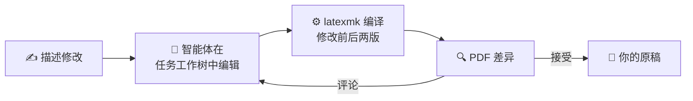

<div align="center">

<picture>
  <source media="(prefers-color-scheme: dark)" srcset="docs/assets/logo-dark.svg">
  
</picture>

<h1>Papilot</h1>

<p><b>让 AI 智能体修改你的 LaTeX 论文，每一处改动都以 PDF 差异呈现，由你审阅。</b></p>

<p><a href="README.md">English</a> · 简体中文</p>

[](https://github.com/cu1ch3n/papilot/actions/workflows/ci.yml)
[](https://www.npmjs.com/package/papilot)
[](LICENSE)
[](https://nodejs.org)
[](https://www.typescriptlang.org)
[](https://react.dev)
[](https://www.latex-project.org)
[](https://github.com/cu1ch3n/papilot/pulls)

[](#-智能体)
[](#-智能体)
[](#-智能体)

<br>


</div>

<br>

Papilot 是一个运行在你自己电脑上的工作台。你描述想要的修改，智能体就在独立的 Git 工作树里编辑论文；Papilot 随后编译，把**排版后 PDF 的变化**展示给你。每一处改动都由你接受、拒绝或评论，接受之前，原稿一个字都不会变。

## ✨ 功能

|  |  |
| --- | --- |
| 🌳 **任务彼此隔离** | 每个任务都在自己的 Git 工作树里修改，最多两个同时运行。 |
| 🔍 **排版后的差异** | 改动以 PDF 修改前后的片段呈现，一键即可查看 LaTeX 源码。 |
| ✅ **由你决定** | 逐条接受、拒绝或评论。“全部接受”和“全部拒绝”只作用于尚未决定的改动，每个决定都可以撤销。 |
| 🤖 **你的智能体** | Codex、Claude 或 Antigravity，各用你自己的登录；模型和推理强度会被记住。 |
| 📖 **真正的 PDF 阅读器** | 基于 pdf.js，支持目录、搜索和清晰缩放；选中的文字与印出的词完全对齐。 |
| 📝 **在页面上批注** | 选中文字或框选公式，SyncTeX 会把对应的 LaTeX 行准确交给智能体。 |
| 🌿 **内置 Git** | 查看差异，只提交你勾选的文件，还能 fetch、pull 和 push。 |
| 📱 **随处可用** | 运行在你的电脑上，也能通过 Tailscale 用手机打开。 |

## 🚀 快速开始

```sh
npm install -g papilot
papilot demo
```

打开 **http://127.0.0.1:4317**。demo 会添加一篇示例论文供你修改：一篇讲 Papilot 本身的 26 页 LaTeX 论文，满是公式。准备好之后，运行 `papilot`，选择 **Add paper**，即可添加任何放在 Git 仓库里的 LaTeX 项目。

> [!NOTE]
> 需要 **Node.js 22.22+**、**Git**、带 `latexmk` 的 **TeX** 发行版，以及至少一个已登录的智能体。

## 🤖 智能体

| 智能体 | 登录（一次即可） | Papilot 如何运行它 |
| --- | --- | --- |
| **Codex** | `npx @openai/codex login` | 通过 Codex app server 在其工作区沙箱中运行；新建任务页会显示你套餐的用量。 |
| **Claude** | 设置 `ANTHROPIC_API_KEY` | 通过 Claude Agent SDK 运行；该 SDK 不接受 Pro 或 Max 订阅登录。 |
| **Antigravity** | 登录 `agy` | 运行 `agy -p`，每轮一个进程，只编辑文件；所在地区需要代理时设置 `PAPILOT_AGY_PROXY`。 |

Papilot 从不读取、保存或转发你的凭据。没有安装或没有登录的智能体会显示为不可用。

## 🧭 工作原理



审阅引擎分别编译智能体修改前后的论文，找出 PDF 中变化的地方，并把每处改动对应到 LaTeX 源码行。接受的改动会合并进原稿的工作区，何时提交由你决定。

<details>
<summary><b>⚙️ 选项与远程访问</b></summary>

<br>

```sh
papilot --port 4400            # 使用其他本地端口
papilot --data ~/papilot-data  # 把状态放在别处（默认 ~/.papilot）
papilot service install        # macOS：登录后自动启动，退出后自动重启
```

Papilot 只监听 `127.0.0.1`。若要从其他设备访问，用 Tailscale Serve 把它发布到你的 tailnet，并设置 `PAPILOT_PUBLIC_ORIGIN` 和 `PAPILOT_TAILSCALE_LOGIN`；Papilot 会校验每个请求的主机、浏览器来源和 Tailscale 身份。具体步骤见[指南](docs/guide.md#remote-access-with-tailscale)。

</details>

<details>
<summary><b>🛠️ 参与开发</b></summary>

<br>

```sh
git clone https://github.com/cu1ch3n/papilot && cd papilot
npm ci && npm run setup:review
npm run build && npm start
```

提交 pull request 前，请运行 `npm run typecheck`、`npm test` 和 `npm run test:ui`。

</details>

## 📚 文档

**[指南](docs/guide.md)**（英文）介绍工作台的每个部分、配置变量、重启后的恢复以及开发流程。[`examples/papilot-paper`](examples/papilot-paper) 中的示例论文深入讲解了设计，并附有证明。

## 📄 许可证

[MIT](LICENSE) © 2026 Cui Chen。内置的审阅引擎 [`vendor/latex-review`](vendor/latex-review) 同样采用 MIT 许可证。
