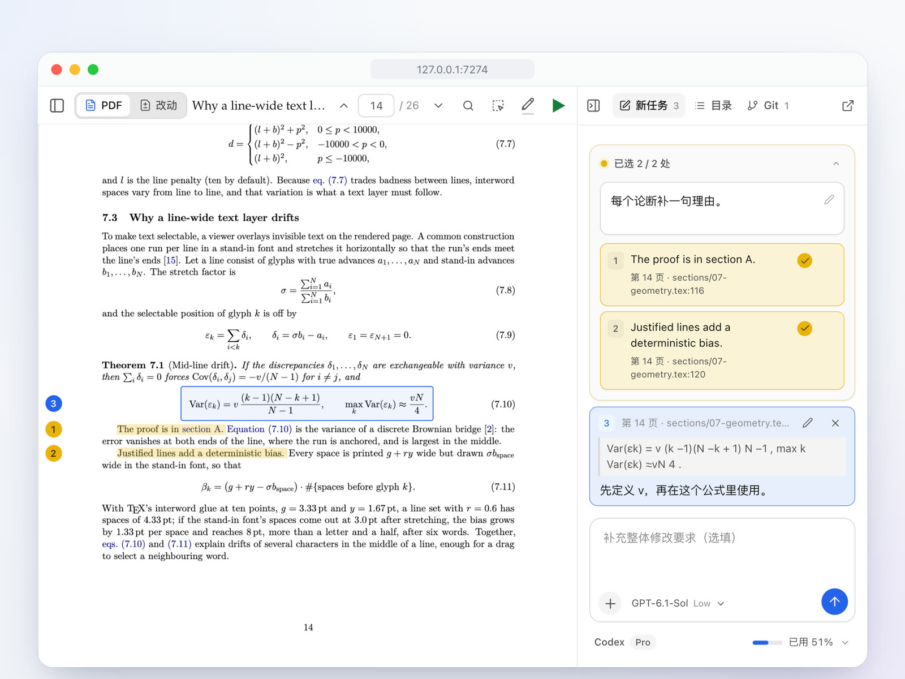
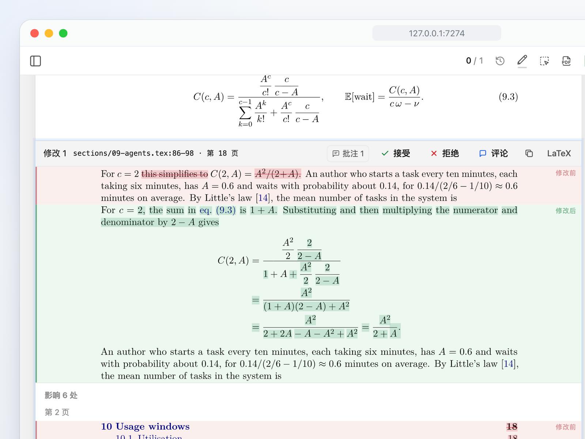
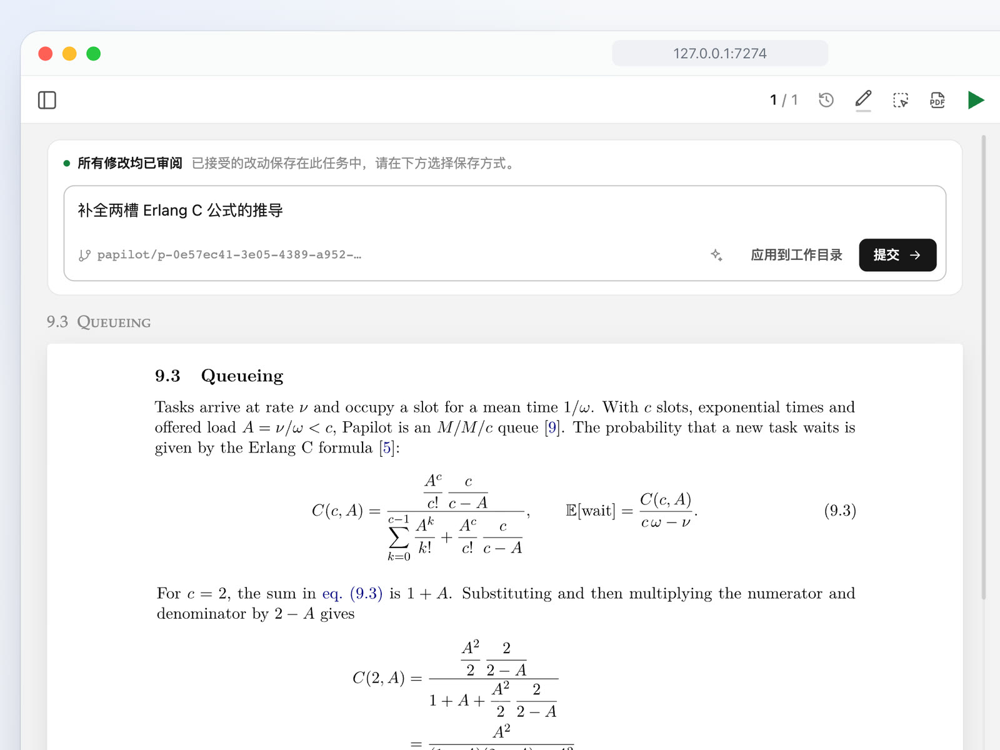
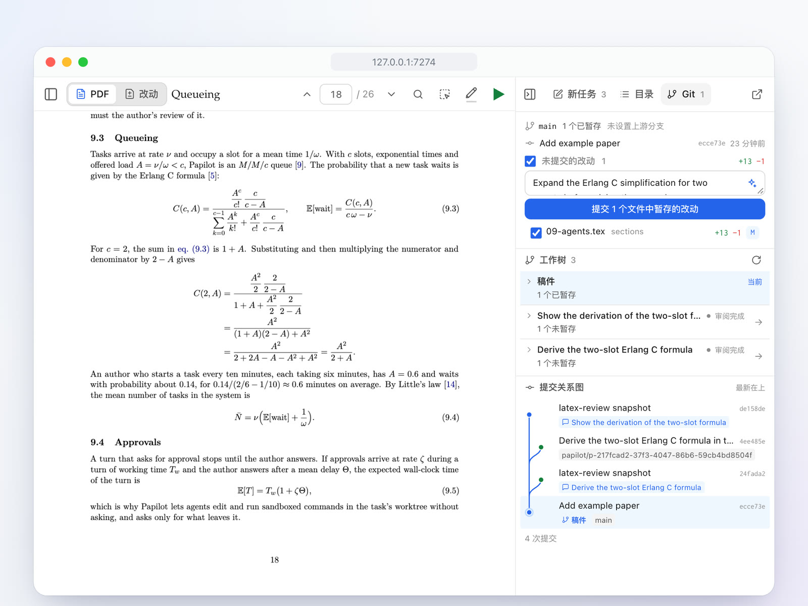
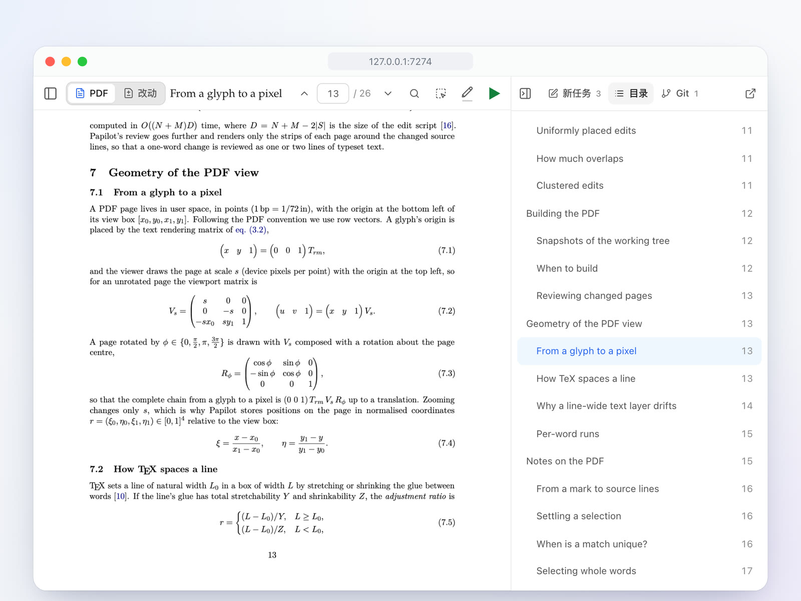

<div align="center">

<h1>
  <picture>
    <source media="(prefers-color-scheme: dark)" srcset="docs/assets/logo-dark.svg">
    
  </picture>
  Papilot
</h1>

<p><b>像 Cursor 一样改论文：直接在 PDF 上批注和审阅，完全不用碰 LaTeX。</b></p>

<p><a href="README.md">English</a> · 简体中文</p>

[](https://github.com/cu1ch3n/papilot/actions/workflows/ci.yml)
[](https://www.npmjs.com/package/papilot)
[](LICENSE)
[](https://nodejs.org)
[](https://www.typescriptlang.org)
[](https://react.dev)
[](https://www.latex-project.org)
[](https://github.com/cu1ch3n/papilot/pulls)

**目录：** [功能](#-功能) · [快速开始](#-快速开始) · [智能体](#-智能体) · [文档](#-文档) · [社区](#-社区) · [友情链接](#-友情链接) · [许可证](#-许可证)


</div>

你像导师批改学生的稿子一样，直接在 PDF 上阅读和批注；AI 智能体去改 LaTeX，每一处改动都以排版后修改前后的对比回到你面前。你点头之前，论文一个字都不会变。

> [!TIP]
> **0.7 新功能**：全新设计的工作台、按颜色分组的批注、任务中附带文件和图片、技能库，以及接受的改动保存到哪里由你选择。详见[更新日志](CHANGELOG.md)。

## ✨ 功能

<table>
<tr>
<td width="50%" valign="top">

<h3>📝 在 PDF 上批注</h3>
选中一句话或框出一个公式，写下要怎么改。SyncTeX 会把对应的 LaTeX 行准确交给智能体。相关的批注可以用颜色归成一组，整组只写一条要求。
</td>
<td width="50%" valign="top">

<h3>✅ 逐条点头</h3>
每处改动都以排版后的差异呈现，连同它在别处引起的变化，比如重新编号的公式和目录。接受、拒绝或评论，任何决定都能撤销。
</td>
</tr>
<tr>
<td width="50%" valign="top">

<h3>📦 改动去哪由你定</h3>
审阅结束前，接受的改动只保存在任务里。之后可以应用到工作目录，也可以提交到独立的 <code>papilot/…</code> 分支，提交信息由智能体来写。
</td>
<td width="50%" valign="top">

<h3>🌿 不离开页面用 Git</h3>
暂存文件，让智能体写提交信息，再 pull、push。每个任务的工作树都显示在提交关系图里；合并合作者的改动时，冲突可以交给智能体解决。
</td>
</tr>
<tr>
<td width="50%" valign="top">

<h3>📖 像本地 PDF 一样阅读</h3>
用目录随意跳转，全文搜索，缩放清晰。选中的文字与印出的词完全对齐。
</td>
<td width="50%" valign="top">
<h3>🧰 还有</h3>
<ul>
<li>✨ <b>技能（skill）</b>，如润色、校对、检查数学，输入 <code>/</code> 即可选用，也能在设置里写你自己的</li>
<li>📎 任务和消息都能附带<b>文件和图片</b></li>
<li>🤖 <b>Codex、Claude、Cursor、Kimi Code、GLM、DeepSeek、Qwen Code、OpenCode 或 Antigravity</b>：电脑上装了哪个就用哪个，各用你自己的登录</li>
<li>🌳 <b>每个任务都有独立的 Git 工作树</b>，最多两个同时运行</li>
<li>🌗 <b>浅色与深色</b>，界面支持中文和英文</li>
<li>📱 <b>运行在你的电脑上</b>，也能用手机打开</li>
</ul>
</td>
</tr>
</table>

## 🚀 快速开始

> [!NOTE]
> 需要 **Node.js 22.22+**、**Git** 和完整的 **TeX** 发行版（[MacTeX](https://www.tug.org/mactex/) 或 [TeX Live](https://www.tug.org/texlive/)）。修改论文还需要至少一个[已登录的智能体](#-智能体)。

```sh
npm install -g papilot
papilot demo
```

打开 **http://127.0.0.1:7274**，在侧栏选择 **稿件**。demo 会添加一篇示例论文供你修改：一篇讲 Papilot 本身的 26 页 LaTeX 论文，满是公式。准备好之后，运行 `papilot`，在论文菜单中选择 **添加论文…**，选择 LaTeX 文件夹或拖入 ZIP。Papilot 会识别主文件、准备 Git 历史并尝试编译，遇到问题可在导入窗口中重试或请求助手修复。

## 🤖 智能体

| 智能体 | 登录（一次即可） | Papilot 如何运行它 |
| --- | --- | --- |
| **Codex** | `papilot codex login` | 通过 Codex app server 在其工作区沙箱中运行；已装有 `codex` 就直接用，没有则在首次启动时自动安装。 |
| **Claude** | 安装 [Claude Code](https://code.claude.com) 并运行 `claude auth login`，或设置好 `ANTHROPIC_API_KEY` 再启动 `papilot` | 装了 Claude Code 时，用你自己的登录（Claude 订阅或密钥）运行 `claude -p`，在 Claude Code 的沙箱中工作；没装时通过 Claude Agent SDK 运行，需要 API 密钥。 |
| **Cursor** | 设置好 `CURSOR_API_KEY` 再启动 `papilot` | 通过 Cursor SDK 在 Cursor 的沙箱中运行，首次使用时下载；该 SDK 不使用 Cursor 应用或 CLI 的登录。 |
| **Kimi Code** | 安装 [Kimi Code CLI](https://www.kimi.com/code/docs/en/kimi-code-cli/guides/getting-started)，运行 `kimi login` | 通过 `kimi acp` 使用本机配置，支持流式回复、会话恢复和工具审批。 |
| **GLM** | 设置好 `ZHIPU_API_KEY`（或 `ZAI_API_KEY`）再启动 `papilot` | 按智谱为 GLM Coding Plan 给出的方式，让 Claude Code 连接智谱的 Anthropic 兼容接口。 |
| **DeepSeek** | 安装 [DeepSeek Harness](https://github.com/deepseek-ai/deepseek-harness)（`npm install -g @deepseek-ai/dsh`）并在其中配置好模型 | 通过 `dsh acp` 在其工作区沙箱中运行；工作树以外的操作需要审批。 |
| **Qwen Code** | 安装 [Qwen Code](https://github.com/QwenLM/qwen-code)，运行 `qwen` 登录 | 以自动编辑模式运行 `qwen --acp`：改文件直接进行，运行命令需要审批。 |
| **OpenCode** | 安装 [OpenCode](https://opencode.ai)，用 `opencode auth login` 连接模型服务商 | 用你配置的服务商运行 `opencode acp`；运行命令和工作树以外的操作需要审批。 |
| **Antigravity** | 安装 Antigravity 并登录 `agy` | 运行 `agy -p`，每轮一个进程，只编辑文件；所在地区需要代理时设置 `PAPILOT_AGY_PROXY`。 |

Papilot 会自动找出电脑上已有的智能体，只列出这些；Codex 始终可用。Papilot 运行期间安装或登录了新的智能体，点击 **重新连接** 即可。如果服务找不到 CLI，可以用 `PAPILOT_KIMI_BIN`、`PAPILOT_DSH_BIN`、`PAPILOT_QWEN_BIN` 或 `PAPILOT_OPENCODE_BIN` 指定其路径。各智能体支持的功能和已验证的版本见[智能体指南](docs/guide.md#agents)。

Papilot 从不保存你的凭据。CLI 智能体使用各自的登录；为 Claude、Cursor 或 GLM 设置的密钥只会交给对应的服务。已找到但没有登录的智能体会显示为不可用。

启动遇到问题？打开 **设置 → 运行环境 → 智能体** 查看智能体配置，或运行 `papilot doctor` 检查环境并查看修复建议，用 `papilot doctor --repo /path/to/paper` 一并检查论文。加上 `--json` 可输出机器可读的报告。诊断不会安装软件、启动服务或修改论文。检查范围见[诊断指南](docs/guide.md#diagnostics)。

<details>
<summary><b>⚙️ 选项与远程访问</b></summary>

<br>

```sh
papilot --port 4400            # 使用其他本地端口
papilot --data ~/papilot-data  # 把状态放在别处（默认 ~/.papilot）
papilot service install        # macOS：登录后自动启动，退出后自动重启
npm uninstall -g papilot       # 卸载；状态仍保留在 ~/.papilot，可自行删除
```

有新版本时，**设置** 旁会出现 **有新版本**，点击即可在浏览器中安装。Papilot 会等任务和 PDF 编译结束后重启，并重新连接页面。更新会保留你的数据，也会保留上一版安装以便回滚。详见[更新](docs/guide.md#updates)。

Papilot 只监听 `127.0.0.1`。若要从其他设备访问，用 Tailscale Serve 把它发布到你的 tailnet，并设置 `PAPILOT_PUBLIC_ORIGIN` 和 `PAPILOT_TAILSCALE_LOGIN`；Papilot 会校验每个请求的主机、浏览器来源和 Tailscale 身份。具体步骤见[指南](docs/guide.md#remote-access-with-tailscale)。

要邀请导师或合作者，用 `PAPILOT_ACCOUNT_ORIGIN` 给 Papilot 一个公开的 HTTPS 地址，然后打开 **成员**：每个人用通行密钥登录，只能看到你共享的论文。只邀请你愿意让其访问运行 Papilot 的这台电脑的人，详见[协作者](docs/guide.md#collaborators)。

</details>

<details>
<summary><b>🛠️ 参与开发</b></summary>

<br>

```sh
git clone https://github.com/cu1ch3n/papilot && cd papilot
npm ci && npm run setup:review
npm run build && npm start
```

提交 pull request 前，请运行 `npm run typecheck`、`npm test` 和 `npm run test:ui`。

</details>

## 📚 文档

**[指南](docs/guide.md)**（英文）介绍工作台的每个部分、配置变量、重启后的恢复以及开发流程。[`examples/papilot-paper`](examples/papilot-paper) 中的示例论文深入讲解了设计，并附有证明。每个版本的变化见[更新日志](CHANGELOG.md)。

## 💬 社区

- 💡 **提问和想法**：[Discussions](https://github.com/cu1ch3n/papilot/discussions)
- 🐛 **遇到问题**：[提交 issue](https://github.com/cu1ch3n/papilot/issues/new/choose)
- 🤝 **想参与**：从 [good first issue](https://github.com/cu1ch3n/papilot/labels/good%20first%20issue) 开始，并阅读 [CONTRIBUTING.md](CONTRIBUTING.md)

如果 Papilot 帮你省下了改论文的时间，点个 ⭐ 能让更多研究者发现它。

<a href="https://github.com/cu1ch3n/papilot/graphs/contributors"></a>

## 🔗 友情链接

[LINUX DO](https://linux.do/) 是一个交流技术、分享开源项目的中文社区。Papilot 认同真诚、友善、团结、专业的社区理念，欢迎大家去发现有趣的项目、交流使用经验。

## 📄 许可证

[MIT](LICENSE) © 2026 Cui Chen。内置的审阅引擎 [`vendor/latex-review`](vendor/latex-review) 同样采用 MIT 许可证。
