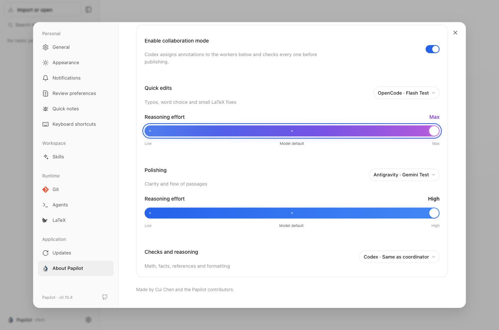
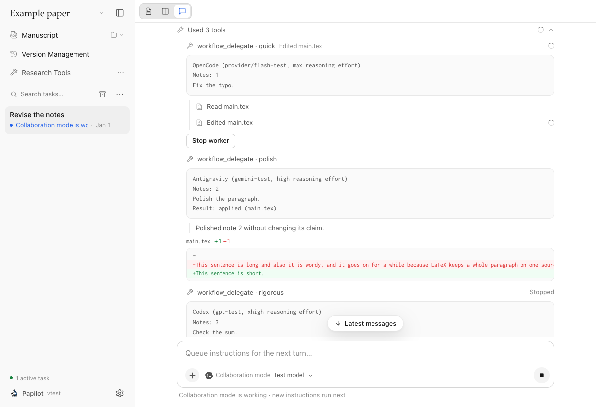

# Collaboration mode

An opt-in experiment for editing many PDF annotations with several agents at once. It is hidden by default. Open **Settings → About Papilot → Experiments**, then turn on **Enable collaboration mode**. It becomes available in the agent/model picker once Codex is detected. The setting is saved on the Papilot host and shared by its browsers. Turning it off hides new choices; existing tasks can continue.

Codex is the coordinator. It plans the work by annotation intent and source span, sends each piece to the worker configured for its role, resolves conflicts and finishes with an independent audit. Pick the coordinator's model and reasoning effort in the task's model picker, as for a Codex task. This mode edits annotations; use Codex directly for the AI review skill that generates new PDF notes.

[Mobile, dark theme](assets/collaboration-mobile-dark.png) · [Mobile, Simplified Chinese](assets/collaboration-mobile-zh-CN.png)

## Roles and workers

Below the switch, each role has a worker and, when the model offers it, a reasoning effort:

| Role | Work |
| --- | --- |
| **Quick edits** | Simple, unambiguous edits: typos, word choice, consistent terms and small LaTeX fixes |
| **Polishing** | Clarity, flow and tone of a passage without changing its claims |
| **Checks and reasoning** | Mathematical reasoning, factual claims, references, citations and formatting |

A worker can be any model of **Codex**, **Antigravity** (`agy`) or **OpenCode** found on the Papilot host. By default every role uses Codex with the coordinator's model and effort (**Same as coordinator**), so the mode works with Codex alone. The coordinator is told which worker runs each role. Changes apply to the next delegation, including in running tasks.

Choosing an Antigravity or OpenCode **Default** model resolves that host's current default when the worker starts. The selected reasoning effort still applies; an unavailable Antigravity effort fails explicitly even if the model no longer offers any effort variants.

For example, to send quick edits to DeepSeek and polishing to Gemini:

1. Install OpenCode, open its TUI, use `/connect` to add a provider (such as **OpenCode Go** or a DeepSeek API key) and check `/models`. OpenCode owns the credentials; Papilot does not read or copy them, and the provider's billing settings apply.
2. Install and sign in to `agy`.
3. Select **Reconnect** in **Settings → Agents**, then choose the models under **Quick edits** and **Polishing**, for example `opencode-go/deepseek-v4.1-flash` at **Max** and `gemini-4-argon` at **High**.

A chosen model must still be offered by the host when a worker starts; otherwise the delegation fails with an explicit error instead of switching models, and the coordinator handles that work itself after explaining why. `PAPILOT_OPENCODE_BIN` and `PAPILOT_AGY_BIN` override CLI paths. `PAPILOT_AGY_PROXY` applies an HTTP proxy only to Antigravity.

OpenCode workers also retain providers and models configured through `OPENCODE_CONFIG_CONTENT`, while replacing its permission rules with the restrictions on delegated files.

See [OpenCode providers](https://opencode.ai/docs/providers/) and [Antigravity CLI](https://antigravity.google/docs/cli/headless).

## Editing and final verification

Each worker receives an isolated copy of the selected source files and edits that copy with its native file tools. The main task directory is never the worker’s workspace. Commands, network tools and MCP operations are denied; edits outside the selected files, symbolic links and file creation/deletion are rejected before integration.

Codex workers use native `apply_patch` with a sandbox limited to their copied workspace. Host writable roots, network access, shell tools, nested agents, hooks, apps and plugins are disabled. Configured MCP servers are disabled individually; if an enabled server name contains a dot, rename or disable that server on the host before using this mode because Codex's native override syntax cannot isolate it safely. Antigravity workers may write only the copied files and cannot run commands, open URLs or use MCP. OpenCode workers may read and edit only the copied files. An editing worker never replaces the separate final audit.

Papilot compares the worker’s base snapshot, current task source and worker result using the review engine’s existing three-way merge. Its word-level fallback can combine independent edits even on the same line. Workers run concurrently; only the short integration step is serialized. Source files are checked again before atomic replacement, so newer edits are preserved. The program returns which files were applied; Codex does not copy or reapply those changes.

If edits overlap, the conflicted task file stays unchanged. The tool returns the current version, worker version and merge candidate for the coordinator to reconcile against the latest source. Other clean files are still integrated. Delegation is limited to existing text files; broader file creation, deletion or restructuring stays with the coordinator.

Audit and publication wait for all delegated edits to finish. Starting another delegation invalidates the previous audit; no new delegate can start while an audit is running. Paused, disconnected or superseded runs cannot integrate late worker results.

Every note in the conversation up to the current turn has a stable message/index ID. The `workflow_audit` tool requires exactly one outcome per ID: addressed, unchanged with evidence, or blocked with an explanation. It verifies that quoted evidence exists, then opens a fresh Codex session, using the coordinator's model and effort, to check the claims against the integrated sources and diff. The auditor also receives the author's own words: the overall request sent with the notes, messages without notes and, for highlights in a color group, that group's instructions, which workers receive with their notes too. Shared source files are included only once. Blocked notes remain unresolved and must be reported to the author.

A successful audit is saved with a fingerprint of tracked and untracked files plus all cited evidence, including ignored source files. Editing these files invalidates it. Both automatic publication and the manual comparison action require a current successful audit. A missing or failed audit holds the task for continuation. For layout changes, the coordinator is instructed to use the existing `view_pdf` tool before auditing; source-level coverage alone does not prove the PDF looks right. Papilot still compiles and publishes its normal review afterward.

Pausing, disconnecting or closing Papilot cancels outstanding workers and discards late results. If a worker is missing, signed out or unavailable, the tool reports the error and the coordinator may handle that work itself after explaining the fallback. The audit is model-assisted review, not a proof of mathematical correctness.

## Following the workers

Each delegation is a line in the task's chat, named by its role. While a worker runs, the line shows its latest step; open it to see the worker, the notes and instructions it received, and its steps as they happen: files it read and edited and its own messages. Its model's reasoning is not shown. When it finishes, the line shows the result and what that worker changed in its copy, before merging. If edits overlapped, the merged task file may differ; the coordinator resolves that.

**Stop worker** stops only that worker. None of its edits are merged; the coordinator is told and does that work itself. Once a worker's edits have been integrated, it is finished and a stop request reports that it has already finished. Other workers and edits that were already merged are unaffected. Nothing stops a worker automatically, so use this when one seems stuck.

## Development checks

`tests/collaboration.test.ts` and the collaboration cases in `tests/workspace.test.ts` use fake native runtimes and disposable Git repositories. They cover hidden selection, role routing and saved settings, isolated edits, automatic same-line merging, conflicts, unavailable models and efforts, source evidence, cancellation, complete annotation accounting, failed/stale audits, publication, worker steps and changes in the timeline, and stopping one worker. `tests/collaboration-codex.test.ts` runs the installed native Codex runtime against a local canned endpoint. The UI checks exercise enable/disable, worker and effort selection, persistence, errors and keyboard interaction, and the nested worker steps, changes and stop control, on desktop and mobile layouts.

The settings disclosure follows Modern Web Guidance `accordion` and `html` using native `details`/`summary`; `checkbox` and `forms` preserve native input behavior, visible labels and error feedback.
