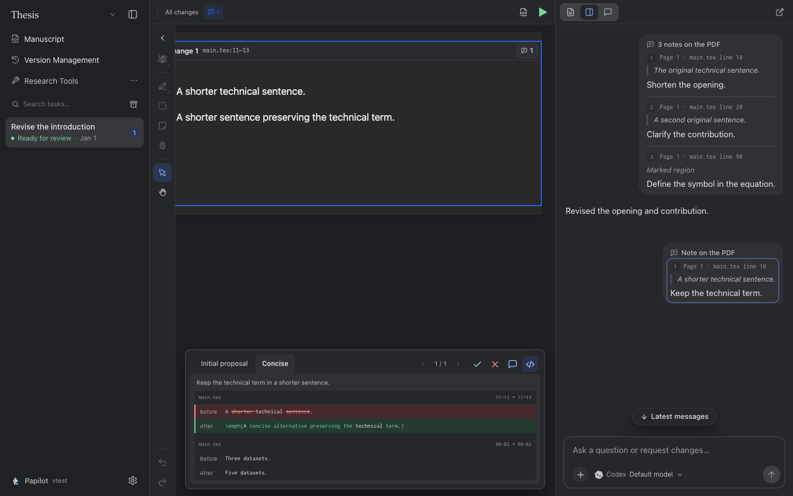

# Note-focused review prototype

The default remains the existing PDF comparison with its full context. Overlapping
PDF crops share one block. Selecting a sent note (or its badge on a change) filters
only the highlight overlays and decision targets to the edits associated with that
note. PDF text, line breaks, crop dimensions and surrounding content stay in place.
The PDF toolbar switches between all changes and the selected note without
discarding the selected option. No context toggle or word-crop view.

Each fine prose edit has exact source offsets and separately attributed PDF marks.
Note quotations narrow source-line matches to those offsets. Accept/reject/comment,
keyboard actions and batch actions operate on the focused note's pending units.
The default still reviews the whole displayed change. TeX constructs and bibliography
entries remain atomic; ambiguous PDF locations use the coarse renderer.

A selected note offers the current proposal and two alternatives in a compact bottom drawer
attached to the bottom edge of the central PDF review pane, with no side margins,
rounded outer card or nested comparison frame. A single row holds option tabs on the left, then
previous/next note arrows with the current position, and accept/reject/comment actions plus a LaTeX toggle on the right.
There is no separate header or note icon. The arrows stop at the first and last notes.
Multiple options use short folder-style tabs; a single proposal is a plain toolbar title.
The active tab shares a continuous background with its content, with no divider or accent stripe. Only the
selected tab’s brief explanation appears beneath them. The drawer slides in from
below and dismisses on an outside click or Escape. It adds measured bottom scroll
space to the review and reveals covered highlights without changing PDF geometry,
so edits at the end of the document remain reachable above it. The conversation keeps only the
original sent annotations; clicking one focuses its changes without inserting any
controls, status, or option text into that message. One icon-only accept, reject and comment group at the right of that row acts on the selected option, with no shared-edit hint. Acceptance uses that option and only the current note’s edits. Rejection immediately restores this note’s original source through the review journal and can be undone. Comments open an editor inside the PDF panel and remain in the existing unsent review draft until the author sends them. Scope controls live in the PDF toolbar. Opening a note only reads cached choices. **Settings → Review preferences → Prepare alternatives by default** is on by default.
When an editing turn receives PDF notes, its prompt requests the main revision and two
alternatives with concise titles and reasons together. The agent appends structured
option data to its response; Papilot preserves the original response and displays only
the human summary in the conversation. Before making the review available, it validates
the prepared source patches against the exact units linked to each note and saves the
choices. Context may disambiguate a patch but cannot authorize changes to another note.
The preference is saved on the server and applies to subsequently submitted notes.
There is no generation button or inference request when reviewing. Missing or invalid
optional data leaves the main proposal available; it never starts a fallback AI call.

Invisible space/newline adjustments in ordinary prose are grouped with the closest
substantive change in the same paragraph, including existing saved rounds. Exact unit
IDs, source patches, and decisions are preserved. Paragraph breaks, verbatim content,
and formatting without a related substantive edit remain separate.

The panel shows the selected note’s groups from the complete compiled PDF comparison,
including their surrounding context, directly below the option labels and reasons. The LaTeX toggle
shows source before/after changes for the selected candidate, with file and line
locations and only the current note’s changes emphasized. Switching views does not
compile, apply a proposal or call the agent. Selecting an
option updates this comparison: original PDF versus the complete proposal with
only that note’s replacements substituted. Other edits within the same group remain visible as context, but only the current
note’s exact marks are highlighted. Unrelated groups remain in the main review and
keep their existing expanded or collapsed state. Choosing an option keeps the note focus. There are no separate word-fragment diff
cards. Candidates compile in isolation and keep native PDF layout and full context.
The panel bounds adjacent context to the edge nearest the change and scans rendered
pixels to remove trailing blank space and distant footers. The document itself is
unchanged, and the comparison scrolls within a compact maximum height. Previewing leaves the task checkout and review decisions unchanged. Selecting a choice is a local draft, remembered across note switches, panel closure and refresh for that review round; it neither applies edits nor calls the agent. The main review continues showing the published proposal. The checkmark accepts only the current note’s source ranges. The cross rejects those ranges through the same undoable journal and restores the original source immediately, even while an alternative is selected; it does not create a feedback draft or wait for a preview build. A successful rejection closes the drawer, while an error keeps it open for retry. For an alternative, it writes the selected fragments, publishes their PDF and completes the scoped acceptance through the normal undoable review journal. Other source changes and decisions remain intact. Choices are retained across option builds, and the selected state is derived from actual source wording. Shared edits are identified, and any option crossing a reviewed edit
is blocked. Original note associations are retained through option rebuilds.

This is a prototype for precisely mapped text edits. Candidate PDFs are cached by
source revision, edits, rejected unit IDs and preview format version. Rejection and undo invalidate browser previews as well, so another note’s choice cannot bring back rejected wording. The browser also shares in-flight previews, preloads existing alternatives and decodes their visible SVG strips in the background. Recently viewed comparisons and note choices stay cached across note switches; changing a choice keeps the previous comparison visible until the next is ready. A preview compilation failure leaves
the current proposal intact. Applying a choice still uses the existing source-save
compilation and recovery flow. Repeated ambiguous
fragments keep historical links instead of guessing their new location.
Editing turns need a connected agent to supply alternatives; the demo below has authored options
so the interaction can be tried offline.

The browser fixture below shows the source view and its single-row controls.



## Run the real demo

With Node >=22.22, installed dependencies and LaTeX:

```sh
npm run build
npm --prefix engine run build
PAPILOT_DATA="$PWD/.papilot/note-focus" npx tsx scripts/fine-diff-demo.ts
PAPILOT_DATA="$PWD/.papilot/note-focus" PAPILOT_PORT=43192 npm start
```

Open `http://127.0.0.1:43192/`, select **按批注聚焦修改**, and use the split view.
Note 1 focuses the speed wording, Note 2 the stability wording, and Note 3 shares
both. All use real compiled PDFs, source patches and review storage. Accepting a
choice stays in this disposable task until Apply. The seed refuses to overwrite
an existing demo; use a fresh data directory to start over.

Verification covers exact same-line patches, preserved context and mark attribution,
source merging, per-note matching, shared accepted changes, stale options, retries,
and associations across rebuilds. Browser checks cover note switching without
geometry changes, scoped acceptance, option selection, compilation and exit to the
overall comparison.
