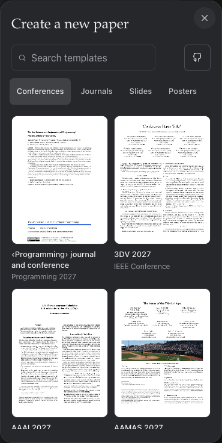
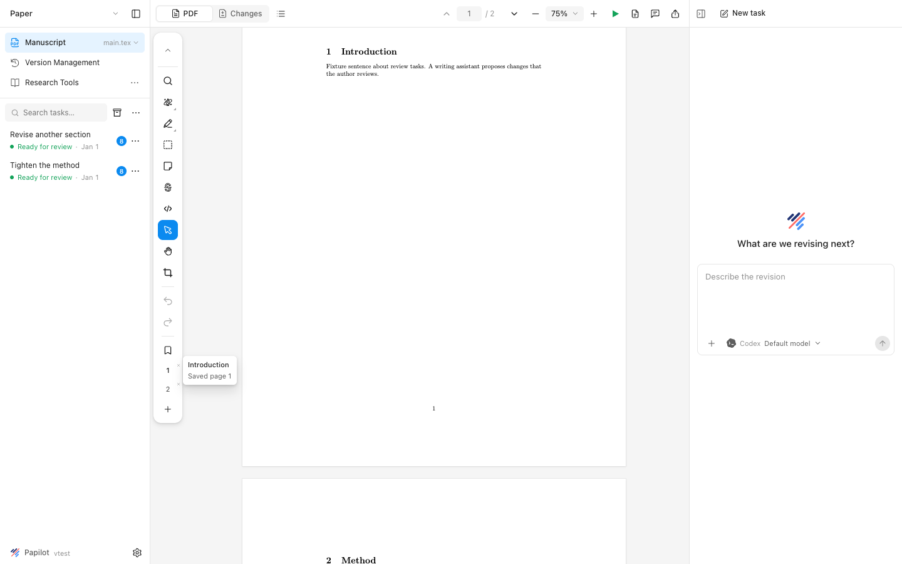
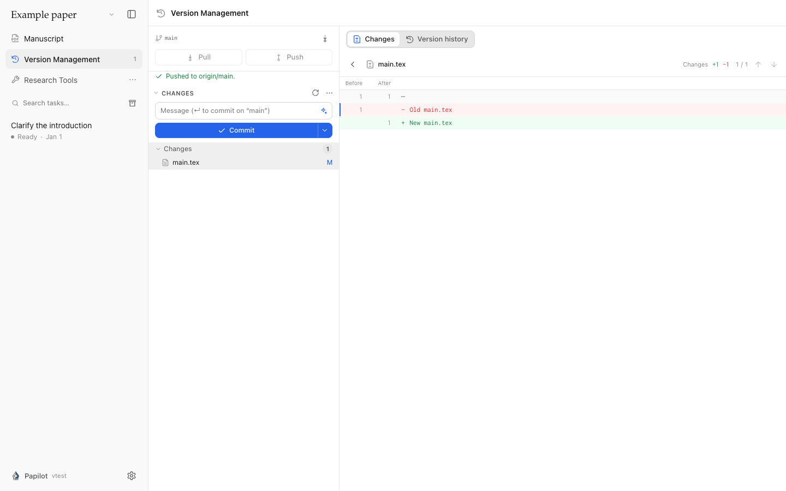
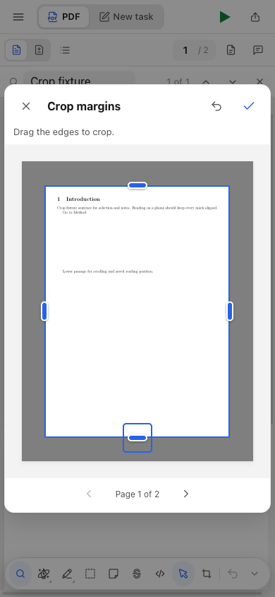
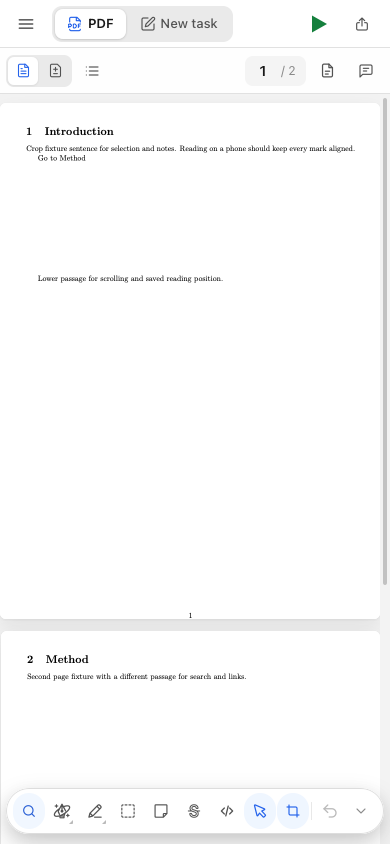
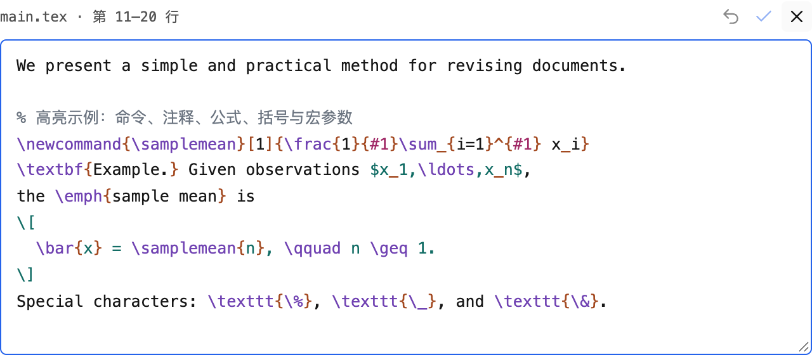

# Papilot guide

The complete manual: installing and running Papilot, every part of the workspace, remote access, configuration and development. For a short introduction, see the [README](../README.md).

Papilot is a personal workspace for revising LaTeX papers with an AI agent (Codex, Claude, Antigravity or Kimi Code) and reviewing the resulting PDF changes. Run it on your host computer and continue from a desktop, tablet, or phone.

The interface is in English or Simplified Chinese: **Settings → Language** follows the browser by default and can be set to either. The messages Papilot sends the agent and the documentation are in English, and Codex defaults to English updates and questions. Your manuscript, project names, comments, and conversation history retain their original language.

Built with TypeScript, React/Vite, Fastify, SQLite, the official Codex app-server over stdio, the Claude Agent SDK, the Antigravity CLI, and Kimi Code CLI over ACP.

## Install and run

Papilot needs Node.js 22.22+, Git, a working TeX installation with `latexmk` and `synctex`, and at least one signed-in agent on the host.

```sh
npm install -g papilot
papilot demo   # add the example paper, then start
papilot        # start
```

On Windows, install [Node.js](https://nodejs.org) 22.22 or newer, [Git for Windows](https://git-scm.com/download/win), and a TeX distribution such as [MiKTeX](https://miktex.org) or [TeX Live](https://tug.org/texlive). The same `npm install -g papilot` command then works in PowerShell or CMD. If `papilot doctor` cannot find `latexmk`, add your TeX distribution's `bin` folder to `PATH`. The background service command `papilot service install` is macOS-only; on Windows, run `papilot` from a terminal or add it to the Task Scheduler.

The `papilot` command keeps its state in `~/.papilot`; `--data <folder>` (or `PAPILOT_DATA`) chooses another folder and `--port <number>` (or `PAPILOT_PORT`) another port. `papilot --help` lists every option.

To run from a source checkout instead:

```sh
npm ci
npm run setup:review
npm run build
npm start
```

For native Windows builds, PowerShell commands and first-machine setup, see [Windows setup](windows.md).

A source checkout keeps its state in `.papilot` inside the checkout, and `npm run demo` adds the example paper.

With Nix, run `nix run . -- demo` from the checkout to build and launch the CLI/browser app with Node.js, Git and TeX Live. `nix develop` supplies the development environment, and `nix build` creates `result/bin/papilot`. See [Nix setup](nix.md) for supported systems, installation and updates.

Open [Papilot](http://127.0.0.1:7274) and select **Import or open**. **Open existing folder** edits the original files: In the desktop app, **Choose folder…** opens the system folder picker. In a browser, type the folder's path and select **Open**, or select the folder button inside the field (**Browse…**): on the computer running Papilot it opens the system folder picker; on another device, such as a phone connected through Tailscale, it lists that computer's folders below the path, then **Open this folder** opens the one shown. Hidden folders are not listed. **Import a copy** saves a separate copy of a folder or LaTeX ZIP in the Papilot data folder (`papers/`), leaving the original unchanged. **Import folder** and **Import ZIP** behave the same in the browser and desktop app. Folder and ZIP uploads stream to disk without a fixed size or file-count limit; available storage still applies. Later papers are added and switched from the paper menu at the top of the sidebar.

The [homepage](https://papilot.ai/) links to [Universe](https://papilot.ai/universe/) through the planet link beside its logo (including on phones), below the downloads and in the footer, so you can browse LaTeX templates before opening the app. On narrow screens, the play button beside Universe opens the online demo.

To import from the web, choose **Import or open** (the download icon) on the empty screen or in the paper menu, in either the browser or desktop app. Paste a URL under **Paper or repository link** and choose **Import** (or press Enter); you can also drop the link onto the import area. The arXiv, Overleaf and GitHub icons identify the supported services beside the link field. Supported links are arXiv abstract, PDF, HTML and source pages, Overleaf sharing links, public GitHub repository links, and public HTTPS downloads of ZIP, TAR and TAR.GZ source archives. For example, paste `https://arxiv.org/abs/1706.03762`. GitHub repository links download the default branch as a source snapshot, without Git history or ongoing synchronization; private repositories can be exported and uploaded as ZIPs. arXiv links preserve an explicit version such as `v2` and also support older identifiers and single-file TeX submissions. Overleaf accepts enabled view links in both `/read/…` and `/project/…/share#…` formats. Copy the complete link, including its fragment after `#`. A plain private `/project/…` URL or a sharing link that requires sign-in cannot be imported anonymously. It copies the current source snapshot; to keep the paper and the project in sync instead, leave **Keep in sync with Overleaf** on and sign in, as described in [Sync with Overleaf](#sync-with-overleaf). Downloads are limited to 64 MB and extracted projects to 64 MB and 5,000 files. Other paper webpages and PDF-only downloads do not provide editable source through this importer; the dialog explains the failure and lets you retry. Downloaded sources use the same saved-folder, main-file selection and compilation workflow as uploaded ZIPs.

**New paper** and **Import or open** open one dialog with **Blank**, **Import or open** and **Templates** tabs. Switching tabs keeps the current name, location and import link. **Blank** starts a minimal LaTeX document; **Templates** offers a built-in **Example project** with sample sections and the full [Papilot Universe](https://papilot.ai/universe/) gallery, with type filters and search immediately available for university theses, conference and journal author kits, slides, posters, CVs and books. **Conferences** appears before **Theses** in the type filters. Common AI conferences, including NeurIPS, ICML, ICLR, CVPR and ACL, appear first in the gallery; other conferences follow alphabetically. Each conference uses the same preview card as other templates and shows its shared author kit when applicable. The GitHub **Contribute** link beside search opens the [Universe contribution guide](https://github.com/PapilotAI/universe/blob/main/CONTRIBUTING.md). Both the blank document and example project are available offline. If the catalog cannot load, **Templates** offers **Retry** without losing the name, save location or selection. **Blank** remains available while loading or offline, and choosing it prevents a late template link from replacing that choice. The browser still needs a connection to the Papilot server.

<details>
<summary>Template gallery on desktop and mobile</summary>




</details>

Give the paper a name and choose its parent folder; the dialog shows the folder it will create beside **Create paper**. On desktop, **Save in** displays the chosen folder and **Change…** opens the system folder picker. The form stays disabled while the picker is open; “Creating your paper…” appears only after you choose **Create paper**. In a browser, type the save path or use **Browse…**, which works as it does for **Open existing folder**. Papilot downloads a selected Universe template, verifies its SHA-256, and creates the folder with local Git history and the template's main file and engine already set. **Open in Papilot** on a Universe page selects that exact template version. Existing folders are never overwritten. The new paper opens in the manuscript workspace, where compilation progress and build errors appear. Creating a paper does not need a Git hosting account.

The desktop app opens papers the way an editor opens folders. **Open existing folder** inside **Import or open**, or **File › Open Paper…** (⌘O, or Ctrl+O on Linux/Windows), goes straight to the system folder picker, and the chosen folder opens as a paper in place: Papilot detects the main file and engine, creates Git history when needed, saves them in `.git/papilot/settings.json`, and compiles the PDF in the paper's own view, where build problems appear as for any paper. Only a folder with several possible main files asks which one to compile. Opening a folder that is already a paper switches to it. **Import a copy** also offers links, ZIPs and folder copies. In a browser, **Open existing folder** accepts a typed host path. The dialog closes with its top-right close button or Escape.

Papilot identifies the main TeX file and compiler, creates Git history when needed, and attempts compilation automatically. If the main document is ambiguous, choose it before compiling. Existing repositories keep their commits and staged changes; new repositories receive a local initial commit without requiring Git identity setup. The main-file and engine selections are saved in the repository's `.git/papilot/settings.json`, outside the files you commit.

A failed build stays in the import window with compiler details and suggested next steps. Change the main file or engine and retry, edit files at the displayed saved location, or choose **Help fix compilation** with a connected assistant. Assistant repairs remain uncommitted for inspection in file changes. Missing TeX tools must be installed on the host. **Continue later** saves the import for the next time you open **Import or open**, including after a restart. **Add and fix later** registers a prepared paper even if compilation still needs attention; PDF review requires a successful build. Closing or replacing an import keeps its saved files. Custom build settings are described in the [review engine reference](../engine/docs/reference.md).

Each paper in that menu has a **pencil** button that opens its name and repository path together, with **Remove paper** in the same dialog. You can manage a paper without switching to it. In the desktop app the dialog shows the paper's **Location**, and **Change…** picks another folder instead of typing a path. Changing the path updates its saved repository location and checks that any existing task worktrees belong to that repository; it does not move files. Removing a paper clears its Papilot tasks, conversations and notes while preserving all files, Git history and worktrees on disk. Path changes and removal require the paper's current tasks and builds to be idle.

To try a sample first, run `papilot demo` (`npm run demo` in a source checkout). It copies the example paper in `examples/papilot-paper` (this README written as a 26-page LaTeX paper in fifteen chapter files, with a usage chapter, formal models of review rounds, conflicts, the PDF view's geometry, queueing and Git, theorems with proofs, an algorithm, TikZ and pgfplots figures, tables and a BibTeX bibliography, so there is plenty to review) into a separate Git repository, `example-paper` in the data folder, and registers it as **Papilot paper** without changing an existing manuscript. Start an editing task from the interface when you are ready to use your chosen agent.

Papilot uses the `codex` on your `PATH` when it is version 0.164.0 or newer; otherwise the `papilot` command installs that version into `agents` in the data folder on its first start. The desktop app does not include or install Codex: it uses the first Codex installed on the computer that runs. If no CLI installation runs, it also looks for the backend bundled with the Codex/ChatGPT desktop app: the current user's registered `OpenAI.Codex` package on Windows, or `Codex.app` and `ChatGPT.app` in `/Applications` and `~/Applications` on macOS. A separate CLI installation is not required when that backend works. An explicit `PAPILOT_CODEX_BIN` takes precedence. **Settings → Runtime → Agents** says when none is found or none runs; install or reinstall Codex, then select **Reconnect**, which checks the current installation again after desktop-app updates. Codex uses the host's normal login and configuration. To sign in, use the Codex/ChatGPT desktop app or `codex login` for an installed CLI; the `papilot` command also provides `papilot codex login`. No API key is stored by Papilot. Model selection defaults to the host's configured Codex model.

### Agents

The model menu below the chat lists models from every configured agent. Choosing another model from the current agent applies it to the next turn. Choosing a model from another agent moves the task to that agent: the conversation, proposed changes, review decisions and unsent drafts stay in the task. The next turn starts a session of the new agent, and Papilot gives it the conversation so far: each request and the replies to it, oldest first. Tool activity is left out, because the task's files already contain the earlier edits. If the task is working, its turn stops first. Instructions already queued behind that turn go to the new agent; your unsent draft stays in the composer. Tasks that Papilot 0.13 and earlier restarted on another agent still link to the task they replaced.

Each task runs on one agent and model, chosen from the model menu below the prompt. The menu lists every available agent's models, grouped by agent with your recent choices first; type to search all of them, or use the arrow keys and Enter. Reasoning effort and fast mode for the chosen model sit below the list. Use the arrow keys on a focused reasoning slider to change its level. Papilot remembers the agent, and each agent's model and reasoning effort, for the next task. Papilot looks for every agent when it starts and whenever you select **Reconnect**, and offers only the ones it finds on this host: an installed CLI, or the API key an SDK-based agent needs. The `papilot` command always offers Codex, because it installs it; the desktop app offers it when it finds one. An agent that is found but not signed in is listed as unavailable and says why. **Settings → Runtime → Agents** shows every supported agent and its live availability, including agents that are not set up. Select an agent card to see its account, model names, setup instructions, installation checks, and usage limits when the agent reports them. Model names appear as compact labels, with longer catalogs expandable. When setup is not detected, the card explains the server-side detection result, offers steps for that adapter, and provides Reconnect to refresh availability. Changes to environment variables require restarting Papilot; a different terminal or desktop-app login may not configure the running server. Details open within Settings; quotas are hidden while the connection is unavailable. The **LaTeX** page automatically identifies the active distribution (such as MacTeX, TeX Live, or MiKTeX), version, and installation location on the host.

Each agent card on the **Agents** page has a switch. Papilot neither starts an agent that is off nor offers it in any model menu, including the agent choices in **Settings → Git**, and automatic helpers such as task titles skip it. A task that already uses it can still continue: sending it a message starts the agent for that task. In an agent's details, select a model to hide it from the model menus, or use **Hide all** and **Show all**; hiding every model turns the agent off, and a model a task or setting already uses stays selectable there. New models an agent reports later are shown. These choices are saved on the Papilot host, so the desktop app and every browser show the same menus. **Reset** above the cards turns every agent back on and shows every model. Collaboration mode is turned on and off in **Settings → Experiments**.

CLI agents, including Claude when Claude Code is installed, use their own login and configuration on this host. The SDK-based agents (Cursor, GLM, and Claude without Claude Code) take their key from Papilot's environment and receive it only for their own service. Papilot never stores a credential. Each agent starts in the task's worktree and leaves compiling and publishing the review to Papilot.

- **Pi** runs your installed [Pi CLI](https://pi.dev) through its RPC interface, using your providers, login, custom models, skills, prompt templates and extensions. Install Pi **1.5.1 or newer** (`npm install -g @earendil-works/pi-coding-agent`), run `pi` and use `/login` or configure a provider, then select **Reconnect** in Papilot. Set `PAPILOT_PI_BIN` to the executable if needed. The model menu groups Pi models by provider. Replies, file edits, commands, image attachments and extension confirmation/input dialogs appear in the conversation. Each task has a separate Pi session under `PAPILOT_DATA/pi/sessions`, resumed on later turns and after a server restart. The CLI starts in the task worktree, so project `.pi` resources must be available there (tracked files are carried into the worktree). Pi also applies its saved project-trust decisions; RPC cannot show the terminal trust prompt, and Papilot never grants trust automatically.

  **Pi and Papilot Writer are separate agents.** Writer embeds a Pi SDK with Papilot's writing tools and provider setup. Selecting Pi runs your own CLI and its coding tools; installing Papilot does not count as installing Pi. Pi tools run on the host with Pi's own configuration and extension permissions; Papilot does not add a sandbox or bypass extension approvals. Read-only generations disable tools, extensions, skills and prompt templates; helpers such as task titles also use a disposable folder. Providers supplied only by extensions are unavailable in those read-only generations. Pi extensions that require a terminal UI are not available in RPC mode; commands that schedule independent work after returning are not supported as Papilot task turns. Pi does not report account quotas through this integration. Version 1.5.1 is required for safe RPC shutdown while Pi refreshes OAuth credentials.

- **Codex** runs through the Codex app-server with workspace access by default. Commands outside the sandbox follow its configured reviewer; requests that need your approval and Codex's questions appear in the conversation. Codex can also look at the typeset paper: Papilot gives each new Codex task a `view_pdf` tool that compiles the task worktree as it is and draws the pages where given source lines, or given printed page numbers, appear, or the same places in the accepted text, as image files that Codex opens with its own image viewer. Codex decides when to use it, for example when line breaks, spacing, figures or formulas matter; it compiles only the chapters it needs when the paper allows partial builds, and the review after the turn reuses that build. When the PDF has no page-label metadata, Codex uses source locations instead of guessing printed numbers from physical page positions. The conversation shows each look as **Viewed the PDF**. This uses the app-server's experimental API; a Codex without it runs tasks without the tool.
- **Claude** runs on [Claude Code](https://code.claude.com) when it is installed: each turn is one `claude -p` process with your own Claude Code login, either your Claude plan, whose usage counts toward the plan's limits, or an API key. Sign in once with `claude auth login`. Papilot only reads whether Claude Code is signed in; the credential stays with Claude Code. Edits in the worktree are accepted. On macOS, Linux and WSL, commands run in Claude Code's sandbox. Native Windows uses **Accept edits** without a command sandbox, with commands following Claude's permission rules. `-p` cannot ask for approval, so anything that would need it, such as a write outside the worktree, is declined and noted in the conversation, and Claude asks its questions in its reply. A later turn resumes the same session. The model menu lists the models your Claude Code offers, such as Opus 5.5 and Sonnet 5.5, with their reasoning efforts and its default first; Papilot reads them from Claude Code without sending a request. Set `PAPILOT_CLAUDE_BIN` if the service cannot find `claude`.

  Without Claude Code, Claude runs through the Claude Agent SDK, which an installed Papilot downloads into `agents` in the data folder the first time it starts with an API key. Through the SDK, anything that needs approval, including Claude's questions, comes to the conversation. The SDK needs an API key: Anthropic does not accept a Claude subscription login through the Agent SDK and refuses such requests with 403. Run Papilot with `ANTHROPIC_API_KEY` set (or with Claude Code configured for Amazon Bedrock, Google Vertex AI or Microsoft Foundry); usage is billed to that key or provider.

  Claude can also run on another service's Anthropic-compatible endpoint. Set `ANTHROPIC_BASE_URL` to the endpoint and `ANTHROPIC_AUTH_TOKEN` (or `ANTHROPIC_API_KEY`) to that service's key, and map the model menu onto the service's models; usage is billed by that service. If the service rejects Anthropic's beta headers, `CLAUDE_CODE_DISABLE_EXPERIMENTAL_BETAS=1` sends only the ones Claude Code needs.

  ```sh
  ANTHROPIC_BASE_URL=https://<service>/anthropic ANTHROPIC_AUTH_TOKEN=<key> \
  ANTHROPIC_DEFAULT_OPUS_MODEL=<model> ANTHROPIC_DEFAULT_SONNET_MODEL=<model> \
  ANTHROPIC_DEFAULT_FABLE_MODEL=<model> ANTHROPIC_DEFAULT_HAIKU_MODEL=<smaller model> \
  CLAUDE_CODE_DISABLE_EXPERIMENTAL_BETAS=1 papilot
  ```
- **Cursor** runs a local agent through the [Cursor SDK](https://cursor.com/docs/api/sdk/typescript), which an installed Papilot downloads into `agents` in the data folder the first time Cursor is used. Start Papilot with `CURSOR_API_KEY` set to a key from the Cursor dashboard; the SDK does not use the Cursor app or CLI login, and usage is billed to that key. By default, Cursor runs in its own sandbox: it writes only inside the worktree and temporary folders, and its commands have no network access. The SDK cannot ask for approval, so anything outside the sandbox fails and is noted in the conversation. The model menu comes from your Cursor account, with **Auto** as the default; reasoning effort is offered for models that have it. Choose **Unrestricted** to disable that sandbox. Changing this setting resumes the same Cursor agent with new SDK options; switching back reinstates the sandbox.
- **Grok Build** runs `grok --no-auto-update agent --no-leader stdio` through its [official ACP interface](https://docs.x.ai/build/cli/headless-scripting). Install [Grok CLI](https://x.ai/cli), run `grok login` on the Papilot host or configure `XAI_API_KEY`, then select **Reconnect**. Configured BYOK models also work. Papilot authenticates using the non-interactive methods advertised by Grok, preferring configured API credentials, then a saved login. Missing credentials are reported with setup instructions. Choose **Default** for native approvals or **YOLO** to auto-approve tools. Each task turn uses a dedicated process and explicitly applies its selection while restoring the same session; one task cannot change another task’s permissions. Auto mode is not offered because Grok may silently fall back when its feature gate is unavailable. Tools run on the host under Grok’s own permission rules, with approval requests forwarded to the conversation. Replies and tools stream; models, reasoning levels, images and session recovery follow the capabilities advertised by the installed CLI. Papilot also searches `~/.grok/bin`; set `PAPILOT_GROK_BIN` for another path. Validated with Grok Build 1.0.70 and a local mock BYOK provider: authentication, streamed replies, approved edits, denied commands, cancellation and session recovery. A full Papilot task corrected a temporary paper and published one PDF review change without changing the manuscript. Also validated with live Grok 4.7 calls using the host’s saved login: a Papilot task requested edit approval, corrected a temporary paper and published one pending PDF review change while leaving the manuscript unchanged. This host required an explicit HTTP proxy for model requests. If direct connections fail on a host using a macOS system proxy, pass `HTTP_PROXY` and `HTTPS_PROXY` to the process or service that starts Papilot; include `NO_PROXY=localhost,127.0.0.1,::1` for its local connections. Reconnect alone cannot change the server environment.

- **GitHub Copilot** runs `copilot --acp --stdio` through its [official ACP server](https://docs.github.com/en/copilot/reference/copilot-cli-reference/acp-server). Install the standalone Copilot CLI (`npm install -g @github/copilot`) and run `copilot login` on the Papilot host, then select **Reconnect**. Its configured BYOK provider also works. Papilot selects Agent mode and applies **Default** or **Allow all** through the native `allow_all` option before each turn. Explicit permission requests still go to the conversation; approved tools run on the host under Copilot's own policies. Replies and tool activity stream, sessions resume after reconnecting, and images are sent when supported by the CLI and selected model. Models and reasoning levels come from ACP when advertised; otherwise choose **Default model** to use Copilot's configured model. An ACP connection alone does not verify account access or quota; login and provider errors may appear on the first task. Set `PAPILOT_COPILOT_BIN` if the server cannot find `copilot`. ACP remains a public-preview interface, so use a recent CLI with the `allow_all` configuration option. Validated with Copilot CLI 1.0.105 and a local mock BYOK provider: streamed replies, approved file writes, denied commands, cancellation and session recovery after restarting the connection. Also validated with live model calls using the host's existing Copilot configuration: a Papilot task requested edit approval, corrected a temporary paper, and produced one pending PDF review change without changing the manuscript.
- **GLM** runs on Claude Code through Zhipu's Anthropic-compatible endpoint, the way Zhipu documents GLM Coding Plan for Claude Code. Start Papilot with `ZHIPU_API_KEY` (open.bigmodel.cn) or `ZAI_API_KEY` (api.z.ai) set to your GLM Coding Plan or API key. It behaves like Claude above, with GLM-5.3, GLM-5.3 Flash, GLM-5 Turbo and GLM-4.7 in the model menu. Claude Code receives only the GLM key: Anthropic keys and cloud-provider settings in Papilot's environment are not passed on.
- **Antigravity** runs `agy -p` with streamed output, one process per turn, and resumes the same agy conversation on later turns. The default **Accept edits** mode approves worktree edits; requests needing approval are declined because headless agy cannot ask. **Plan** asks the agent to plan first; it is not a separate security sandbox. **Always proceed** uses native `toolPermission: always-proceed`, enables non-workspace access and disables the terminal sandbox. Explicit native rules still apply. Each turn resets these settings, including after a downgrade. Its models are listed with their effort variants grouped, and your saved agy model is the default. Switching between Antigravity models keeps the conversation and applies the selected model and effort to the next turn. If that turn finishes successfully, an earlier capacity error repeated by the CLI does not block its review. If agy reports that your location is not supported, set `PAPILOT_AGY_PROXY` to an HTTP proxy; it applies only to agy. Open the agent/model menu in a new or existing task to check account quotas. Each reported model group shows its five-hour and weekly usage and reset times when available. The menu refreshes on opening and every minute while visible, and offers a refresh button (reads within 30 seconds share a cached result). Unreported windows are omitted; unavailable usage never blocks a conversation. See [Antigravity account quotas](antigravity-usage.md) for the verified source and compatibility details.

- **Kimi Code** runs `kimi acp` using the [official ACP interface](https://www.kimi.com/code/docs/en/kimi-code-cli/reference/kimi-acp). Install Kimi Code CLI, run `kimi login`, then choose a Kimi model in the model menu, selecting **Reconnect** first if Papilot was already running. Papilot reads the model catalog and available thinking levels from the CLI, streams replies and tool activity, forwards tool approvals, sends images as native inputs, and resumes the same session after a restart. The permission menu offers the installed CLI’s native modes: **Default**, **Plan**, **Auto**, and **YOLO** on Kimi 2.4.1. It defaults to manual approval and reapplies the selected mode before every turn. Kimi executes approved tools on the host, without a Papilot sandbox. Credentials stay with Kimi. Set `PAPILOT_KIMI_BIN` to the executable path if the service cannot find `kimi`. Validated with Kimi Code CLI 2.4.1: model discovery, thinking level selection, tool approvals, file writes, streamed replies, and session recovery after restarting the connection. Older CLIs must support ACP and manual approval mode.

- **DeepSeek** runs `dsh acp` from [DeepSeek Harness](https://github.com/deepseek-ai/deepseek-harness). Install it with `npm install -g @deepseek-ai/dsh` (Node 22.19 or newer) and set up a model and API key in `dsh web` or the dsh terminal UI first. Papilot pins its `workspace-write` permission preset: writes and commands stay inside the worktree, and anything outside it comes to the conversation for approval. The picker displays this fixed ACP preset. DeepSeek’s ACP interface cannot change an existing session’s permission policy, and restarting it with a different environment does not change saved permissions, so Papilot does not offer a nonfunctional broader choice. The model and reasoning effort come from dsh; it does not accept images. On macOS, Papilot also finds the `dsh` inside the DeepSeek Harness app when it is not on `PATH`. Set `PAPILOT_DSH_BIN` if the service cannot find `dsh`. `dsh acp` reads its own profile, `~/.dsh/profiles/acp/cordis.patch.yml`, not the app's: to use a provider or model set up in the app, add it there too, and give Papilot any API key variable it names.
- **Qwen** runs `qwen --acp` from [Qwen Code](https://github.com/QwenLM/qwen-code). Install it and sign in by running `qwen` once. Papilot defaults to **Auto edit**: edits go ahead and other operations follow Qwen’s native approvals. **Default**, **Plan**, **Auto**, and **YOLO** are also offered when the installed ACP server advertises them. Set `PAPILOT_QWEN_BIN` if needed.
- **OpenCode** runs `opencode acp`, with the providers and models you connected in [OpenCode](https://opencode.ai) (`opencode auth login`). Papilot adds two primary agents through `OPENCODE_CONFIG_CONTENT` and switches them per session before each turn. **Default** allows worktree edits and asks before shell commands or access outside the worktree; **Allow all** selects the agent with native allow rules. Other provider and agent configuration is preserved. Persistent session rules and subagent policies still apply; any explicit approval request is forwarded. Set `PAPILOT_OPENCODE_BIN` if needed.

- **Qoder** runs [Qoder CLI](https://docs.qoder.com/cli/acp) with `qoder --acp`. Install the CLI and run `qoder login`, then reconnect in Papilot. The Qoder desktop application and its launcher are not a replacement for the agent CLI; the CLI may need a separate login. Set `PAPILOT_QODER_BIN` to the CLI executable if needed. Papilot starts in the native **Default** permission mode and forwards permission requests. **YOLO** (bypass approvals) is offered only when the CLI advertises it.
- **CodeBuddy** runs [CodeBuddy CLI](https://www.codebuddy.ai/docs/cli/acp) with `codebuddy --acp`, using that CLI's existing login and provider configuration. Install `@tencent-ai/codebuddy-code` and run `codebuddy` to sign in, or set `PAPILOT_CODEBUDDY_BIN` to an existing CLI. The CodeBuddy IDE launcher is not the agent CLI. Papilot starts a separate process in each task's worktree because CodeBuddy's ACP server uses its process working directory. The native **Default** permission mode asks before tools; additional modes appear only when advertised by the CLI.
- **WorkBuddy** uses an explicitly configured WorkBuddy ACP launcher, selected by `PAPILOT_WORKBUDDY_BIN`. It must forward arguments, support `--acp --permission-mode default`, keep the working directory supplied by Papilot, and keep stdout reserved for ACP messages. WorkBuddy also gets a separate process per task. A desktop installation or desktop login alone does not guarantee that its bundled CLI can authenticate externally. Use a launcher compatible with your WorkBuddy installation and configure its own provider or login before reconnecting; a tested launcher for Windows WorkBuddy 5.11.3 is described in the [Windows guide](windows.md). Papilot does not substitute CodeBuddy, copy credentials, call interactive authentication, or depend on private WorkBuddy admission metadata. See the [WorkBuddy ACP extension specification](https://cloud.tencent.com/document/product/1831/137025).

These three integrations run tools on the host with their native permission rules, without an additional Papilot sandbox. They do not provide a verified read-only ACP mode, so Papilot refuses AI-review tasks and other read-only generations on them rather than treating a planning mode as a sandbox. Task titles and commit messages use another connected agent that supports read-only requests; connect one to enable these helpers. Choose a supported agent explicitly for AI reviews and compilation diagnosis. Settings distinguish a detected launcher from a successfully authenticated connection; `papilot doctor` checks the ACP command but does not validate login or generate a response.

CodeBuddy and WorkBuddy release their task process between turns and restore the native session when you continue. A failed launch or restore can be retried; Papilot preserves the initial task instructions if the first prompt has not been sent, and waits for the previous process and its tools to exit before starting another process in that worktree or deleting the task. On macOS and Linux, this includes tools that outlive the agent process. If a process cannot exit, close it on the host and retry.

OpenCode, DeepSeek Harness and Qwen, like Kimi, run their approved tools on the host. Each was tested in Papilot with a task that edited the example paper and built its review: OpenCode 2.0.32 (also a command approved from the conversation), DeepSeek Harness 0.2.1-rc.5 (also its approval request for a write outside the worktree) and Qwen Code 0.26.4. The Cursor and GLM adapters are covered by protocol tests only.

Qoder 1.1.91 and CodeBuddy 2.185.0 were checked with authenticated session discovery and model catalogs without generation, as well as unauthenticated failures. WorkBuddy 5.9.3's bundled runtime returned a session and model catalog through an explicitly configured launcher. Further native Windows tests used CodeBuddy 2.185.0 and WorkBuddy 5.11.3's bundled CLI 2.176.0 with an isolated local provider returning deterministic responses: real streamed replies, approved file writes, persisted-session follow-ups, cancellation and process cleanup passed, including simultaneous WorkBuddy tasks on separate loopback ports. These exercise the installed runtimes and filesystem, but do not verify hosted model generation or desktop-account login. All three adapters also have deterministic protocol regression tests.

Reasoning effort and Fast mode are remembered separately for each agent/model in this browser or desktop app. Switching away and back, including after a reload, restores that model’s supported settings. **Model default** is remembered as an explicit choice. Successfully saved changes in an existing task also become the remembered choice for future model selections; other existing tasks keep their current settings. Switching an existing task to another agent uses the destination model’s remembered effort and Fast mode.

## Task permissions

Open the model menu and choose **Permissions** when creating an editing task or before its next message. The current mode appears beneath the model name. Pause running tasks before changing it; saved changes take effect on the next turn without discarding the conversation. Permission choices are remembered per agent in this browser or desktop app, including after a reload. Switching agents restores the destination agent’s own supported mode; an agent without a saved choice starts with its default permissions. AI-review tasks keep their existing policies.

Options come from the selected adapter. Codex exposes workspace sandbox/on-request approvals and full access; Claude and GLM expose sandboxed edits (or **Accept edits** without a command sandbox on native Windows) and native bypass mode. Other agents use the native modes described above. A mode can control approvals, sandboxing, or both; it does not grant access beyond managed native policies. ACP tool approvals and questions remain available whenever the agent requests them.

Kimi mode changes were checked against CLI 2.4.1 without model generation, including YOLO → Default. Regression tests cover repeated downgrades, reconnects, concurrent Grok tasks, failed native configuration, and UI saves. Other newly selectable modes are checked through protocol fixtures; those tests do not establish live account or model availability.

## Diagnostics

Papilot checks Git, `latexmk`, SyncTeX and the available LaTeX engines when the workspace opens and after reconnecting. On a first visit, missing tools open a setup guide; returning users see a **Review setup** notice. **Settings → Runtime → Required tools** is always available. The guide explains what each tool does, links to official installation instructions for the computer running Papilot, and offers **Check again** after installation. A partial TeX installation is marked as incomplete. If installed tools are still not detected, restart Papilot; a server may need to be restarted from a new terminal with the correct `PATH`.

**Set up later** leaves the notice available while you explore. Healthy installations do not show a setup prompt. These checks share only availability and the host operating system, without host paths or diagnostic logs. They do not install software. AI agent setup remains in **Settings → Runtime → Agents**.

```sh
papilot doctor
papilot doctor --repo /path/to/paper
papilot doctor --json --data ~/papilot-data --port 4400
```

Doctor checks Node, runtime packages, built frontend and review-engine files, the data directory, Git, `latexmk`, SyncTeX and available TeX engines, and the personal remote-access settings. With `--repo`, it also checks that the selected folder is the Git root, has an initial commit, has a valid main document and review configuration, and can create task worktrees. It uses the review engine's own configuration loader, without compiling or creating a worktree. Registered papers are not automatically inspected; select the paper explicitly with `--repo`.

Agent checks use the same Codex locations as the installed launcher, check its version and login status, check whether Claude Code is signed in (or, without it, look for a Claude key), look for the Cursor and GLM keys and SDKs in the current environment, ask `agy models` for its model list, and check that the ACP mode of `copilot`, `grok`, `kimi`, `dsh`, `qwen` and `opencode` is available (without checking their logins). No model prompt is sent. Keys are not validated against the API, and SDK-managed credentials are not inspected. A successful report does not guarantee a model request or a paper build will succeed. Agents that are not found are listed for information only, since Papilot does not offer them; an agent that is found but not working is a warning. PDF reading can still work without any agent. Configure at least one agent for editing.

Doctor also checks the local health endpoint and Tailscale origin/owner settings. On macOS, it compares an installed service's saved tool paths and data directory with the terminal environment. It does not start, stop or reinstall a service. A stopped server or an uninstalled optional service is normal.

Each failed check includes a suggested fix. Exit code **0** means no blocking errors (warnings may remain), **1** means blocking errors, and **2** means invalid command-line options. `--json` writes one object to standard output with `name`, `version`, `ok`, and `checks`; each check contains `id`, `ok`, `severity`, `detail`, and `fix`. Node fallback notices go to standard error. Diagnostics do not install dependencies, create Papilot state, compile papers or change manuscript files. Each external command has a five-second timeout.

From a source checkout, use `npm run doctor -- --data .papilot` (or `node bin/papilot.mjs doctor --data .papilot` if npm dependencies are missing). The CLI default is `~/.papilot`, even in a checkout; specify the data folder used by the instance you are diagnosing. `PAPILOT_DATA`, `PAPILOT_PORT` and the agent overrides are honored; command-line data and port options take precedence.

## Commit message language

Choose **Settings → Git → Commit message language → English** to generate English commit messages even when task titles and recent commits are in another language. You can also select any of the other listed languages. The choice is saved in this browser or desktop app and applies to Version Management, the staged-commit dialog and task commits, independently of the interface language.

**Auto** (the default) follows recent commit subjects and uses English when the repository has none. After you finish reviewing a task, Papilot prepares a suggestion in the selected language. You can enter your own message or apply the changes while the suggestion is being written. Changing the language affects the next generation. Use **Generate commit message** to replace an existing draft.

## Reading with anchors

The PDF toolbar starts expanded each time you open the view. On desktop, it stays in place as you choose a marking tool or open a note. The arrow at the top folds the tools away, and the floating down arrow in the same place opens them again. On phones, use the arrow at the end of the bottom toolbar or swipe it down to collapse it, then tap the up arrow to reopen it.

On desktop, saved anchors appear as numbered buttons at the end of the PDF tool rail. Click a number to jump there, hover or focus to see its name, and use **+** to save the current passage. Each compact numbered anchor shows a **×** in its upper-right corner on hover or keyboard focus to delete it directly; touch input keeps the delete action visible. On phones, **+** also saves the current passage directly, and **Anchors** (the bookmark icon) opens the compact list. The bookmark button also opens naming and deletion controls on desktop: click a pencil to rename in place; Enter or leaving the row saves it, and Escape cancels. The trash button removes an anchor.


With the PDF focused, **Shift+B** adds an anchor, **B** focuses the saved anchors (or opens their list on a phone), and **[** / **]** jump to the previous / next available anchor in saved order, wrapping at either end. These keys leave typing and text composition alone. Arrow keys move between desktop anchor buttons and their delete actions; deleting focuses the next anchor, the previous anchor, or **+** when none remain. The shortcuts are also listed in **Settings → Keyboard shortcuts**.

Manuscript anchors bind to the selected TeX passage, or the first visible text near the top of the reader. After each successful compilation, their page numbers and destinations update to follow that source, including content moved to another page. While source relocation is pending or if the lookup fails, anchors can still jump to their saved positions when those pages exist; **Saved page** identifies this temporary destination. If a lookup fails, open **Anchors** and choose **Retry**. A completed lookup that finds deleted or ambiguous source marks the anchor unavailable instead of jumping to an old page. Older anchors saved without a source binding must be recreated. Task and AI review PDFs are fixed snapshots and retain page positions.



Anchor names stay in this browser across reloads and reopening, separately for each paper and main document. Papilot retains a shared source snapshot on the server so source bindings survive build-cache cleanup. Anchors are not shared across devices or written into the TeX or PDF. Zoom and resizing preserve positions.

## Workflow

The Papilot logo keeps all five stripes at every size in the app, including the sidebar, **Settings → About Papilot** and Papilot Writer. It scales proportionally and adapts its colours to light and dark themes.

1. Select **New task**, describe the revision, and press Enter. The first line of the prompt becomes the task title. Instead of writing the whole prompt, you can start from a [skill](#skills): pick one of the suggestions under the prompt, or type `/`, then say where to apply it (or nothing, for the whole paper). The task runs on the paper selected in the sidebar. Below the prompt, choose the Codex model and its reasoning effort: the effort chip opens a slider from the lightest to the deepest reasoning the model supports. Papilot remembers both for the next task, including tasks started from PDF notes; if a remembered model or effort is no longer offered, the host's default is used. The chat header shows the model and effort a task runs with. When the host's Codex login reports usage (a ChatGPT plan), the new-task page also shows each usage window, such as the weekly limit, with how much is used and when it resets, plus the credit balance; it refreshes when Codex reports new usage after a turn.
2. Newly sent tasks briefly highlight their row in the task list. With the sidebar hidden, a dot appears on the task-list button. Follow the conversation and answer any Codex questions or permission requests. Extra tasks queue when both execution slots are occupied.
3. When Codex finishes, Papilot builds the PDF review automatically. The review covers the paper's source folder (`source_dir` in `.git/papilot/settings.json`), and the agent is told so. If the agent's own edits stop the build, because they touch a file outside that folder, such as a project note, or the LaTeX no longer compiles, Papilot sends the error back to the agent once, and the chat shows it as **Build failed · sent to** the agent. If the next build fails too, the task stops and shows the error. Accept, reject, or comment on individual changes in the viewer. Each change shows the edit's own lines. With **Settings → Track indirect changes** on, when an edit also changes the PDF away from its own lines, such as the uses of a macro it redefines or the equations renumbered after one it inserts, those places are listed under the edit as **Affects N places**: the first three are shown, and **Show N more** renders the rest. These previews have no separate decision buttons; accepting or rejecting changes only the selected edit. Papilot finds them by comparing the two PDFs word by word, and when a round has several edits it compiles combinations of them to verify one combination that reproduces each result. This combination need not be the smallest or the only one. Accepting a change keeps it in the task until you choose how to save it. **Commit to manuscript** creates one commit containing only this task's accepted edits on the manuscript's current branch and updates its files. Other staged and unstaged edits remain yours, including independent edits in the same file. **Apply to workspace** updates the files without committing or staging. Neither action pushes. After saving, **Archive** beside the saved status lets you put the finished task away. Ignoring it keeps the task listed; its conversation and review remain available under archived tasks. Older tasks already saved to task branches can use either action. Edit the commit message or use ✨ to generate one; the message stays with you between Chat and PDF. If the result depends on earlier uncommitted edits to the same passage, Papilot previews a combined commit. Choose **Commit together** to include that passage, or **Apply without committing**. Independent edits stay uncommitted; a changed manuscript invalidates the preview and requires another confirmation.

When note alternatives are enabled, the agent prepares them with the editing request. The alternatives appear in the review, while Chat shows the agent’s reply. Their PDF previews load in the background after the main comparison is ready, starting with one alternative per note. Opening a note starts loading its other choices, and selecting an unfinished choice gives it priority. Completed previews are reused when switching back. You can review and save the main proposal without waiting for every alternative. Accepting an alternative takes effect at once in the current review, as accepting any change does, and can be undone the same way. It does not wait for the alternative's PDF or start a new round, so the other notes stay open with their prepared previews. Those previews show the rest of the round as proposed, without alternatives already accepted elsewhere. The accepted change's card shows the alternative's PDF once it is compiled. A failed optional preview can be retried without blocking the rest of the review.

If application finds overlapping edits in the latest manuscript, Papilot leaves the manuscript unchanged and automatically asks AI to resolve the conflict in the task copy. Compatible edits remain accepted, including clean passages in a file with conflicts. The new PDF review shows the proposed changes to overlapping passages against the latest wording. Accept or reject those suggestions, then choose **Confirm and commit** or **Confirm and apply**. Your original save choice and commit message survive the conflict review and a restart. AI handles conflicts itself when your instructions and the manuscript context make the intended result clear. Only when it cannot determine the intended content does it ask a short question in Chat, showing the alternatives; after your answer, it continues the merge. If the reviewed result keeps the latest wording unchanged, **Keep latest wording and apply** saves only the other accepted edits. Papilot checks the manuscript again at application time, so an overlapping edit made during review requires another suggestion. Worktree details and the commit graph appear in **Git** after enabling **Settings → Git → Show advanced Git features**.
4. If you commented, use **Send feedback** below the PDF review to send your decisions and comments to the agent for another round; it also sends rounds whose changes you all rejected. You can also write further instructions in the conversation panel. Both actions include new review feedback. Sending feedback opens the conversation on a phone, or the split view when reviewing on desktop, while preserving an unsent instruction draft.

New task copies live under `~/.papilot/worktrees`. Each repository has a folder named for the paper’s checkout with a stable suffix, so two checkouts named `thesis` stay separate. Existing tasks keep their original paths. Set `worktrees` in the project’s `.git/papilot/settings.json` to choose a different directory for that paper. Set `PAPILOT_WORKTREES` to an absolute path before starting Papilot to use a different default root for an installation.

After sending PDF notes to a task, their passages stay outlined on the manuscript with faint dashed marks. A hollow status dot means work is in progress; a green filled dot means the task is ready for review. Hover or focus the dot to see the task title and status, or click the dot or passage to open its review. Sent notes cannot be edited or selected for another task. Paused tasks and tasks needing attention keep their marks, including when archived; completing, applying, committing or deleting the task clears them. After recompilation, marks move only when their passage can be located reliably; unresolved marks are not drawn on a different PDF.

In a task review, the annotation badge beside a change opens the note that requested it. A follow-up note on the **After** PDF can follow a pending change into the next round. If the selected passage is ambiguous, the note remains in Chat without a change link.

While Codex works, the composer shows a stop button that pauses the task; when the chat is hidden, **Pause** appears in the task header instead. The header also keeps status and recovery actions beside the selected task. Choose **Review**, **Split**, or **Chat** for the desktop workspace; choosing a view always shows that view, and the choice is saved in this browser. On phones, switch between **Review** and **Chat** in the header. PDF controls share the review toolbar with the viewer's progress, **Accept all** and **Reject all**: **Full PDF** and **Build review** (the refresh button) to build the review again. The separate **Accept all** and **Reject all** buttons act immediately; each shows how many undecided changes it decides. When the review panel is narrow, the toolbar keeps everything on one line: the progress and the shortcuts button go first, then **Accept all** and **Reject all** show only their icon and count (hover for the full name), and **Notes** shows only its icon; on a phone **Build review** is hidden too, since a failed build offers it. The review always fits the panel's width. **Accept all** and **Reject all** apply only to changes you have not decided yet; accepted, rejected and commented changes keep their state, and one undo reverses the whole batch. On phones, the current change's Accept, Reject and Comment bar sits at the bottom of the screen, menus open as bottom sheets, **Full PDF** is in **Review options**, and **Fit** crops the page margins so the text block fills the width. The zoom menu enlarges PDF strips; scroll horizontally to read enlarged content. Real-device keyboard and touch behavior still needs validation on iOS and Android.

Successful task statuses and their dots stay green while the result is available, including **Completed** answers that make no manuscript changes and **Review complete** results awaiting application. **Applied to manuscript** and **Committed** are gray once the current changes reach the manuscript. A new answer or changes after an earlier delivery return to green; reading an answer does not change its color.

If the PDF comparison service disconnects, Papilot retries briefly and keeps the original build request. If it stays unavailable, select **Check status** to resume that build. Restarting Papilot also resumes saved builds. A completed comparison opens for review without rerunning the agent; a build confirmed to have been interrupted by a service restart is rebuilt once. Repeated service failures and compiler errors remain visible for troubleshooting. Your edits stay in the task copy throughout recovery.

Select **PDF** under the paper in the sidebar to read the manuscript as it is on disk, including review changes you applied but have not committed yet. The viewer is [pdf.js](https://mozilla.github.io/pdf.js/), so it behaves like a local PDF reader: continuous pages with crisp text at any zoom, selectable text, working links and cross-references, and search across the whole document.

- **Peek at references** by hovering over an internal PDF link for 400 ms or Alt-clicking it (Option-click on macOS). A small preview shows the destination near the equation, table, figure or bibliography entry without changing your page, zoom or reading position. You can move into the preview to keep reading. It follows the link as the PDF moves and closes when the link scrolls out of view, you move away, or you press Esc. Keyboard focus also previews a link; Enter and ordinary clicks still navigate. Touch taps keep navigating normally. Peek needs a link embedded in the PDF, typically from `hyperref`, and shows a local excerpt rather than the whole referenced object.
- **Contents** lists the PDF's bookmarks (hyperref writes them for every section) with their page numbers and highlights the section you are reading. Select an entry to jump to it, from the panel beside the PDF or from the section menu at the left of the toolbar, which always shows the current section and is the quickest way to move around on a phone.
- Type a page number or use the arrows to change page. Zoom with **−** and **+**, the zoom menu (**Fit width**, **Fit page** or a percentage), ⌘+ / ⌘− / ⌘0, a trackpad pinch or a two-finger pinch on a phone. The zoom is remembered.
- ⌘F (Ctrl+F) or the search button finds text in every page; Enter and Shift+Enter step through the matches.

Choose **Version Management** (the clock with a rewind arrow) below **Manuscript** in the sidebar. This opens a dedicated workspace with commit and sync controls pinned on the left, a separately scrolling file list, and a file diff or **Version history** on the right. The sidebar shows the changed-file count. The workspace remembers the selected file, history view and commit draft, while Manuscript keeps its PDF position and panel preference. File rows show names, muted folder paths and status indicators. Hover over a status indicator for its meaning and available added/removed line counts. Select a file to read its diff in the main workspace; the file list stays compact. The diff has original/current line numbers and previous/next change navigation, and long diffs scroll independently. Return to Manuscript to continue at the same PDF position. On a phone, the controls and file list stack above the detail area; return to the file list to choose another file. The single main button changes from **Commit** to **Sync** when the chosen changes are committed and incoming or outgoing commits remain, then to **Synced** when both sides match. Incoming commits are checked automatically while the Git panel is visible. **Sync** fetches remote history, integrates incoming commits and pushes local commits; it keeps uncommitted edits, and stops if local changes prevent the merge or conflicts need attention. The dropdown stays available in every state: **Commit and sync** commits first, then syncs, and **Sync** can check the remote even when the main button reads **Synced**. A failed sync keeps the local commit so you can retry **Sync**. **Version history** is visible by default below the changed files. Each entry shows the commit message, author and date; expand it to read the full message and open its changed files in the main diff view. **Older versions** loads earlier entries. **Restore this version** asks for confirmation and creates a new local version with the selected content, preserving the entire history. Save pending changes first; restoration refuses a stale version, ongoing Git operations and ignored-file collisions. Sync remains a separate choice in the same main button. Advanced features are off by default: enable **Settings → Git → Show advanced Git features** in the App's existing settings to show the commit graph, worktrees, amend and separate remote actions. This preference is saved in the browser. Staging is available in the default view. Clicking a file in **Staged changes** shows the version to commit; clicking it in **Changes** shows only the edits not staged yet. If the remote also changed the file, its indicator shows both statuses (for example **↓M, M**); the tooltip explains incoming and local changes. Hover over a file for its actions: **+** stages it, **−** unstages it, and the undo arrow discards its unstaged changes after asking (staged changes stay, and an untracked file is deleted). The same actions for a whole list sit on its header. Press Enter or **Commit** to commit what is staged, or, with nothing staged, every changed file but build output as it is on disk; with advanced Git enabled, the arrow beside **Commit** also offers **Commit (Amend)** and **Commit and push**. New build output (LaTeX's `.aux`, `.log`, `.synctex.gz` and the like, minted's `_minted*` cache, and macOS's `.DS_Store`) is left out of such a commit, and the **⋯** menu in the Changes header offers **Add to .gitignore**: one click adds a pattern for each kind of file (such as `*.aux`) to the repository's `.gitignore`, without repeating patterns it already has, and `.gitignore` then appears as a change to commit. The commit graph draws the history with its branches, remote branches and tags, HEAD as an open circle, and each task's branch as the task; its header names the branch and how far it is ahead of or behind its upstream. The ✨ button in the message box writes the commit message, like Cursor's: the current conversation's agent reads the chosen files' changes, the titles of the tasks that changed them and the repository's recent commit subjects, whose style and language it follows, and answers in one read-only turn using the selected model and reasoning effort. No file is changed, and Codex does not keep the turn in its history. Edit the message before committing if you like. **Settings → Git → Commit-message agent** defaults to **Follow current conversation**: Git remembers the last conversation visited in the same paper, including after a reload, and uses the new-task agent when no conversation has been visited. The same model picker used in conversations lets you choose the agent, model, reasoning effort and, where supported, Fast mode. Choosing a model or changing its settings turns off **Follow current conversation** and saves the complete choice across conversations and reloads. Turn the switch back on to follow the conversation’s model settings again. This browser preference also applies to commit-message generation within tasks; it does not change new tasks or merge-conflict resolution. If the selected agent is unavailable or cannot run read-only tasks, generation reports the problem without switching agents or clearing your draft. When the repository has a remote, the commit graph's header offers **Fetch** to check for new commits, **Pull** to fast-forward, and **Push** to send your commits, or **Publish branch** for a branch that has no upstream yet. When your branch and its upstream have both moved on, for example after a coauthor pushed from Overleaf, **Merge** takes Pull's place and merges the upstream into your branch (it never rebases). A merge without conflicts commits itself. One with conflicts stops, and the panel shows how many files still have conflict markers (marked **!**): **Resolve with** the agent chosen on the new-task page edits only those files in the manuscript checkout, keeping both sides' changes where they fit and saying where it had to choose, and its summary appears in the panel. Read each file's diff, then **Commit merge**, or **Abort merge** to return to where you were. Until the merge is committed or aborted, accepting, rejecting and undoing review changes, other commits, pull and push are refused with a message saying so. Remote operations use the host's own Git credentials and never prompt; if a credential is missing they fail with Git's message. The PDF recompiles when the working tree changes and reopens at the same page and zoom; **Recompile** retries a failed build and **Open the PDF file** opens the PDF itself. A temporary Git index captures the working tree, so your index, branches and files are not touched. Builds reuse the review engine's cache in the repository's `.git/papilot` folder. On phones, switch between **PDF**, **Notes** and **Git** in the header.



Choose a separate **Conflict-resolution agent** in **Settings → Git**, or open it using **Change conflict agent** from an active merge. It follows the current paper's last conversation by default, with the new-task settings as a fallback. A saved choice applies only to Git conflict resolution.

To leave a note directly on the PDF, select the text and choose **Add note**, then write the comment and press Enter. Click the note text to edit it; Enter, Esc, or clicking outside saves the edit, and Esc or clicking outside also closes the card. Selection follows the printed words exactly: the server reads every word's place from the PDF, and the viewer puts one selectable run on each word (pdf.js on its own lays a whole line out in a stand-in font, which drifts from the printed words mid-line). A drag that starts or ends inside a word takes the whole word; one that starts or ends between words takes just the words it covers. For a figure, an equation or anything else without selectable text, turn on **Mark region** in the toolbar and drag across it. Nothing is recognized from images: the marked text comes from the PDF's own text layer, and SyncTeX, which the TeX engine writes while compiling, maps the first and last marked character of each line back to the LaTeX file and lines that produced them. SyncTeX records spaces rather than characters, so a word that starts a printed line can be credited to the source line before it; Papilot then matches the printed line around each end of the selection against the nearby source lines to settle on the exact lines. Each note stores that location and the source lines themselves, so formulas reach the agent as LaTeX rather than as extracted PDF text, and the note stays meaningful after the PDF recompiles. Notes are shared across devices, highlighted on the page with a numbered tag in the margin, and listed under **My notes** with their LaTeX source. Select a number to find a note on the page, click its text to edit it, or use the trash button to delete it. Notes remain saved without being sent to an agent. The right arrow quotes a note into the new-task draft; the left arrow removes it from that draft. Starting the task sends only the explicitly selected notes with their marked passages and source locations.

Click the sort button in the **My notes** header to cycle through **Original order** (default), **PDF position** (by page and reading order, keeping notes whose positions need confirmation at the end), and **Newest first**; its icon updates to match the active mode. Sorting applies within each color group and to individual notes while keeping every note's number matched to its PDF marker. Your chosen order is saved in this browser.

Choose the trash button (**Clear all annotations…**) in the **My notes** header to clear the current document's annotations across all pages and color groups. The confirmation shows the document and count. **Undo** below the header restores the cleared batch. Annotations added after the confirmation opened, annotations from other documents, and notes already sent to tasks stay in place.

To send existing comments about one part of a paper, choose **Add to task** in the **My notes** header and pick a section. The menu shows comment counts and nested subsections; choosing a section adds its comments and those in its descendants across pages and color groups. Existing selections elsewhere stay selected. The note library closes and **New task** opens so you can remove individual comments, add instructions, and choose an agent, including Papilot Writer, before sending. Selecting a section never starts a task. The agent receives the comments' section hierarchy and source/PDF locations. Notes that cannot be placed reliably remain available for individual selection or **Add all to task**. Section choices require a compiled paper outline or PDF bookmarks; without them, the ordinary bulk action remains available. Section choices appear once grouping is ready; notes and their source locations remain available while it finishes. Adding or moving a note updates its section without reprocessing the other notes.

Titles (the brand, paper names, task and page headings) use the manuscript's TeX Gyre Pagella; the rest of the interface uses the system sans, and code uses Inconsolata. The fonts are bundled in `src/web/fonts` with their licenses. Colours are clean neutral greys with one blue (#2563EB) for primary actions, links and selection, and green and red only where they mean accept and reject; the embedded review viewer uses the same palette. **Settings** at the bottom of the sidebar chooses the **Appearance**, **Light**, **Dark** or **System**; the choice is saved in this browser, applies before the page first paints, and the review viewer follows it. In the dark theme PDF pages turn dark too, in the review and in the PDF view: their lightness is inverted and their hue kept, so removed and added text stay red and green and links stay blue. Figures are inverted the same way, and Notes and search marks keep their colours.

**Send feedback** appears while review comments have not been sent to the agent, and after a round in which you rejected every change. Accepted and rejected decisions alone do not need a message: they reach the agent with the next one. With only the chat in view, or on a phone's **Chat** tab, the bar ends the conversation. The count is the number of review updates (a batch decision is one update). Updates also go with any message you type; pausing a queued message returns its updates to the unsent count. Deciding every change does not start the agent until you send feedback. When only the chat is visible, a card at the end of the conversation announces a new review round and opens it. In **Split** view, drag the divider between the PDF and the chat to resize the chat; with the divider focused, the arrow keys resize it and Enter or a double-click resets it. The width is saved in this browser. Rename a task from its **Task actions** menu or by double-clicking it in the sidebar; Enter saves and Escape cancels. Click the pushpin beside a task to pin or unpin it. The outline appears when you hover over the row or reach it with the keyboard, and it is always visible on touchscreens. A filled pushpin marks a pinned task. The **Task actions** menu offers **Pin task** and **Unpin task** too. Multiple pins stay in the order you pinned them and are shared by clients connected to the workspace. Search still filters them. Archiving hides a pinned task from the current list, and restoring it brings back its pin. Each Codex reply has a **Copy** button, and the browser tab shows the selected task and how many tasks are waiting for your reply.

The current review shows action bars and map markers only for pending changes. Accepted changes show the clean revised PDF; rejected changes show the clean original. Commented changes leave the pending list while their feedback waits to be sent. When a single change card contains multiple edits, numbered chips in its header let you inspect and decide each edit directly on the PDF (showing distinct pending, active, accepted, rejected, and commented states); once every edit in that block is decided with a mix of accepts and rejects, the viewer compiles the resulting block once and shows the clean mixed PDF in place. **History** shows the diffs and comments from any round. **Undo last decision** restores the most recent decision in the latest round, returning those changes to the current review. An accept made while the agent was working can still be undone after the agent's next round arrives, as long as nothing in that round has been decided and the task's files have not changed since: Undo then publishes another round in which that change is pending again. Earlier rounds are read-only. After sending feedback, the viewer shows the agent's progress; if the agent makes no new edits, the completed review stays clear of old Change bars.

Linked manuscript annotations and any prepared alternative options appear inline directly below the current change card's header, and selecting an alternative tab previews it in place on that card's PDF strips while reusing the card's Accept, Reject, and Comment controls. When you reject a change, the original manuscript annotations linked to it return to the count beside **Manuscript** with a card flight animation. The returned annotation dims and shows a muted note icon. Click that icon to bring the annotation back and continue in the current task. The change stays rejected. To undo the rejection itself, press Ctrl+Z or ⌘Z in Review. The proposed change returns for review and any annotations returned by that rejection come back to the task. Use the comment bubble beside the change to explain what to try next, then send the feedback in Chat.

You can also return a missed annotation by clicking its checked note icon in Chat or in the inline note bar on the change card. Press Ctrl+Z or ⌘Z to undo a manual return. The count includes available annotations across the paper’s root documents. Open **Manuscript** after a return to see the annotation on the PDF. If its position needs confirmation, the original comment and passage are preserved. The returned annotation keeps its original color group. Use the pencil to edit the comment, and click the color swatch on the annotation or its **My notes** row to choose another color, or select **Individual notes** to remove the color. Click the leftmost swatch in a color group’s header to change every annotation in that group at once. Choosing **Individual notes** removes their color. Ctrl+Z or ⌘Z restores the whole group in one step. From the manuscript you can add it to a new task.

Reviews show each change directly in place on the full PDF, falling back to the changed sections only when a full PDF is unavailable. Once every change is decided, the card at the top of the review holds the next step, such as committing, and stays at the top while you keep reading.

**Indirect changes** (such as the uses of a macro, updated contents or reference numbering elsewhere in the paper) are not looked for by default: each change shows only the edit's own lines, and a round compiles only the two versions of the paper. The owner can turn on **Settings → Track indirect changes**; rounds then list them under **Affects … places**, expanded, and Settings explains that verifying the effects requires additional compilations. The server keeps the setting, so rounds built when an agent finishes and the manuscript's **Changes** follow it too. Turning it on does not change rounds already built; **Regenerate PDF comparison** builds the current one again with its indirect changes. It changes what is found and shown, not what accepting an edit applies. With it off, an edit with no visible change at its source, such as a macro definition, notes that no PDF preview is available and offers **Show LaTeX source** instead of opening raw LaTeX inline.

**Bibliography changes** are reviewed entry by entry rather than as source lines. Each entry a change adds, modifies or removes in a `.bib` file appears whole under that change: every field with its value as written (a modified field shows its old and new value), the lines it occupies, and where the paper cites it. Hunks that touch the same entry make one change, so an entry is never half accepted; the raw source stays under **LaTeX**. Papilot then looks up each added or modified entry online: a DOI through doi.org, an arXiv identifier through arXiv, and otherwise the title and authors in Crossref, DBLP and arXiv. An entry is **Verified** when a record agrees in title, authors and year, **Differs from the record** when the same work has other details or its DOI names another work (the differing fields are listed against the record's, with a link to it), **Not verified** when no record matches, and **Could not check** when no source could be reached. Not verified is not proof that a work does not exist: theses, reports and many books are in none of these sources. A preprint's year before the published version's, or a subtitle, counts as a small difference only. A source that turns requests away, as DBLP's bot check sometimes does, is skipped, and the entry names it. The **Bibliography** line above the review counts the entries and lists those that need a look, together with removed entries the paper still cites, keys defined twice, entries in a `.bib` file the paper does not read, and new citations with no entry. Accepting (or staging) a change with such an entry asks first, and **Accept all** leaves those changes for you to decide one by one. An entry no source knows, such as a book or a thesis, can be marked **I checked it myself**: it then counts as checked in every later review, until its title, authors, year or identifiers change. Only an entry's title, authors, year and identifiers are sent; turn the lookups off with **Settings → Check references online**, which applies to this browser. Results are kept for a month, or a day when nothing matched, in the repository's `.git/papilot/references.json`, and in the data folder for uncommitted changes. Agents are told never to write an entry from memory and to include its DOI or arXiv identifier.

**Reference check**, under **Research Tools** below **Manuscript** in the sidebar, checks the paper's whole bibliography as it is on disk: the `.bib` files named by `\bibliography` or `\addbibresource`, and the citations in every file the paper inputs. Without looking anything up it lists citations of keys no entry defines, keys defined twice, the same work under two keys (same DOI or title), entries the paper never cites (unless it uses `\nocite{*}`) and entries BibTeX cannot read. **Check online** compares each entry with Crossref, DBLP and arXiv as reviews do; results are kept, so later checks look up only new or edited entries, and **Check again** retries those that found nothing. **Problems** lists what needs a look, **All entries** every entry; open one to see all its fields, where it is cited, and the record it was compared with. **I checked it myself** works here as in reviews. **Ask an agent to look into** opens the manuscript's new task with the ticked problems in its prompt, which you can edit before sending. The agent is asked to change nothing and to find out what happened with each: whether the work exists and what its published record says, where the entry or citation came from in the Git history, and what it would suggest, marking which findings it confirmed in a source. What to change stays your decision. **More** opens its tools beside the sidebar (a sheet on a phone); once the check has run, the menu shows how many problems it found.

Conversation drafts are saved per task in this browser. Sending review comments preserves an unsent draft, and text entered while a message is sending stays in the composer. Switching tasks preserves pending submissions and unfinished Codex answers. If browser storage is unavailable, the workspace remains usable and drafts stay in the current tab until it closes or reloads. Press Enter to send and Shift+Enter for a new line. On touch keyboards, Enter adds a new line; use the send button. **Command+Enter** on macOS or **Ctrl+Enter** elsewhere always sends. Input-method composition is never sent by Enter. The new-task prompt is also saved in this browser until the task is created. Agent replies render Markdown, including tables, task lists, nested lists, fenced code and LaTeX mathematics (`$…$`, `$$…$$`, `\(…\)` and `\[…\]`, typeset with KaTeX, which loads the first time a reply contains mathematics). Your own messages show what you did: a skill as its name with your words, sent review feedback as its decisions and comments, and PDF notes as the notes, never the prompt the agent receives. Local file references copy their full path. The **New paper** and delete dialogs keep keyboard focus inside them; **Escape** closes them when no submission is in progress.

Press **Ctrl + grave accent (`)** to switch between the current paper’s manuscript and tasks in recently visited order. Hold Ctrl and press the grave-accent key repeatedly to choose a destination, then release Ctrl to open it; Shift reverses the direction and Escape cancels. Mouse navigation also updates this order. Archived tasks are excluded unless currently open. The order resets when you reload or change papers. The shortcut works in the conversation and embedded PDF review, and is listed in **Settings → Keyboard shortcuts**. On macOS, use Control too: Command + grave accent belongs to the system’s window switcher.

The mobile task drawer keeps keyboard focus inside it and closes with **Escape**, returning focus to its opener. Long conversations follow new messages until you scroll up; **Latest messages** returns to the bottom. Connection loss is shown above the workspace even when the sidebar is hidden. Failed conversation and PDF review loads offer their own retry controls, so your instruction draft stays in place.

To remove a task, open the **Task actions** menu (the ⋯ button that appears when you hover over or focus that task in the sidebar) and choose **Delete task**. Opening its menu does not change the task you are reading. The confirmation defaults to **Cancel**. Deleting a task permanently removes its Papilot conversation, worktree, PDF review files, and unaccepted edits and comments. Accepted manuscript changes and other tasks stay in place, but the deleted task's review decisions can no longer be undone. Pause active or queued work first using that task's menu, wait for PDF builds, and resolve uncertain actions before deleting. If cleanup is interrupted, the task stays reserved as **Deleting task**; use **Retry deletion** to confirm cleanup. The review engine owns the file removal. Codex host history and the engine's internal bookkeeping are managed separately.

To organize all tasks in the current paper, open **Task list actions** (⋯ beside task search). Choose **Archive all tasks…** or **Delete all current tasks…**; in the archive, choose **Delete all archived tasks…**. The confirmation shows the paper and task count, including tasks hidden by search. Other papers and tasks added after opening the confirmation are excluded. Archiving preserves conversations and reviews and does not stop running tasks. Deletion is permanent and uses the same protections as deleting one task. Progress appears while tasks are processed; failures name the affected tasks, and **Retry** processes only those tasks.

Use **Full PDF** to open the entire manuscript from the selected review round, after the task’s changes. This is a complete build, even when the diff used a partial build. It includes pending changes from that round, so it is not the accepted main manuscript. The browser PDF viewer supports reading, zooming and downloading. The endpoint also accepts `version=before` and `download=1`.

Review acceptance stays in the isolated task until you choose to commit or apply it. Conflicting manuscript edits become a new proposal for review; they are not automatically overwritten. Accept, reject, and undo are disabled while the task is running, queued, building, or awaiting reconciliation, with a reason shown in the viewer. Pause the task or resolve that state before deciding its changes. You can still read and add comments while Codex works. Acceptance is a manuscript decision, distinct from a Codex command permission request.

If a Codex start request or a review write has an uncertain outcome, the task displays **Check status**. Further editing and manuscript decisions remain blocked until that action is reconciled. Checking a review write retries its original action ID, so it cannot apply a second decision or undo a different action. Pausing a queued message preserves feedback that has not yet reached Codex.

Messages and queued runs are saved in `papilot.sqlite` in the data folder. Closing the browser does not stop a run. After a process restart, confirmed in-flight turns are marked interrupted and can be continued; already queued follow-up messages are retained. Uncertain operations remain reserved until their outcome is checked. Reconnecting after an uncertain request does not promise exactly-once execution of arbitrary Codex commands.

Turn on **Settings → Notifications** to receive browser notifications while Papilot is in another tab or app. Under **Notify me about**, choose **Push** or **Off** separately for questions, approval requests, reviews ready, tasks finished without changes to review, and task errors. Choices are saved in this browser and kept when the main switch is turned off. Clicking a notification opens the task. Browsers allow notifications only on HTTPS or localhost, so remotely use the Tailscale HTTPS address.

### Crop PDF margins

Choose **Crop margins** near the end of the PDF tool rail, before Undo and Redo (the floating bottom toolbar on phones, or the left toolbar on desktop). **Find** stays at the start. Narrow desktop panels and read-only PDFs keep these controls in the top bar. The crop preview follows the page proportions and fits the available screen space. Drag its four edges, or focus an edge and use the arrow keys. Use the page arrows to check the crop on other pages, then choose the checkmark (**Apply**) in the title bar to apply it to the whole document and fit the remaining width.

 

The crop is saved for this document on the current device, including after reopening or recompiling it. The **×** (**Cancel**) discards your adjustments; the curved arrow (**Reset**) immediately restores the full page. Cropping changes the reading view only: PDF exports, LaTeX layout, annotations and source coordinates keep their original page geometry. Separate crops for odd and even pages and automatic margin detection are not included.

### Edit a passage yourself

In a task review, expand **LaTeX** under a change and select the pencil (**Edit**) beside the filename. The existing source area switches from the diff to editable current source, with syntax highlighting for commands, formulas, brackets and comments. It loads the complete passage even when the displayed diff is shortened. The checkmark (**Save and update PDF**, also ⌘Enter on macOS or Ctrl+Enter elsewhere) saves it in the task's copy, restores the diff view and rebuilds the review without starting an agent. Review and apply the result through the usual task workflow. Closing the editor with **×** returns to the diff and keeps an unfinished draft in this browser, including across reloads; the curved arrow (**Reset to saved source**) replaces the draft with the current saved text. Hover over an icon to see its action.



Wait for active agent work and PDF builds before saving. Earlier rounds are read-only, and a rejected change must be undone before editing. If another operation changes the source after you opened it, saving refuses to overwrite it and keeps your draft. If compilation fails, reopen **Edit** to repair the saved source; the previous PDF remains available. Manual compilation failures are not sent to an agent automatically.

### Browse files and switch documents

**Manuscript** in the sidebar names the document it compiles, such as `main.tex`. Select that name to open **Files**, a menu beside the sidebar that lists the paper's repository as Git sees it: tracked files and new files that are not ignored. Select any text file to open it in the manuscript's source tab, beside the PDF; images and other binary files are listed but do not open. A save compiles the manuscript as usual. The menu remembers which folders you opened, and **Escape** closes it.

A repository can hold several root documents, such as a thesis, its slides and a response letter. Each TeX file that declares `\documentclass` and begins the document has a green play button (**Compile this document**) on its row; the document the manuscript compiles has a checkmark. Switching compiles the chosen document and shows its PDF. Each document keeps its own build settings (engine, source folder and the rest) in `.git/papilot/documents.json` while another one is compiled, so switching back restores them and reuses its cached builds. Each document also remembers its reading position. Notes stay with the PDF they were written on. A task keeps compiling the document it was started on, even after the manuscript switches to another.

Switching documents saves pending note edits first, including when using the keyboard. If a note cannot be saved, the current document and the draft stay open so you can retry.

### Fix a LaTeX build

Papilot continues past recoverable LaTeX errors by default and shows the generated PDF with the errors in **Compilation Problems**. For example, `minted` can display code without syntax highlighting when its helper is unavailable. Fatal errors, such as a missing chapter that stops XeLaTeX, still fail the build even if the compiler leaves a partial PDF. The previous preview stays visible when a build fails.

Task reviews and Git comparisons show compiler errors for both the original and revised text. The full PDF, accepted PDF and retained task preview show the diagnostics for the PDF currently displayed; expand the message above its pages to read them. Errors found only when compiling the whole document also appear there, even when the chapter comparison compiled cleanly. The message updates when the replacement PDF finishes loading and clears after a clean build. Agents receive these diagnostics when they use `view_pdf`, and AI reviewers receive the errors associated with their saved PDF.

Chapter comparisons also include chapters changed by earlier accepted edits. If the latest full build has errors, Papilot compares the whole document so errors in other chapters remain visible. Papilot retries errors from generated auxiliary files, including lists of listings or algorithms and Beamer navigation files, with fresh state in either compilation mode; recoverable errors that persist after the retry stay alongside the PDF.

To stop at the first error instead, add `"halt_on_error": true` to the existing object in `.git/papilot/settings.json`, then recompile. Set it to `false` or remove it to restore the default. This setting belongs to the selected root document and is restored when you switch back to it.

Papilot preserves an explicit engine setting. Otherwise, an engine directive such as `% !TEX program = lualatex` takes precedence over `latexmkrc`'s `$pdf_mode`, followed by active Unicode package or class hints such as `fontspec` or `ctexart`; without a hint, it uses pdfLaTeX. Commented examples do not select an engine, including comments inside multiline package lists. A literal `\%` does not hide commands later on the same line.

In the manuscript's **Compilation Problems** panel, select **Fix with an agent…** to have the selected agent diagnose the failed build. Papilot gives it the compiler diagnostics and relevant source excerpts in a read-only turn. If the agent proposes changes to the engine, source directory, or use of the current `latexmkrc`, Papilot tests them and saves a successful configuration in its data directory for this paper and compiler host. Later builds use those settings after a restart. A subsequent change to the paper's explicit build settings takes precedence. If the agent thinks a different main document should be used, it asks you to check the selection.

If the agent recommends editing the paper, review its diagnosis and select **Start task** to let the agent make the proposed edits in a task worktree. If the original cannot produce a PDF and the revision compiles, the review shows the source changes and the original compiler errors. You can accept the changes and apply them to the manuscript from that review.

### Compile with PhiTeX (experimental)

[PhiTeX](https://phitex.org) is an incremental TeX compiler: it writes the same PDF as pdfLaTeX and, after an edit, rebuilds only what the edit affects. To try it, install PhiTeX on the computer running Papilot so that `phitex` is on that computer's `PATH`, then turn on **Compile with PhiTeX** in **Settings → Experiments**. The setting applies to every paper compiled on that computer from its next build; turn it off to compile with latexmk again. PhiTeX reads TeX files from the TeX installation Papilot already uses. Papilot does not include or download PhiTeX, which is licensed separately under the AGPL-3.0.

PhiTeX keeps what it built of a document by the document's location, so Papilot compiles each paper in a working folder of its own inside the paper's build cache, one for each build running at once, and copies each result into that build's own folder. The first builds after installing PhiTeX prepare its formats and can take longer than with latexmk; later builds after small edits usually take a second or two. PhiTeX also keeps a cache of its own, `~/.cache/phitex` (4 GB at most by default). **Recompile PDF** starts from a clean state.

While PhiTeX is experimental:

- LuaLaTeX papers keep using latexmk, because PhiTeX does not support LuaLaTeX yet. PhiTeX's XeLaTeX support is less complete than its pdfLaTeX support, and its first XeLaTeX build indexes the installed fonts, which can take several minutes.
- From a `latexmkrc` in the document's folder, PhiTeX applies only the search paths (`TEXINPUTS`, `BIBINPUTS`, `BSTINPUTS`) and `@default_files`. Custom latexmk rules do not run.
- New comparisons compile the whole document, without previews of individual TeX passes. Existing chapter-only reviews keep using latexmk to preserve their comparison scope.
- With `"halt_on_error": true`, the build still fails at the first error, but PhiTeX processes the rest of the document before it stops.
- Shell escape follows your own PhiTeX settings (`phitex config shell-escape on`), and so does the number of threads (`phitex config threads N`).

## Sync with Overleaf

**Sync with Overleaf**, with the Overleaf icon on the second row of the empty opening page, imports a project and keeps it in sync. Paste its project link and sign in when prompted. With a paper open, use the paper menu to open its sync settings.


[Phone sign-in](assets/canvas-consistency/overleaf-sign-in-touch-320-dark.png) · [Phone import controls](assets/canvas-consistency/overleaf-import-touch-320-dark.png)

Papilot can keep a paper folder and an Overleaf project in step while it runs, so coauthors writing on Overleaf and you in Papilot edit the same paper. Edits travel through Overleaf's real-time editing service, the way the Overleaf editor sends them: the changes you apply appear for coauthors within about a second, and theirs appear in your files and PDF. Edits to one paragraph made at the same moment merge character by character, as they do between two Overleaf editors. A free Overleaf account is enough; Overleaf's Git integration is not needed.

- **Sign in.** If a browser on the computer Papilot runs on is already signed in to Overleaf, the sign-in offers it: choose **Use the sign-in from Chrome**, or whichever browser it names. Papilot reads only the cookies of the Overleaf site. Chrome, Edge, Brave, Arc and Vivaldi encrypt theirs, so macOS asks for your login password before handing over the key; choose **Allow**. Firefox needs no password. Safari is not offered, and on Windows only Firefox is. Otherwise, in the desktop app, choose **Sign in to overleaf.com**: Overleaf's own sign-in page opens in a separate window with a fresh session, so Google, ORCID and institutional logins work and Papilot never sees your password. In a browser on another device, for example over Tailscale, you can use an account already signed in to the same Papilot service. To reuse a browser session, open that service through localhost on its host computer and sign in there first. Otherwise, paste a session cookie; **Where to find it** shows the steps in place: on overleaf.com, open the browser's developer tools, then **Application** (Chrome, Edge) or **Storage** (Safari, Firefox) › **Cookies** › `https://www.overleaf.com`, and copy the value of `overleaf_session2`. **Settings › Overleaf** lists your accounts and signs out. Signing in again reconnects linked papers with the new session and its project permissions. If a session expires while choosing a project, sign in in the same dialog to continue. Signing out ends the session only if Papilot made it in its own sign-in window; a browser whose session Papilot used, found or pasted, stays signed in. Self-hosted Overleaf servers work the same way: choose **Use another Overleaf server** and enter its address.
- **Import a project.** Paste an Overleaf project link or sharing link in **Import or open**. **Keep in sync with Overleaf** is on for project links and sharing links that invite you to edit: Papilot downloads the project with its folder structure, uses the main document and compiler set on Overleaf, and the paper keeps syncing once you add it. For read-only view links (`…/read/…`) the switch starts off, and the import is a one-time copy that needs no sign-in; turn it on to receive the project's changes. A sharing link from a coauthor (`…/project/<id>/share#…`) adds your account to the project, as opening it on Overleaf would.
- **Link an existing paper.** Choose **Sync with Overleaf…** in the paper menu, then pick one of your projects or paste its link. Papilot compares both sides first: files only on Overleaf are downloaded, files only in the paper are uploaded, and where a file differs you choose **Keep Overleaf’s** or **Keep this paper’s**. When Overleaf's version is kept, yours is saved and the Overleaf panel can put it back; when yours is kept, Overleaf's history keeps the previous version. To sync the paper with another project later, choose **Change…** beside the project's name at the top of the Overleaf panel: pick the project or paste its link, check the same comparison, and choose **Switch project**. The paper then stops syncing with the first project, whose set-aside versions go with it, and starts with the new one. Each Overleaf project can sync with only one paper in Papilot, including papers added through import.
- **While syncing.** An **Overleaf** row appears under **Version Management**. Its dot shows the state: green when synced, blue while sending, amber when offline, signed out or without access. Coauthors who have the project open appear as initials beside it. Select the row for details: **Open in Overleaf**, **Retry**, **Stop syncing…**, which unlinks the paper and leaves its files as they are, and who is on Overleaf now, by name, with the file each person is in. Your own account appears there too, marked **(you)**, when you have the project open in a browser, as Overleaf lists it. Select a file beside a name to open it in the source editor at that person's line.
- **Who wrote what.** In the source editor, the words a coauthor wrote on Overleaf since your last commit carry their colour, with a line beneath; point at them to see who wrote them and when. Their cursors show in the same file with their names, as on Overleaf. Papilot learns who wrote what from the edits it receives while it runs, keeps it with the link across restarts, and moves it along as the text changes; what coauthors wrote while Papilot was not running is merged without a name. Text you write in Papilot is not marked, and once you commit, the marks go, as the change bars do. New, renamed, moved and deleted files and folders follow in both directions; figures and other binary files sync whole. Changes from Overleaf are written to the paper folder like any other edit, so they appear as uncommitted changes in Version Management until you commit them; Papilot never commits on its own. While Git merges, rebases or cherry-picks in the folder, syncing pauses and resumes afterwards.
- **What stays local.** Hidden files and folders (such as `.git`), editor backups, system files, private keys, LaTeX build output (`.aux`, `.log`, `.synctex.gz` and the like), and a PDF or `.bbl` next to a TeX file of the same name are not uploaded, and neither are new files that `.gitignore` ignores. Files already on Overleaf always sync. Files over 50 MB, names this computer cannot store, and names that differ only in letter case on a disk that ignores case stay where they are; the panel lists them under files not synced.
- **Offline and conflicts.** When the connection drops, Papilot reconnects and replays the edits both sides made meanwhile. After a longer break, or when Papilot was not running, it merges each file from the version both sides last shared, by line and then by character. Where both sides changed the same passage, Overleaf's text stays, so coauthors never see their words replaced, and the panel shows both versions with the difference marked: **Use mine** puts your version back, which then syncs like any edit, and **Keep Overleaf’s** dismisses it.
- **Safety.** If the paper folder is moved, renamed, emptied or on a disk that is not mounted, syncing pauses instead of treating its files as deleted, and resumes when they are back. Unreadable files or folders are not treated as deletions. Symbolic links in the folder stay as they are and are never followed. If you edit a binary file while its remote replacement downloads, your version is saved for **Use mine** before the download replaces it. A file Overleaf refuses is listed under files not synced while the rest keeps syncing, and a file a coauthor moves to a name this folder does not sync (such as a hidden file) is kept to put back.
- **Text details.** Overleaf stores text without carriage returns, and replaces characters outside the Basic Multilingual Plane, such as emoji, with U+FFFD when an edit inserts them. Papilot does the same for what it sends, keeps your files' line endings, and writes those replacements back, so both copies stay identical; such characters already on Overleaf stay. In files where track changes hides deleted text, only the remaining text is written to the paper, and your edits leave those suggestions in place. While Overleaf tracks changes for your account, your edits arrive there as suggestions, as they would from the Overleaf editor, and the Overleaf panel says so. Projects shared with you read-only, or with review access, only receive changes; your edits stay in the paper.

Sessions are kept in Papilot's data folder, readable only by your user account, and are sent only to the Overleaf server they belong to.

## Ask an agent to annotate

In an ordinary task, ask the agent to add comments to the manuscript, for example: “Read `comments.txt`, find the relevant passages and save these comments as annotations. Preserve the feedback and leave the manuscript text unchanged.” The same tools work for feedback in the conversation or findings the agent develops itself; there is no special import format.

The agent searches the current manuscript PDF and reads small ranges with real line anchors. It saves each annotation immediately in the manuscript's existing notes, and can optionally assign a color group (`yellow`, `green`, `purple`, `orange`, or `red`) or a short quick-note stamp label (up to 40 characters) when creating or updating a note. You can read and edit those notes normally and later send selected notes to an editing task. An interrupted turn keeps annotations already saved; stable request IDs let the agent retry a creation without duplicating it. Updates check the note's revision so they cannot silently overwrite a concurrent change, and can set, change, or clear (`null`) a note's color group or stamp without resending its comment. Deleted notes can be listed and restored through the tools.

The PDF must have selectable text and a current successful build. Tools use the manuscript PDF, not unaccepted changes in the task copy; a changed PDF requires fresh anchors. If the agent cannot identify a passage confidently, it should report that comment in chat rather than place it arbitrarily. Reading and search results are paginated; neither the paper's size nor the number of annotations is capped.

Codex and Papilot Writer receive native tools. Other command-capable agents use the same operations through a private local JSON client, subject to their command and local-network permissions. Cursor's default network-disabled sandbox cannot use that client; its unrestricted mode can. Old Codex conversations and versions without native dynamic tools also use the client. Session access expires when the turn ends. These tools are separate from the preserved-snapshot AI review skill below.

## AI review

In **Manuscript → New task**, choose the **AI review** skill from the composer’s **+** menu, or type `/ai-review`. Optionally describe a focus (for example, assumptions, argument structure, or clarity), choose Codex, Claude, or GLM, and send it like any other skill. Papilot builds and preserves a PDF from the task's own manuscript copy, so you don't need to wait for the preview to finish compiling. Papilot saves the PDF's extracted text, one line per row, in the task's copy, and the reviewer reads the parts your request covers, so a focused review of a long thesis does not have to read all of it. The reviewer's comments are anchored to the PDF's actual lines. It runs in read-only mode and cannot publish or apply manuscript edits.

Open **AI suggestions** in the task's PDF toolbar to read findings beside the relevant passages. With a suggestion open and the PDF focused, **← / →** move between findings, and **Esc** or a click outside closes the card. Comments aim for one short, actionable sentence anchored to a specific sentence or equation, usually 1–3 lines; the conversation shows only a brief summary. Opening the PDF keeps the review task available.

Suggestions stay in the task until you click their bookmark (**Keep on manuscript**). This copies only that annotation to the main manuscript, without changing its text; the bookmark fills after success. You can ignore a suggestion and undo that action. Copies already kept on the manuscript survive ignoring the original or deleting its review task. To request edits later, explicitly quote a kept suggestion into a normal editing task. Personal reading notes are not automatically included in task prompts; agents can access them through the paper tools when you ask to inspect or manage annotations; click their text to edit them directly. Notes are saved in Papilot and displayed over the PDF, not embedded in downloaded PDF files.

Follow-ups in the review conversation continue reviewing the same preserved PDF. Start a new AI review to review a newer manuscript. When keeping a suggestion after the manuscript has changed, Papilot locates its passage in the current compiled manuscript. If that location cannot be matched reliably, it reports the problem and leaves the original suggestion in the task.

This version reviews selectable text, including text extracted from equations and captions; it does not inspect figure images or page appearance. Scanned PDFs without selectable text cannot be reviewed. An invalid model response saves no partial annotations and can be retried in the same conversation.

## Task attachments

Use **＋ → Add files…** in a new task or an existing conversation, drag files onto the composer, or paste an image from the clipboard. Uploaded files appear above the message, with image thumbnails and a remove action. A failed upload offers **Retry**; sending waits until every selected file has uploaded or been removed. Uploaded attachments stay with their paper or task when you navigate away or reload. Sending review feedback separately leaves your draft attachments in place.

Attach up to **10 files**, with **25 MB per file**, **5 MB per PNG, JPEG, GIF or WebP image**, and **100 MB total per message**. You can send attachments without text; the agent is then asked to identify the material and ask what you want to do, without editing the manuscript. Sent attachments remain available from the conversation.

Files are stored beside Papilot's database, outside the manuscript and task worktrees. Codex, Claude and Kimi receive supported raster images as native image inputs; other files are provided by their local paths for the agent to read with its tools. Antigravity receives image paths for its file/image tools rather than native image blocks. Reading a particular file format depends on the agent's tools; uploading does not automatically convert documents or import them into the paper. If you ask to use an attached figure or data file in the manuscript, the agent can copy it into its task worktree for review.

Sending a draft attaches its files to that task. Deleting a task removes its stored attachments after task cleanup is confirmed. Unsent uploads expire after 30 days and are cleaned up during later uploads; each paper can keep up to 500 MB of unsent uploads.

## Statistics

Open **Settings → Statistics** to see what Papilot has done for you, across all papers or for one paper, over the last **7 days**, **30 days**, **90 days**, or **All time** (the default).

- **Figures**: four numbers at the top.
  - **Accepted changes** and **Rejected changes** count the changes you kept and the ones you stopped, across task reviews, uncommitted manuscript changes, and AI review suggestions.
  - **Agent time** adds up how long agents worked on finished turns.
  - **Tasks started** counts the tasks you started.
- **Activity**: your active days, current streak, and longest streak, above a calendar with one square per day, shaded by how much happened that day. It shows as many weeks as fit, and ‹ › page back through earlier weeks. Days before the chosen range stay visible but fade. Hover a day, tap it, or move with the arrow keys to see its runs, decisions, and tokens.
- **Cards**:
  - **Reviews & notes**: your acceptance rate as a ring, with review comments, undos, annotations, and annotations sent to tasks.
  - **Tokens**: the total, split into input, cached, cache write, and output, with the spend. Spend is provider-reported where the agent reports it. Otherwise it is an API-equivalent estimate (`~`) for known model IDs; models without known API pricing keep their token counts without guessed prices.
  - **Active hours**: a weekday-by-hour heatmap of when you work, in local time, with the peak hour.
  - **Agents & models**: tokens (or runs) by agent and by model, across editing tasks, AI reviews, collaboration workers, and background helpers.
- **Share** draws the figures and the latest 26 weeks of activity into an image in your current theme and accent. Save it as a PNG, or copy or share it where the browser allows (Papilot on this computer or over HTTPS). Paper names are not included.

Activity events are stored locally in your workspace SQLite database, backfilled once from existing tasks, runs, and annotations when upgrading, and kept even after individual tasks or papers are removed.

## Skills

A skill is a named set of instructions for a common revision, so you do not have to write the prompt each time. Type `/` at the start of the prompt for a new task or a follow-up, keep typing to narrow the list, and press Enter or Tab (or click) to choose one; Escape closes the list and Backspace in an empty prompt removes the chosen skill. You can also pick a skill from the composer's **+** menu. What you type next says where or how to apply it, such as "Section 3 only"; send without text to apply it to the whole paper. The agent receives the skill's instructions with your words, and the chat shows the skill's name.

The owner can open **Settings → Skills** to search, preview, create, edit and delete skills. New skills default to **Global** (`~/.papilot/skills/<id>/SKILL.md`); choose **This paper** to save in `<paper>/.papilot/skills/<id>/SKILL.md` instead. Global skills belong to the user and stay in the home folder even when `--data` or `PAPILOT_DATA` points the workspace database elsewhere. Saving updates the composer immediately. Built-in skills are read-only: use **Copy and edit** to customize one. The Markdown editor preserves front matter and supporting files. If a file changed elsewhere, reload it before saving. Deleting removes only the skill's Markdown file and leaves supporting files intact; a same-ID skill from a lower-priority scope becomes available again.

The editor has fields for the name and description, a Markdown instruction area, and an icon button beside the skill's title. Click the icon to choose from 48 matching line icons for writing, references, research, data and collaboration; search by the icon's English name, translated name or ID. Arrow keys move through the grid, Home and End jump to its first and last icons, and Enter confirms the choice. The choice appears in the library, composer and new chat messages. **Preview** renders the instructions; **Source** edits the complete file, including fields such as `hint` and `order`. Editing the form preserves other front-matter fields. Copying a skill also keeps its icon.

Papilot includes these skills:

| Skill | What it does |
| --- | --- |
| **Polish** | Improves clarity and flow sentence by sentence, keeping every claim, term and citation. |
| **Proofread** | Fixes typos, grammar and punctuation without rewording. |
| **Shorten** | Cuts length without losing results, definitions or citations; give a target such as "8 pages". |
| **Check math** | Checks notation, equations and proofs; fixes clear slips and reports suspected errors instead of changing results. |
| **Consistency** | Unifies terminology, spelling, notation, acronyms and reference style, using the paper's majority choice. |
| **Fix LaTeX warnings** | Builds the paper and fixes undefined references, overfull boxes and other warnings without silencing them globally. |
| **Address reviewers** | Revises for the reviewer comments you paste and ends with a point-by-point reply. |

Add your own as Markdown files: in `~/.papilot/skills/` for every paper, or in the paper's `.papilot/skills/` folder, committed with the paper, for that paper only. A paper's skill replaces one of yours with the same name, and yours replaces a built-in one. Each skill is `<name>.md` (lowercase letters, digits and hyphens), or a `<name>/SKILL.md` folder in the Agent Skills layout, whose other files the agent can read. Optional front matter gives its name, a one-line description, the hint shown in the empty prompt, and its order in the picker:

```markdown
---
name: Venue style
description: Follow the venue's style guide
icon: book
hint: Which section?
order: 10
---
Follow the style guide in style.md: …
```

The optional `icon` field accepts these IDs:

- Original icons: `spark`, `pen`, `spellcheck`, `compress`, `sigma`, `checklist`, `notes`, `book`, `search`, `code`, `tool`, `chart`, `globe`, `lightbulb`, `link`, `branch`.
- Writing and references: `paper`, `bookmark`, `quote`, `library`, `languages`, `heading`, `list`, `highlighter`.
- Figures and data: `table`, `image`, `presentation`, `diagram`, `database`, `calculator`, `ruler`, `target`.
- Research: `flask`, `atom`, `dna`, `microscope`, `brain`, `network`, `shield`, `scale`.
- Collaboration and organization: `people`, `graduation`, `calendar`, `clock`, `folder`, `tag`, `layers`, `workflow`.

Omit it to use the default icon; unknown values also fall back to the default.

Papilot reads the skills again when you return to its window, so a new skill file appears without a restart.

## Writing memory

Papilot keeps the writing preferences you want every agent to follow in later tasks, such as how strongly to state claims, terminology, voice or heading case. They are plain Markdown lists you can read and edit; each `-` line is one preference, and any other text you write in the file is kept and sent along.

| Scope | File | Who receives it |
| --- | --- | --- |
| **This paper** | `<paper>/.papilot/memory.local.md` | Only this checkout. Papilot lists the file in the repository's `.git/info/exclude` before creating it, so Git never shows or commits it. |
| **Shared with coauthors** | `<paper>/.papilot/memory.md` | Everyone with the repository, once you commit the file. Overleaf sync skips it. |
| **All papers** | `~/.papilot/memory.md` | Every paper you open. `PAPILOT_MEMORY` names another file. |

The agent of every editing task and AI review receives the saved preferences with its instructions, and so do Collaboration mode workers and their audit, so a review does not flag a deliberate convention. Conflict resolution and import repair do not use them, since they keep the text as it is. Your current request, PDF notes and review feedback take precedence, and a preference for this paper takes precedence over one for all papers. When memory changes during a task, the agent receives the new version with your next message. Preferences describe writing only; they never widen what an agent may do. Saving shared memory does not rebuild the PDF.

**Learning from reviews.** When you finish reviewing a task (no pending changes and no comments waiting to go back), Papilot records your messages, PDF notes, comments and rejected edits from it, without asking any model. When you go on to save the task, as its commit message is written or as you apply it (or, for a task with nothing to save, as its review finishes), the task's own agent reads its recorded feedback from this paper's tasks in one read-only turn of its light model, beside the commit message rather than before it, and judges whether it shows a lasting preference: something you asked for, such as "Remember to use sentence case for headings in this paper", or the same kind of correction more than once, in one task or across tasks. It names the principle behind your corrections rather than a word swap, such as not strengthening claims after you turned down "prove" for "show" and "significantly outperforms" for "outperforms". A suggestion appears below the save step and never holds it up: the preference, where it would be kept, and under **What prompted it** the edits and words it is based on with the task each came from. Papilot checks each of them against your reviews before showing it. Select **Remember** or **Dismiss**, or save the task and leave it; a remembered suggestion keeps its **Undo** until you leave the task. Nothing is saved until you choose **Remember**, and a dismissed suggestion is not proposed again. **Undo** reverses what **Remember** did: it takes the new preference back out and restores one it replaced. Edit a remembered preference or keep it elsewhere in **Settings → Memory**. The same feedback is read once, however often the commit message is written again. An agent reads only the feedback from its own tasks. Agents that cannot run read-only tasks do not learn and keep nothing, and no other agent receives your feedback instead. Turn learning off in **Settings → Memory**; turning it back on starts again from the next finished review.

**Settings → Memory**, under **Writing and review**, lists the preferences for this paper, kept on this computer or shared with coauthors, and for all papers, each list under the file that holds it. Edit one in place, add one to a list, delete one, or use its menu to move it between this paper, all papers and shared; commit `.papilot/memory.md` from the Git panel to send shared ones to coauthors. **Memory language** sets the language of the preferences Papilot suggests; **Auto** follows the language of your feedback. Before suggesting a preference, the agent compares it with the ones you saved, in any language, and suggests nothing for a point they already cover, or offers to replace the one it refines. Deleting a task deletes what Papilot noted from its review.

## Remote access with Tailscale

Papilot binds **only to 127.0.0.1**. Configure a private Tailscale Serve endpoint and the exact owner login shown by your tailnet. The server verifies the remote Host, browser Origin, and Tailscale identity supplied by the local proxy.

```sh
export PAPILOT_PUBLIC_ORIGIN=https://your-host.your-tailnet.ts.net:8443
export PAPILOT_TAILSCALE_LOGIN=your-tailscale-login
papilot service install   # npm run service:install in a source checkout
tailscale serve --bg --https=8443 http://127.0.0.1:7274
```

This uses a separate HTTPS port so an existing service on 443 can stay in place. Keep devices connected to your tailnet. Never turn on Funnel for this endpoint: requests on it act as you, and Papilot refuses Funnel traffic there. The Codex app-server itself is never exposed to the network.

If certificate issuance cannot reach Let's Encrypt, use a private HTTP endpoint over the encrypted tailnet instead:

```sh
export PAPILOT_PUBLIC_ORIGIN=http://your-host.your-tailnet.ts.net:8081
export PAPILOT_TAILSCALE_LOGIN=your-tailscale-login
papilot service install
tailscale serve --bg --http=8081 http://127.0.0.1:7274
```

With HTTP Serve, the connection is protected by Tailscale rather than browser HTTPS. Browser features that require a secure context, such as the viewer's clipboard button, may be unavailable; native text selection and copying remain available.

If you use a private Tailscale IP instead of a MagicDNS hostname, set `PAPILOT_PUBLIC_ORIGIN` to the exact URL you open in the browser and configure the matching Serve host. Keep the same origin and owner identity when reinstalling the service. Preserve any other Serve endpoints already running on the host.

The launchd user agent starts after login, restarts the service on exit, and uses `caffeinate -i` to prevent idle system sleep while Papilot runs. A full reboot still requires the account to log in. Run `papilot service stop` (`npm run service:stop` in a source checkout) to stop it. Logs are in `service.log` and `service.error.log` in the data folder.

The installer retains your shell's tool search path. To select a particular Python or TeX installation for the service, set `PAPILOT_SERVICE_PATH` to its absolute binary directory. Multiple directories use the usual path separator. This override is saved and reused when you reinstall the service. Set it to an empty string during installation to clear it.

For example, older `latexminted` releases can fail under Python 3.14 with `ArgParser.__init__() got an unexpected keyword argument 'color'` ([upstream issue](https://github.com/gpoore/minted/issues/463)). Update `latexminted`, or select an installed compatible Python. On a Mac with Homebrew Python 3.12 installed:

```sh
PAPILOT_SERVICE_PATH=/opt/homebrew/opt/python@3.12/libexec/bin papilot service install
```

Preserve your `PAPILOT_DATA`, port and remote-access settings when reinstalling. When a paper is accessed again, an existing review server with different tool paths is restarted after its active builds finish. Compilation errors show both the TeX diagnostic and Python helper exceptions when available. The saved build log includes the complete compiler output.

For SSH access without Tailscale, run `ssh -N -L 7274:127.0.0.1:7274 user@your-host` on the computer running your browser, keep that terminal open, and visit `http://localhost:7274`.

The workspace uses short, non-overlapping polling on HTTP/1 connections so multiple tabs cannot exhaust the browser's connection pool with permanent event streams. HTTP/2 and HTTP/3 connections use event streams. Hidden workspace tabs pause their status refreshes and update when reopened; task switches cancel obsolete conversation requests. If upgrading from an older frontend leaves pages loading indefinitely, close the old Papilot tabs and reopen the workspace.

## Updates

**Desktop app:** Settings → Updates offers the same **Stable** and **Dev (GitHub main)** channels. Stable follows published releases with an installer for your OS and CPU architecture; Dev follows a nightly build of main. When the new version was built for the installer you have, **Update now** downloads only Papilot's own code (about 5 MB), checks that it starts and restarts when tasks are idle, as the web server does. When it needs a newer Electron, Node or dependencies, the update links to the installer for your system instead. Papers and settings stay in place either way, and desktop update status is separate from the web server's. See [Papilot Desktop](../desktop/README.md).

**Web server (npm or source checkout):** A **New version** badge appears beside **Settings** when npm has a newer stable Papilot release. Papilot checks at startup and every six hours. Click the badge, then **Update to …**; the panel shows installation, waiting, restart and failure states.

Open **Settings → Updates** to check manually or choose an update channel. **Stable** uses npm releases. **Dev (GitHub main)** checks the latest commit on `PapilotAI/papilot`'s `main` branch; the version includes its short commit ID. Choosing a channel checks availability without installing anything. Click **Update to …** to download and build that exact commit in a separate managed directory. Dev builds require Git, npm and at least 2 GB of free disk space. They may be less reliable; select **Stable** and install its latest release to return. Both channels keep the existing data directory, wait for active work to finish, and restore the previous installation if startup fails.

The installer downloads the exact advertised version into `PAPILOT_DATA/updates/releases`, installs its dependencies and tests startup with a separate empty data directory. It does not overwrite the original npm installation, source checkout, manuscripts or worktrees. npm must be available to the server. The update waits for active tasks, pending replies, uncertain tasks, PDF builds and outstanding requests before restarting; finish or pause those tasks to proceed. The page reconnects and reloads automatically with its saved drafts.

The `papilot` command, `npm start` and the installed macOS service use the selected release on subsequent starts. Starting from a source checkout after a browser update also uses that selected release with the same data directory; use a separate `PAPILOT_DATA` for development. Newer versions installed through npm take precedence over older managed releases. Automatic restarts support the standalone server and the built-in macOS service.

If installation or its initial startup check fails, the existing server keeps running. If activation fails, Papilot restores the previous runtime and its pre-update SQLite database, including any WAL, and restarts it. The badge offers **Retry update**. Installation and restart diagnostics are in `PAPILOT_DATA/updates/install.log` and `restart.log`; the standalone restarted server writes to `updates/server.log`.

**Container images and system packages:** When the installation pins Papilot's version itself, as a container image, a server deployment built from a release or a system package does, set `PAPILOT_INSTALL_METHOD=managed` in the environment that starts the `papilot` command or server; the desktop app does not use this setting. Papilot then never checks for or installs updates, ignores releases that in-app updates installed in the data folder, and **Settings → Updates** shows the current version with a note that updates are managed outside Papilot. Update by rebuilding the image or upgrading the package. Papilot also never downloads Codex or agent SDKs at runtime. Install Codex 0.164.0 or newer with the installation, or set `PAPILOT_CODEX_BIN`, and install any other agent CLIs you use. Cursor, GLM, and Claude with an API key but without Claude Code run on an SDK, which must be installed in Papilot's `node_modules`; a source checkout installed with `npm ci` already includes the Claude Agent SDK as a development dependency, which `--omit=dev` leaves out. A missing SDK is reported with the package to install, and `papilot doctor` checks the result. The [Nix package](nix.md) sets `PAPILOT_INSTALL_METHOD=nix` for the same behavior.

## Configuration

| Variable | Default | Purpose |
| --- | --- | --- |
| `PAPILOT_PORT` | `7274` | Local HTTP port; the server binds to `127.0.0.1`. |
| `PAPILOT_DATA` | `~/.papilot` for the `papilot` command, `.papilot` in a source checkout | SQLite state and generated example project. |
| `PAPILOT_MEMORY` | `~/.papilot/memory.md` | Personal writing memory file, followed in every paper (see [Writing memory](#writing-memory)). |
| `PAPILOT_CODEX_BIN` | `papilot`: `codex` on `PATH` (0.164.0 or newer), else one installed into the data folder. Desktop app: the first `codex` on `PATH` that runs | Codex executable used by the backend. |
| `PAPILOT_SERVICE_PATH` | Unset | Absolute tool directories to prioritize in the macOS service; retained across service reinstalls. |
| `PAPILOT_INSTALL_METHOD` | Unset | `managed` for an installation that pins Papilot's version, such as a container image or system package: no in-app updates and no runtime downloads of Codex or agent SDKs (see [Updates](#updates)). The Nix package sets `nix`. |
| `PAPILOT_CLAUDE_BIN` | `claude` on `PATH` | Claude Code CLI used for Claude tasks; when found, Claude runs `claude -p` on its login instead of the Agent SDK. |
| `ANTHROPIC_API_KEY` | Unset | Anthropic API key for Claude tasks (the Agent SDK does not accept a Claude subscription login). |
| `ANTHROPIC_BASE_URL`, `ANTHROPIC_AUTH_TOKEN` | Unset | Run Claude tasks on a gateway or another service's Anthropic-compatible endpoint, with that service's key. `ANTHROPIC_DEFAULT_OPUS_MODEL` and its Sonnet, Fable and Haiku counterparts map the model menu onto its models. |
| `CURSOR_API_KEY` | Unset | Cursor API key for Cursor tasks (the Cursor SDK does not use the app or CLI login). |
| `ZHIPU_API_KEY`, `ZAI_API_KEY` | Unset | GLM Coding Plan or API key for GLM tasks, on open.bigmodel.cn or api.z.ai respectively. |
| `PAPILOT_KIMI_BIN` | `kimi` on `PATH` | Kimi Code CLI used for Kimi tasks; use an absolute path for background services if needed. |
| `PAPILOT_DSH_BIN` | `dsh` on `PATH` | DeepSeek Harness CLI used for DeepSeek tasks. |
| `PAPILOT_QWEN_BIN` | `qwen` on `PATH` | Qwen Code CLI used for Qwen tasks. |
| `PAPILOT_GROK_BIN` | `grok` on `PATH` or in `~/.grok/bin` | Grok Build CLI used for Grok tasks; credentials stay with the CLI. |
| `PAPILOT_COPILOT_BIN` | `copilot` on `PATH` | GitHub Copilot CLI used for Copilot tasks. |
| `PAPILOT_PI_BIN` | `pi` on `PATH` | Native Pi CLI (1.5.1+), separate from the bundled Papilot Writer SDK. |
| `PAPILOT_OPENCODE_BIN` | `opencode` on `PATH` | OpenCode CLI used for OpenCode tasks. |
| `PAPILOT_QODER_BIN` | `qoder` on `PATH` | Qoder agent CLI, separate from the desktop application launcher. |
| `PAPILOT_CODEBUDDY_BIN` | `codebuddy` on `PATH` | CodeBuddy agent CLI with its existing provider configuration and login. |
| `PAPILOT_WORKBUDDY_BIN` | Unset | Explicit WorkBuddy ACP launcher with a usable WorkBuddy login; never falls back to CodeBuddy. |
| `PAPILOT_AGY_BIN` | `agy` on `PATH` | Antigravity CLI used for Antigravity tasks. |
| `PAPILOT_AGY_PROXY` | Unset | HTTP proxy for agy only, for regions where Antigravity needs one. |
| `PAPILOT_REVIEW_ENGINE` | `engine` | Review engine directory. |
| `PAPILOT_PUBLIC_ORIGIN` | Unset | Exact remote browser origin, including scheme and port. |
| `PAPILOT_TAILSCALE_LOGIN` | Unset | Tailscale login allowed to access the remote workspace. |

## Development and validation

```sh
npm run typecheck
npm test
npm run build
npm run test:ui
```

The landing page at [papilot.ai](https://papilot.ai/) lives in `site/`. English and Chinese are written side by side in `site/index.html`: text appears in `lang="en"` and `lang="zh-CN"` spans, and attributes carry their Chinese in `data-zh-*`, so change both when editing. The build takes every language, Chinese included, from `site/locales/<locale>.json`, so `site/locales/zh-CN.json` must hold the same Chinese as the inline spans; the other languages are translated with `npm run i18n -- translate --scope site`, and `npx tsx scripts/i18n.ts check --scope site` checks them. `npm run site` builds all languages into `_site`, copies the styles and workspace fonts, and checks local asset references. Serve `_site` through any static server to preview it. `npm run test:site` builds and checks the page in an isolated browser (using the same Playwright/Chrome setup as `test:ui`) and saves screenshots in `test-results/site`.

The bilingual notice at `/privacy/` lives in `site/privacy.html`. The homepage footer keeps its existing navigation, with a translated privacy-notice link as its only privacy or statistics entry. Statistics controls are on the privacy page, which loads only the local `statistics-preferences.js` script and never loads Umami or `analytics.js`. The notice remains readable without JavaScript. Update it when the operator, purposes, service, region or retention settings change. `node scripts/check-site-privacy.mjs` checks the page, its controls and its links, and is included in `npm run test:site`.

With production configuration present, [Umami](https://docs.umami.is/docs/collect-data) statistics are on by default on the production host. Visitors can opt out or re-enable them on the privacy page. The browser stores `papilot-statistics-disabled` as `true` or `false` in localStorage, with no automatic expiry; changing the choice propagates to other tabs of this site. An existing refusal in the legacy `papilot-statistics-consent` preference remains effective unless the visitor explicitly changes the preference. DNT, GPC or the provider’s `umami.disabled` preference disables analytics. Failed localStorage reads disable collection. Failed writes turn statistics off in the current document and notify already-open tabs through BroadcastChannel where available; if the browser refuses to persist a change, it cannot be promised to survive a reload or a new tab. Clearing site storage removes the saved refusal and restores the default unless a browser privacy signal disables collection. Turning statistics off leaves downloads available; activity while disabled is not cached for later replay.

When enabled, pageviews identify the localized page, and referring sites are reduced to their origin. Query parameters, fragments, UTM tags, advertising click IDs, and source-page paths are excluded. Interaction events use fixed categories rather than link URLs, visible text, or arbitrary DOM attributes. Each event includes the page locale; available properties distinguish the control's location and action:

| Event | Records |
| --- | --- |
| `navigation` | Navigation to a page section or the homepage through the site's links. |
| `outbound_click` | Clicks to GitHub, releases, npm, documentation, changelog, license, discussions, or TeX distributions, identified by a fixed destination category. |
| `menu_open` | Opening a download or language menu. |
| `download_click` | Choosing a specific installer, with platform, architecture, package format, and button location. |
| `copy_install` | Successfully copying an installation command, without its contents. |
| `copy_install_failed` | An unsuccessful copy attempt, without clipboard contents or error messages. |
| `language_change` | Selecting a language, identified by its locale code. |
| `theme_change` | Choosing light or dark appearance. |
| `demo_interaction` | Using the interactive hero demo: accepting, rejecting, reopening, or showing/hiding LaTeX source. |
| `section_view` | A main section or individual feature demonstration remains at least half visible for one second; sections taller than the viewport use half the viewport height. |
| `scroll_depth` | Newly reached scroll milestones at 25%, 50%, 75%, and 100%. |
| `engaged_time` | Visible-page time milestones at 15, 30, 60, and 120 seconds after statistics starts. Hidden-page time is excluded; this measures visibility, not actual attention. |

Opening a download menu and following “All downloads” are separate from installer clicks. A download click does not establish a completed download or installation. Automatic demo animations do not count as user actions. Section, depth, and time milestones are deduplicated within a period of enabled collection on a page; previously reached scroll milestones are not replayed when statistics are enabled. Opting out disconnects exposure monitoring and timers, and clears their in-memory progress. No input contents, clipboard contents, selected text, account identifiers, replay, or heatmap features are collected by these events. Language redirects are not counted as an extra visit, and no attribution information is cached in browser storage. Consequently, some external sources are lost during a language redirect.

Cookieless does not mean that no personal data is processed or that consent is unnecessary. Umami processes IP addresses and User-Agent information for visitor identifiers and approximate location; infrastructure logs may also contain IP addresses. See its [metric definitions](https://docs.umami.is/docs/metric-definitions). The default-on behavior, opt-out controls and payload filtering do not establish GDPR or ePrivacy compliance. Umami's own [FAQ](https://docs.umami.is/docs/faq) says compliance depends on configuration and use. The proposed basis for this mode is the operator's legitimate interest in understanding usage and improving the website, only where that basis and applicable local ePrivacy rules allow it. Before publishing this mode, the operator must assess the actual processing, legitimate-interest basis and local consent requirements. Where prior consent is required, do not publish default-on collection without obtaining it. Audience-measurement exemptions have conditions and may vary by country; see [CNIL's guidance](https://www.cnil.fr/fr/node/677).

Before enabling statistics, the operator must publish a privacy notice identifying the controller and privacy contact, purposes and legal basis, collected data, processors, actual retention periods, international transfers and safeguards, and visitors' rights and how to exercise them. See the [European Commission's transparency guidance](https://commission.europa.eu/law/law-topic/data-protection/information-individuals_en). Choose and verify hosting, access controls, deletion procedures, and retention for analytics, logs, and backups. For Umami Cloud, review its [DPA](https://umami.is/dpa), [subprocessors](https://umami.is/subprocessors), and account's region and retention: an EU storage region does not mean all processing stays in the EU ([Cloud FAQ](https://docs.umami.is/docs/cloud/faq)). Self-hosting requires equivalent arrangements with the chosen infrastructure providers, and Umami's default self-hosted retention is indefinite ([FAQ](https://docs.umami.is/docs/faq)). This repository does not configure or verify those external arrangements. Opting out stops subsequent collection; handling requests concerning already collected data remains the operator's responsibility.

Once the notice and deployment arrangements are in place, add `papilot.ai` to the chosen Umami instance (2.18 or newer, with the `before-send` hook) and set these public repository or `website` environment **Actions variables**:

| Variable | Value |
| --- | --- |
| `PAPILOT_UMAMI_SCRIPT_URL` | Full HTTPS tracker script URL. |
| `PAPILOT_UMAMI_WEBSITE_ID` | Website UUID from its tracking snippet. |
| `PAPILOT_ANALYTICS_PRIVACY_URL` | Public HTTPS URL of the site's applicable privacy notice. |

These values are not API credentials. All three are required together; leave all unset to disable statistics. A notice URL is a configuration requirement, not an automated check of the notice's accuracy. Run the **Pages** workflow after changing variables; setting variables alone does not rebuild the site. The tracker runs by default only on HTTPS `papilot.ai` and `www.papilot.ai`, subject to the saved refusal and browser privacy/storage checks; local previews do not load it even with these variables set. `node scripts/check-site-analytics.mjs` verifies the configuration, opt-out flow, payload filtering, and events with an offline browser stub; `npm run test:site` includes it. Verify the actual provider's network payloads and settings before production use and after tracker upgrades.

The opening window and the three feature windows are drawn in HTML and CSS, with abstract text, equations and figures. The feature windows are decoration only (`role="img"`, inert); the opening window lets visitors accept, reject and reopen a change or inspect its LaTeX source. A small script in `site/index.html` plays each in a loop: the opening window boxes a sentence, writes a note, sends it to the agent and accepts the typeset change; the features send two notes at once, revise a change after a comment, and commit and push with Git. Playback pauses offscreen, in background tabs and under the pointer, and the opening window stops when a visitor clicks into it; reduced motion shows each final state. Annotations follow their targets through scrolling and resizing, and the feature panes reserve enough room for their translated content. Without JavaScript, each window is a static view. These examples never contact an agent or write to Git. The README's images and social preview remain separate assets. The Pages workflow publishes the site when its sources change on `main`.

`npm run dev` watches the TypeScript backend. After frontend changes, run `npm run build` and reload the browser; the server serves rebuilt assets without a restart. Backend changes require a restart, which interrupts active turns, so wait for running tasks to finish first. To develop alongside an existing instance, use a different `PAPILOT_PORT` and `PAPILOT_DATA` directory.

The automated tests cover restart recovery, access restrictions, review proxy routes, Codex RPC, worktree reservations, stale events, uncertain-operation recovery, rebuilt frontend assets, and draft preservation during feedback, retries, and concurrent editing.

`npm run test:ui` uses Playwright from the review engine's development dependencies (installed by `npm run setup:review`) and an installed Chrome browser. Set `PAPILOT_BROWSER_CHANNEL` to use another installed Playwright browser channel. It exercises English copy, keyboard focus, mobile layouts, the PDF viewer (contents, paging, zoom, search, text and region notes) against `tests/fixtures/outline.pdf`, request failures, navigation during submission, stale snapshots, unanswered Codex requests, blocked browser storage, connection recovery, long conversations, and task deletion confirmation and retries. Browser checks use an isolated local server and simulated task data; they do not start real Codex runs or modify manuscripts. Backend deletion tests also exercise the actual review engine against a disposable Git repository, checking that accepted manuscript content and another task's worktree survive cleanup.

Codex recovery uses the bundled CLI's generated protocol definitions and the [official app-server protocol](https://developers.openai.com/codex/app-server). It matches the pending message identity before adopting a turn and never treats a transport timeout as proof that a turn stopped.

The app reuses the existing review viewer, including its lazy images and immutable assets. Full section-level JSON pagination and text-layer virtualization remain future work.

`scripts/verify-demo.ts --allow-example-writes` is an opt-in integration check for the generated sample only. After two real Codex tasks and a reviewer-requested second round, it checks conflict rejection, accepted changes from independent worktrees, undo, and proxied SVG delivery. Its safety check requires the exact `.papilot/example-paper` project and the recorded smoke-test task IDs; it will not run against an arbitrary manuscript.

To release, set the version in `package.json` and `package-lock.json`, give it a `## [x.y.z] - date` section in `CHANGELOG.md`, commit, and push a `vx.y.z` tag. Optionally append ` — Release title` to that heading to name the GitHub release `Papilot x.y.z — Release title`. The **Release** workflow checks that the tag, `package.json` and the CHANGELOG agree, requires successful native Windows, macOS and Linux installer builds and smoke tests, runs the type check, tests and translation checks, then publishes to npm and creates the GitHub release from that CHANGELOG section with the tested installers attached. npm accepts the workflow through [trusted publishing](https://docs.npmjs.com/trusted-publishers), so publishing needs no token or one-time code. Rerunning a failed release skips the steps that already succeeded.

Before publishing, check the merged PRs and linked issues since the previous release. Credit external contributors and issue reporters in the release notes, using verified GitHub handles and links to their contributions. When correcting published release notes, update both the versioned file in `docs/releases/` and the GitHub release body.

## Review engine

`engine/` is Papilot's review engine. Its viewer honors Papilot's decision availability state. The engine also compares the whole PDFs to list the places an edit changes away from its own lines, as its reference describes. It also reads `.bib` changes entry by entry and checks added and modified entries online (`src/core/bib.ts`, `src/core/verify.ts`, and `GET /api/tasks/:name/rounds/:number/references`). Papilot uses the engine's public HTTP interface and does not write its SQLite database. The embedded review gateway only exposes review assets and review decisions, not shutdown or task-deletion endpoints.

See [requirements](requirements.md) for the initial scope and acceptance criteria.
