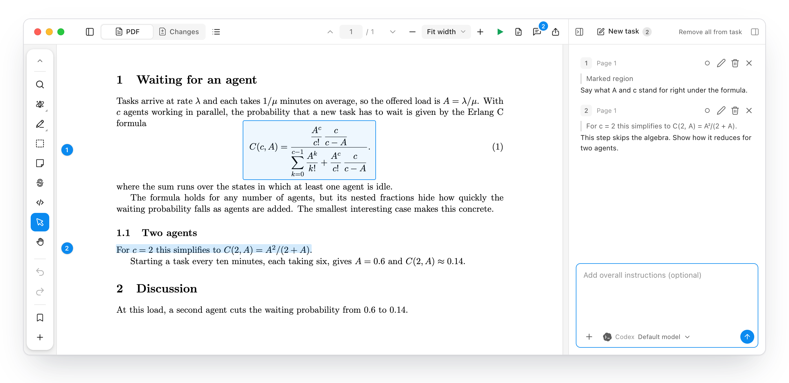

## Mark what should change on the PDF

Open **Manuscript** to read your compiled paper. Papilot extracts exact word geometry from the PDF and pairs it with **SyncTeX**, so dragging over printed text selects whole words cleanly and maps every note back to the exact `.tex` file and line range — even in multi-file theses or equations where raw PDF text would be garbled.

### Marking tools and shortcuts

The **Marking tools** rail sits beside the PDF on desktop and floats along the bottom on phones (press the arrow or swipe down on a phone to collapse it; press `Escape` to return to **Select**):

| Tool | Shortcut | When to use it |
| --- | --- | --- |
| **Magic pen** | `Q` | Drag over text or click a spot to apply a one-tap quick note (such as *Polish*, *Shorten* or *Verify*; customize presets in **Settings → Quick notes**, or press a number key to lock a preset). |
| **Note** | `T` | Drag across text and write a comment immediately. Click **Note** again to assign a color group (`yellow`, `green`, `purple`, `orange`, `red`). |
| **Region** | `M` | Draw a box around an equation, figure, algorithm or table that cannot be selected as plain words. |
| **Sticky note** | `P` | Click any spot on the page to leave a point comment anchored to the nearest line. |
| **Delete** | `D` | Strike through text you want removed; click the mark to optionally specify replacement wording. |
| **Edit source** | `E` | Click a passage on the manuscript PDF to open and edit its `.tex` lines directly without an agent. |
| **Select** | `V` | Copy text normally, or click **Add note** beside a selection. Hold `Space` with any tool (or press `H` on desktop) to pan. |

### Organize and send notes

- **Shared `My notes` list**: all saved annotations are stored on your Papilot host, shared across devices on the same server, and listed in **My notes** with their mapped LaTeX source. Sort them by **Original order**, **PDF position** or **Newest first**.
- **Quote single notes or whole sections**: click the right arrow on any note to quote it into **New task**, or use **Add to task** in the **My notes** header to select all notes in a specific paper section (and its subsections) at once.
- **Clear safely**: **Clear all annotations…** (trash icon) clears unsent annotations on the active document with confirmation and one-click **Undo**.

## Reading helpers

- **Peek at references**: hover over an internal link (citation, equation, figure or section from `hyperref`) for 400 ms, Option-click (Alt-click), or focus it with the keyboard to preview the referenced target in place without losing your scroll position.
- **Reading anchors**: click **+** at the end of the tool rail (or press `Shift+B`) to bookmark a passage; jump with numbered buttons or `[` and `]`. Anchors follow their `.tex` source even when edits move the passage to another page.
- **Crop margins**: trim white page margins per device so two-column or wide margins fill narrow laptop or phone screens without altering your `.tex` geometry.

## AI review and agent-created notes

- **Read-only `/ai-review`**: run `/ai-review` in **New task** (with a read-only-capable agent such as Codex, Claude, GLM or Papilot Writer) to get short, line-anchored suggestions under **AI suggestions** without editing any files; click **Keep on manuscript** (bookmark icon) on any finding you want to keep as a manuscript note.
- **Agent-placed annotations**: ask an ordinary task to read external feedback (for example from a pasted referee report or `comments.txt`) and place anchored annotations directly onto your manuscript PDF.
- **Voice notes (macOS)**: enable the optional **Settings → Experiments → Typeless voice notes** integration to trigger your configured Typeless dictation shortcut when creating a PDF note ([Experimental Features](experiments.md#typeless-voice-notes-macos)).

Once your notes are quoted into a task and the agent finishes its turn, continue to [Review & Save](review-and-save.md).
