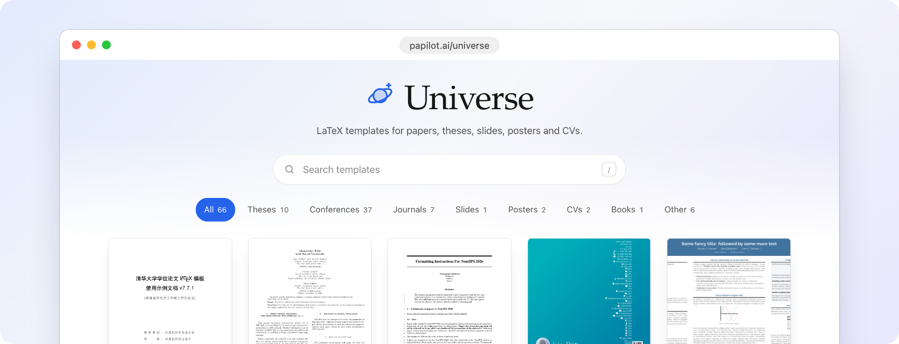

## Open or import a paper

Click **New paper** or **Import or open** (the paper menu at the top of the sidebar lets you add and switch papers at any time). One dialog offers three tabs — **Blank**, **Import or open** and **Templates** — and preserves your typed name, save folder and link when switching tabs.

### Choosing how to bring in a paper

| Route | Where files live | Ongoing remote connection? | Best when… |
| --- | --- | --- | --- |
| **Open existing folder** (`File › Open Paper…`, `⌘O` / `Ctrl+O`) | Your original folder in place | Uses that folder's existing Git remote if any | You already have a local LaTeX repo (for example `~/papers/icml2027`) and want edits written there |
| **Import a copy** (folder, `.zip`, arXiv, GitHub, `.tar.gz`, or read-only Overleaf `/read/…`) | A new copy under Papilot's `papers/` folder | **No** — one-time source snapshot | You want to experiment safely, read/revise an arXiv paper (`https://arxiv.org/abs/1706.03762`), or pull a snapshot without touching the original |
| **Import Overleaf with sync** (**Keep in sync with Overleaf** on) | A new copy under Papilot's `papers/` folder | **Yes** — live two-way Overleaf sync while Papilot runs | Coauthors are actively editing in Overleaf and you want accepted changes exchanged in ~1 second ([Overleaf Sync](overleaf.md)) |

### Supported URLs and archive limits

- **Links and archives**: supports arXiv abstract/PDF/HTML/e-print URLs (including explicit versions like `v2`), Overleaf project and sharing links (`/project/…` and `/read/…`, keeping any `#…` fragment), public GitHub repository URLs (default branch snapshot; export private repos as ZIPs first), and public HTTPS `.zip`, `.tar` and `.tar.gz` archives up to **64 MB** and **5,000 extracted files**. Local folder openings and local ZIP/folder uploads have no fixed file-count cap.
- **Remote browser picker**: when opening Papilot in a browser on another device (such as a phone over Tailscale), **Browse…** lists non-hidden folders on the host computer so you can choose a save or paper folder without a desktop file dialog.
- **If the initial build fails**: the import dialog keeps your prepared files and offers main-file/engine selectors, **Help fix compilation** (using a connected agent, saved as uncommitted changes for inspection), **Continue later** and **Add and fix later**. See [Troubleshooting](troubleshooting.md#the-paper-does-not-compile).

## Start from a Papilot Universe template

Open **New paper → Templates** (or browse [papilot.ai/universe/](https://papilot.ai/universe/) and click **Open in Papilot** on any template):

- **Coverage**: includes university theses, conference and journal author kits, slides, posters, CVs and books, and maps **more than 400 conferences** (with common AI venues such as NeurIPS, ICML, ICLR, CVPR and ACL listed first) to the exact author kit requested by their call for papers.
- **Ready to compile**: enter a **Paper name** and **Save in** parent folder, then click **Create paper**. Papilot downloads the selected template version, verifies its SHA-256 checksum, initializes local Git history without needing a GitHub account, sets the template's main `.tex` file and LaTeX engine (`pdfLaTeX`, `XeLaTeX` or `LuaLaTeX`), and compiles the first PDF automatically. Existing folders are never overwritten.
- **Offline fallback**: the built-in **Example project** and **Blank** document work completely offline; if the online catalog is unreachable, **Retry** preserves your typed name and folder.

## Manage papers and multi-document repositories

- **Switch root `.tex` documents**: in the sidebar, **Manuscript** shows the active root file (such as `main.tex`). Click that filename to open **Files**: any `.tex` file with `\documentclass` has a green play button (**Compile this document**) so you can switch between a paper, slides and a rebuttal letter in the same repository while keeping separate build settings and PDF reading positions per document.
- **Rename, relocate or remove a paper**: open the paper menu at the top of the sidebar and click the **pencil** icon beside a paper. **Remove paper** deletes only Papilot's task records, conversations and notes; your `.tex` files, Git commits and worktrees on disk are never deleted.
