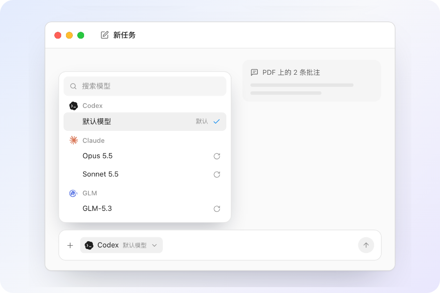

## 选择与切换智能体和模型

每个任务都使用聊天输入框下方**模型菜单**中选定的智能体与模型运行：

- **支持的智能体**：内置 **Papilot Writer**、{{codingAgentCount}} 种编程智能体（{{codingAgentListZh}}），以及可在实验设置中开启的**协作模式**与 **ChatGPT Pro（网页）**（详见[实验性功能](experiments.md)）。
- **搜索、推理强度、速度与显隐控制**：模型按智能体分组并将最近使用项置顶，支持直接输入关键字跨智能体搜索、拖动 **Reasoning effort** 滑块以及在支持的模型上切换 **Fast** / **Ultrafast**。可在 **Settings → Agents** 中开关单个智能体或隐藏特定模型（**Reset** 一键恢复），也可在 **Settings → General → Quick model** 指定用于文献核验与任务命名的轻量模型。
- **无缝切换智能体与模型**：
  - 选择**同一智能体的其他模型**：在当前会话的下一轮直接生效。
  - 选择**另一个智能体的模型**：在当前任务中原地交接——完整保留对话记录、改动、审阅决定与未发送草稿，并在下一轮把此前的请求与回复交给新智能体继续执行。

## 配置智能体

打开 **Settings → Agents** 可查看所有受支持智能体的实时连接状态、可用模型与配置说明。Papilot 从不保存第三方 CLI 的账号密码：命令行智能体直接复用主机上的登录状态，通过环境变量传入的 API 密钥也仅提供给对应适配器。

> **提示**：在主机上安装 CLI 或完成登录后，请回到 **Settings → Agents** 点击 **Reconnect**（或 **Refresh**）。如果你新增或修改了环境变量（如 `ANTHROPIC_API_KEY`、`CURSOR_API_KEY`、代理变量或 `PAPILOT_*_BIN`），请**重启 Papilot** 让服务端进程读取新的环境。

### 内置论文智能体

- **Papilot Writer**（`papilot`）：开箱内置（基于内嵌 Pi SDK 构建，提供论文大纲、阅读文本检索、参考文献核验与排版页面预览工具；架构说明见 [Papilot Writer](../../paper-agent.md)）。在 **Settings → Agents → Papilot Writer** 中，可通过浏览器 OAuth 登录 **ChatGPT Plus/Pro** 或 **GitHub Copilot** 订阅，填写 **Anthropic**、**OpenAI**、**Google**、**OpenRouter**、**DeepSeek**、**xAI**、**Moonshot**、**Z.ai** 或 **Mistral** 的 API 密钥（Anthropic 仅支持 API 密钥），或在 **Custom API** 中接入任意 OpenAI 兼容端点。
- **Papilot Writer 与 Pi 的区别**：Papilot Writer 独立存放在 `PAPILOT_DATA/papilot-writer` 下，不加载 `~/.pi` 扩展；选择 **Pi** 则会通过 RPC 调用你自己安装的 `pi` CLI（需 `1.5.1+`）及其自定义供应商、技能和扩展。

### 主机 CLI 与 API 密钥智能体配置表

| 智能体 | 主机配置步骤 | 路径 / 密钥变量 | 说明与特性 |
| --- | --- | --- | --- |
| **Codex** | 通过 Codex/ChatGPT 桌面端或 `codex login` 登录（CLI 版也可运行 `papilot codex login`）。`papilot` 命令缺省时会自动安装 Codex `0.164.0+`；桌面端优先使用主机 `codex`，否则自动查找 macOS `Codex.app`/`ChatGPT.app` 或 Windows `OpenAI.Codex` 内置后端。 | `PAPILOT_CODEX_BIN` | 配备 `view_pdf` 工具可直接查看排版后的页面图像；支持显示 ChatGPT 订阅额度窗口。 |
| **Claude** | 安装 [Claude Code](https://code.claude.com) 并运行 `claude auth login`（通过 `claude -p` 复用订阅或密钥），**或**在启动前设置 `ANTHROPIC_API_KEY`（使用 Claude Agent SDK；自定义兼容网关可设 `ANTHROPIC_BASE_URL` + `ANTHROPIC_AUTH_TOKEN`）。 | `PAPILOT_CLAUDE_BIN`、`ANTHROPIC_API_KEY` | macOS/Linux/WSL 下启用沙盒编辑；原生 Windows 使用无命令沙盒的 `Accept edits`。 |
| **Cursor** | 从 Cursor 控制台获取密钥，在启动前设置 `CURSOR_API_KEY`（不读取 Cursor 桌面登录）。 | `CURSOR_API_KEY` | 默认限制在工作树沙盒且禁网（可在权限菜单切换 `Unrestricted`）。 |
| **GitHub Copilot** | 安装独立 CLI（`npm install -g @github/copilot`），运行 `copilot login` 后点击 **Reconnect**。 | `PAPILOT_COPILOT_BIN` | 通过 `copilot --acp --stdio` 运行（支持 `Default` 与 `Allow all`）。 |
| **Grok** | 安装 [Grok CLI](https://x.ai/cli)，运行 `grok login` 或设置 `XAI_API_KEY`，再点击 **Reconnect**。 | `PAPILOT_GROK_BIN`、`XAI_API_KEY` | 通过 ACP 运行（支持 `Default` 与 `YOLO`）。 |
| **Antigravity** | 安装 `agy` CLI 并完成登录，再点击 **Reconnect**。 | `PAPILOT_AGY_BIN`、`PAPILOT_AGY_PROXY` | 模型菜单可直接显示 5 小时与每周配额进度（[说明](../../antigravity-usage.md)）。 |
| **Kimi** | 安装 Kimi Code CLI（建议 `2.4.1+`），运行 `kimi login` 后点击 **Reconnect**。 | `PAPILOT_KIMI_BIN` | 通过 `kimi acp` 运行，支持思考等级与原生图片输入。 |
| **GLM** | 安装 Claude Code（或使用自动下载的 SDK），并设置 `ZHIPU_API_KEY`（`open.bigmodel.cn`）或 `ZAI_API_KEY`（`api.z.ai`）。 | `ZHIPU_API_KEY`、`ZAI_API_KEY` | 接入 GLM 系列模型，并与 Anthropic 环境变量隔离。 |
| **ZCode** | 安装 [ZCode CLI](https://github.com/zai-org/ZCode/blob/v4.0.0/apps/zcode-cli/docs/usage/01-quickstart.md)（`0.18.0+`，macOS 也可识别 `ZCode.app`），运行 `zcode login` 或配置模型后点击 **Reconnect**。 | `PAPILOT_ZCODE_BIN` | 适用于编辑任务（`Accept edits` / `YOLO`）；只读辅助任务会交由其他兼容智能体。 |
| **DeepSeek** | 安装 DeepSeek Harness（`npm install -g @deepseek-ai/dsh`，需 Node 22.19+；Windows 下也会自动识别桌面版 Harness CLI）并在 `dsh` 中配好模型和密钥。 | `PAPILOT_DSH_BIN` | 通过 `dsh acp` 运行并固定为 `workspace-write` 权限（纯文本，不支持图片输入）。 |
| **Qwen** | 安装 [Qwen Code](https://github.com/QwenLM/qwen-code) 并运行一次 `qwen` 完成登录。 | `PAPILOT_QWEN_BIN` | 通过 `qwen --acp` 运行（默认为 `Auto edit`）。 |
| **OpenCode** | 安装 [OpenCode](https://opencode.ai) 并通过 `opencode auth login` 连接供应商。 | `PAPILOT_OPENCODE_BIN` | 通过 `opencode acp` 运行（支持 `Default` 与 `Allow all`）。 |
| **Pi** | 安装 Pi `1.5.1+`（`npm install -g @earendil-works/pi-coding-agent`），运行 `pi` 并执行 `/login`，再点击 **Reconnect**。 | `PAPILOT_PI_BIN` | 通过 RPC 复用你本机的 Pi 供应商、技能与项目信任设置。 |
| **Qoder** | 安装独立的 [Qoder CLI](https://docs.qoder.com/cli/acp)（非 IDE 启动器）并运行 `qoder login`。 | `PAPILOT_QODER_BIN` | 仅限编辑任务；**不支持只读模式**（见下）。 |
| **CodeBuddy** | 安装 `@tencent-ai/codebuddy-code` 并运行 `codebuddy` 完成登录。 | `PAPILOT_CODEBUDDY_BIN` | 仅限编辑任务；**不支持只读模式**（见下）。 |
| **WorkBuddy** | 通过 `PAPILOT_WORKBUDDY_BIN` 指定兼容的 ACP 启动器（[Windows 示例](../../windows.md)）并完成该运行时的登录配置。 | `PAPILOT_WORKBUDDY_BIN` | 仅限编辑任务；**不支持只读模式**（见下）。 |

- **只读任务限制（`Qoder`、`CodeBuddy`、`WorkBuddy`、`ZCode`）**：这几个 CLI 暂未提供经验证的只读沙盒，因此无法直接执行 `/ai-review` 或只读编译诊断；任务标题与 `✨` 提交说明会自动改用已连接的其他支持只读的智能体生成。
- **统一的论文工具集**：每个编辑任务都会向智能体提供本地工具，用于检索和阅读原稿 PDF、读写批注、查阅文献库中的引用 PDF、记录引用核验结论以及维护写作记忆（详见 [Agent 工具接口](../../agent-tools.md)）。

## 任务权限

创建编辑任务时或在发送下一条消息前（运行中的任务需先暂停），打开模型菜单点击 **Permissions** 即可切换权限模式：

- **Papilot Writer** 默认使用 **Paper edits**（工作树内的 `.tex`、`.bib`、`.ltx` 修改直接执行；删除文件、非 LaTeX 文件与终端命令会在对话中先征求同意），也可切换为 **Full access**（仍严格限制在任务工作树内）。
- **Codex** 默认使用 **Workspace access**（工作树写沙盒 + 按需审批），并提供 **Full access**。
- **Claude** 与 **GLM** 在 macOS、Linux 和 WSL 下默认启用 **Sandboxed edits**（原生 Windows 下为无命令沙盒的 **Accept edits**），并提供跳过审批模式。
- **ACP 与其他 CLI 智能体**提供各自原生支持的模式（如 **Default**、**Auto edit**、**Allow all** 或 **YOLO**），工具审批与提问都会直接转发到聊天面板。

权限选择会在当前浏览器或桌面端中按智能体分别记住；只读的 `/ai-review` 任务始终保持只读。下一步：前往[技能、写作记忆与附件](skills-and-memory.md)定制提示技能、持久偏好与附件上传。
