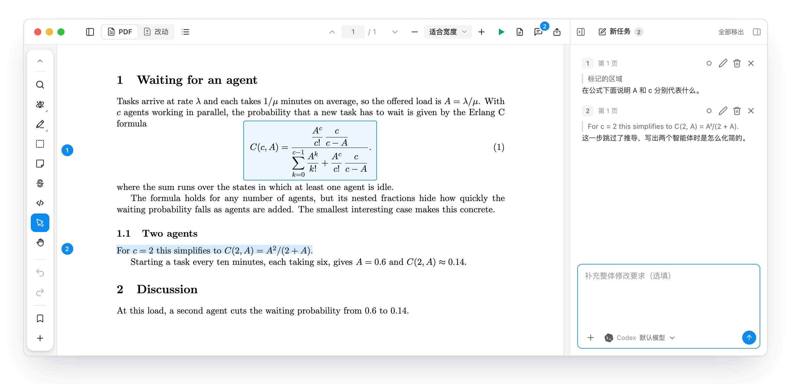

## 在 PDF 上指出要改什么

打开 **Manuscript** 即可阅读编译后的论文。Papilot 直接从 PDF 提取每个词的精确排版坐标并结合 **SyncTeX** 反向定位，因此划选文字时会自然对齐完整词界，并将每条批注准确关联到对应的 `.tex` 文件和源码行——哪怕论文拆成了十几个章节文件，或包含复杂数学公式，智能体拿到的也是原始 LaTeX 代码而非破碎的 PDF 提取文本。

### 标注工具与快捷键

**Marking tools** 工具栏在桌面端位于 PDF 左侧，在手机端悬浮于底部（点击箭头或在手机端向下滑动可收起，按 `Escape` 回到 **Select**）：

| 工具 | 快捷键 | 用途 |
| --- | --- | --- |
| **Magic pen** | `Q` | 划选文字或点击位置，一键盖上快捷批注（如 *Polish*、*Shorten*、*Verify*；可在 **Settings → Quick notes** 自定义，或按数字键锁定某一项）。 |
| **Note** | `T` | 划选文字立即写下修改意见；再次点击 **Note** 可选择颜色分组（黄、绿、紫、橙、红）。 |
| **Region** | `M` | 框选无法按普通文字划选的公式、插图、算法框或表格。 |
| **Sticky note** | `P` | 在页面任意位置点击，留下锚定到最近一行的定点批注。 |
| **Delete** | `D` | 划掉需要删除的文字；点开标记还可填写替换文本。 |
| **Edit source** | `E` | 直接点击原稿 PDF 上的某段内容，无需智能体即可就地打开并修改其 `.tex` 源码。 |
| **Select** | `V` | 正常复制文字，或点击选区旁弹出的 **Add note**。按住 `Space`（桌面端也可按 `H`）可拖拽平移页面。 |

### 整理与发送批注

- **跨设备共享的 `My notes` 列表**：所有批注保存在 Papilot 主机端并跨设备共享，在 **My notes** 中连同对应的 LaTeX 源码一并列出，支持按 **Original order**、**PDF position** 或 **Newest first** 排序。
- **单条引用或按章节批量发送**：点击单条批注的右箭头可将其加入 **New task**，也可点击 **My notes** 顶部的 **Add to task** 按章节一次性选中该节及其子节下的全部批注。
- **安全清空**：点击垃圾桶图标（**Clear all annotations…**）可在确认后清空当前文档尚未发送的批注，并支持一键 **Undo** 恢复。

## 阅读辅助工具

- **引用悬浮预览（Peek）**：将鼠标悬停在文内交叉引用链接（`hyperref` 生成的文献、公式、图表或章节链接）上满 400 ms，或按住 Option/Alt 点击（或键盘聚焦），即可在原位弹出目标片段预览，无需翻页来回找。
- **阅读锚点（Anchors）**：点击工具栏末端的 **+**（或按 `Shift+B`）收藏当前位置，用数字按钮或 `[` / `]` 快速跳转；重新编译后内容即使跨页移动，锚点也会跟随 `.tex` 源码自动更新页码。
- **裁切白边（Crop margins）**：按当前设备裁掉页面四周多余留白，让双栏或宽边距论文在笔记本小屏和手机上铺满可视宽度，且丝毫不改动 `.tex` 版式。

## AI 审稿与智能体代加批注

- **只读 `/ai-review`**：在 **New task** 中选择 **AI review** 技能（输入 `/ai-review`，搭配 Codex、Claude、GLM 或 Papilot Writer 等支持只读的智能体），可在不改动任何文件的前提下生成锚定到具体行号的审稿建议（在工具栏 **AI suggestions** 中查看）；对有价值的建议点击书签图标（**Keep on manuscript**）即可转为正式原稿批注。
- **智能体代写批注**：在普通任务中让智能体读取外部反馈（例如粘贴的审稿意见或 `comments.txt`），由它直接在原稿 PDF 上写入带锚点的批注。
- **macOS 语音批注**：可在 **Settings → Experiments → Typeless voice notes** 中开启实验性 Typeless 集成，新建 PDF 批注时自动触发语音听写快捷键（详见[实验性功能](experiments.md#typeless-语音批注macos)）。

批注发送到任务且智能体完成修改后，继续查看[审阅、应用与提交](review-and-save.md)。
