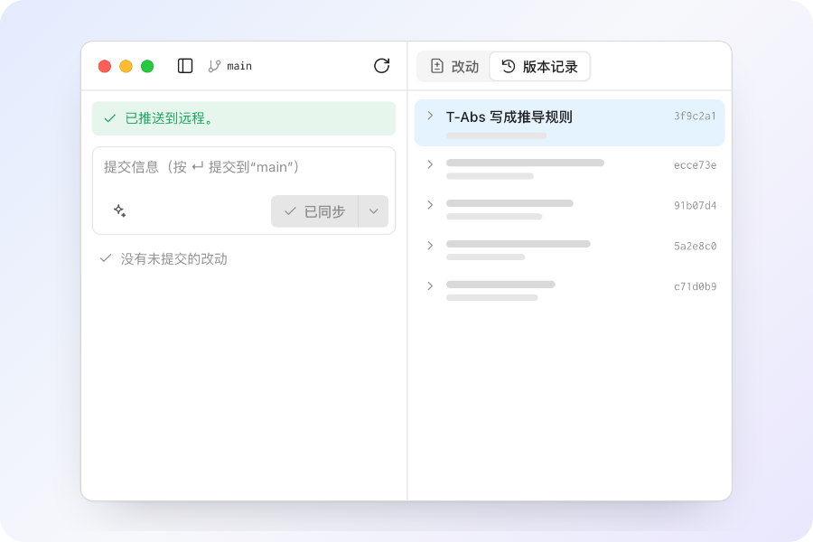

## 暂存、提交与智能提交说明

点击侧边栏 **Manuscript** 下方的 **Version Management**（带回退箭头的时钟图标；手机端为顶部的 **Git** 标签页），即可查看文件差异、暂存、提交、回退历史版本或与远端 Git 仓库同步。

- **查看差异与暂存**：点击 **Changes** 或 **Staged changes** 下的文件查看带行号的对比，悬停文件行可执行 **+**（暂存）、**−**（取消暂存）或丢弃未暂存修改。
- **干净的论文提交**：即使未手动暂存，直接点 **Commit** 也会提交所有已修改的论文文件，并自动排除 `.aux`、`.log`、`.synctex.gz`、`_minted*`、`.DS_Store` 等编译副产物；点击列表标题的 **⋯ → Add to .gitignore** 可一键补齐忽略规则。
- **智能生成提交说明（`✨`）**：点击提交输入框内的 `✨`，当前智能体会在一次只读回合中读取所选文件差异、相关任务标题以及仓库近期提交风格，生成贴合语境的提交说明。可在 **Settings → Git → Commit-message agent** 指定生成所用的智能体/模型，并在 **Settings → Git → Commit message language** 中设为 **Auto** 或固定语言。

## 与远端 Git 仓库同步

任务审阅中的 **Apply** 与 **Commit** 都不会自动推送到远端仓库。本地提交完成后，**Version Management** 中的主按钮会自动变为 **Sync**：

- 点击 **Sync** 会使用主机自身的 Git 凭据（SSH 密钥、凭据助手或 GitHub CLI）拉取合并远端更新，并将本地提交推送到 GitHub、GitLab 等远端仓库。
- 双端一致后按钮显示 **Synced**；随时可展开右侧下拉箭头执行 **Commit and sync**。

## 版本历史与安全回退

- 在下方 **Version history** 展开任意历史记录，即可查看该次提交改动了哪些文件。
- 点击 **Restore this version** 会在完整保留既有提交历史的前提下生成一条恢复到该版本内容的新本地提交，绝不会强制改写历史。

## 高级 Git 视图与合并冲突

开启 **Settings → Git → Show advanced Git features**，即可在 **Version Management** 中展开进阶控制：

- **提交图与工作树**：查看分支与任务工作树 **Commit graph** 及活跃的 **Worktrees**（默认存放在 `~/.papilot/worktrees` 或 `PAPILOT_WORKTREES`，可在单篇论文的 `.git/papilot/settings.json` 中单独覆盖）。
- **细粒度 Git 操作**：展开 **Commit (Amend)** 以及独立的 **Fetch**、**Pull** / **Merge** 和 **Push**。
- **解决合并冲突（`!`）**：若合并因冲突暂停，点击 **Resolve with** 可让智能体在冲突文件内综合两侧修改供你逐文件审阅后 **Commit merge**（可在 **Settings → Git → Conflict-resolution agent** 指定冲突消解智能体），或点击 **Abort merge** 立即回到合并前状态。
