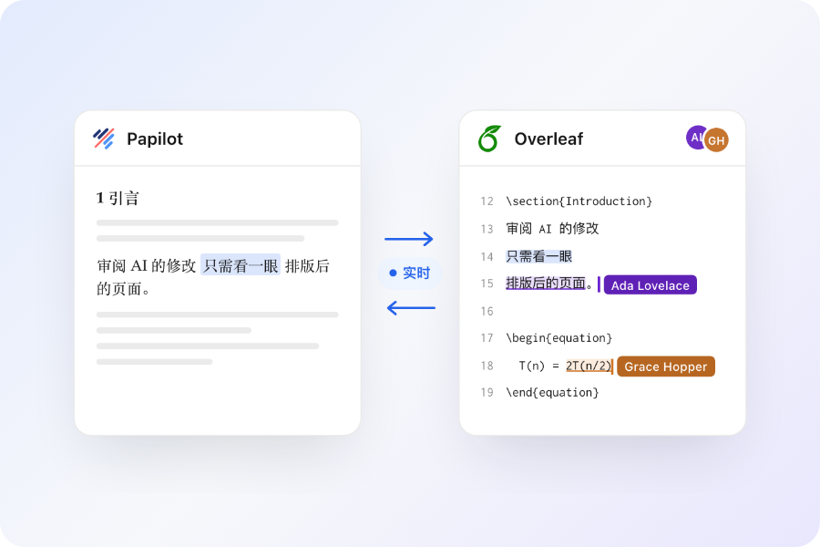

## 快照导入与实时同步的区别

Papilot 支持两种接入 Overleaf 项目的方式——取决于合作者是否仍在 Overleaf 上继续修改：

| 模式 | 选择方法 | 是否需要登录？ | 导入后的行为 |
| --- | --- | --- | --- |
| **一次性源码快照** | 粘贴只读分享链接（`…/read/…`），或在 **Import or open** 中关闭 **Keep in sync with Overleaf** | 否（开启查看权限的链接无需登录） | 将当前项目源码一次性下载为独立的本地副本，后续两边的改动互不影响。 |
| **双向实时同步** | 选择 **Sync with Overleaf**，或粘贴项目/可编辑分享链接（`…/project/…`）并开启 **Keep in sync with Overleaf** | 是（免费 Overleaf 账号即可，无需付费 Git 扩展） | 只要 Papilot 正在运行，你点击 **Apply** 或 **Commit** 的改动会在**约 1 秒内**到达 Overleaf，合作者的修改也会实时写入你的本地文件与 PDF。 |

**具体示例**：如果同事发来一条只读链接 `https://www.overleaf.com/read/abcd…` 请你帮忙检查证明或私下试改一版，直接按**快照**导入即可；如果你和两位合作者正在赶截稿，他们习惯留在 Overleaf 网页端写作，则开启**实时同步**——智能体尚未审阅的草稿始终隔离在任务工作树内，只有当你接受并点击 **Apply** 或 **Commit** 后，审定好的内容才会在约一秒内同步到合作者的编辑器中。

## 设置 Overleaf 实时同步

1. **登录 Overleaf**：
   - **直接复用本机浏览器会话**：若运行 Papilot 的电脑浏览器已登录 Overleaf，直接点 **Use the sign-in from Chrome**（或 Firefox、Edge、Brave、Arc、Vivaldi；Chromium 系浏览器在 macOS 上会请求一次钥匙串解密授权，Firefox 无需输入密码）。
   - **桌面端独立登录窗口**：在桌面应用中点击 **Sign in to overleaf.com**，可在独立窗口中使用 Google、ORCID、高校统一认证或邮箱登录——Papilot 全程不会接触你的密码。
   - **远程浏览器或手动粘贴 Cookie**：按 **Where to find it** 的提示复制粘贴 `overleaf_session2`（自建实例为 `overleaf.sid`），或点击 **Use another Overleaf server** 填写高校/机构自建 Overleaf 地址。账号可随时在 **Settings → Overleaf** 中管理。
2. **导入新项目或关联现有本地论文**：
   - **新建同步副本**：在 **Sync with Overleaf**（或开启同步开关的 **Import or open**）中粘贴项目链接。
   - **关联已有本地论文**：打开侧边栏顶部的论文菜单，选择 **Sync with Overleaf…**。Papilot 会先逐文件对比两边内容，存在差异的文件可逐一选择 **Keep Overleaf's** 或 **Keep this paper's**，被替换的一方也会妥善备份。

## 日常同步机制与冲突保护

- **在线光标与作者署名**：关联后 **Version Management** 下方会出现 **Overleaf** 状态行（绿点表示已同步，蓝点表示传输中，黄点表示离线或登录失效）及在线合作者头像缩写。在 **Source** 源码视图中，合作者的实时光标以及自上次提交以来新增的文字会用各自专属颜色下划线标出，悬停即可查看作者与时间。
- **哪些文件只留在本地**：`.git`、LaTeX 编译产物（`.aux`、`.log`、`synctex.gz`、同名编译生成的 PDF/`.bbl`）、私钥、新产生的 `.gitignore` 忽略文件以及超过 **50 MB** 的大文件不会上传（跳过的文件会在面板中明确列出）。
- **断线重连与冲突处理**：断网恢复或重启打开 Papilot 后，系统会基于双方最近一次共同版本按行、按字符自动三方合并。若离线期间双方恰好改了同一句话，默认保留 Overleaf 上的合作者文本（绝不静默覆盖合作者），并在面板中并排标出差异，由你一键选择 **Use mine**（改用我的版本）或 **Keep Overleaf's**（保留 Overleaf 版本）。点击 **Stop syncing…** 可随时解除关联并完整保留本地文件。
