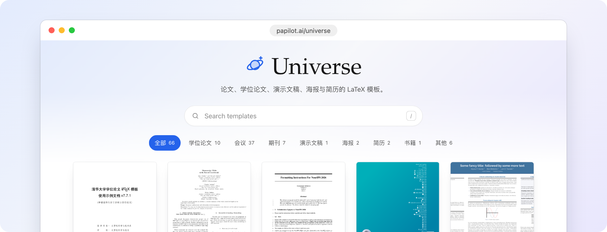

## 打开或导入论文

点击 **New paper** 或 **Import or open**（侧边栏顶部的论文菜单随时可以添加或切换论文）。同一个对话框包含 **Blank**、**Import or open** 和 **Templates** 三个标签页，切换标签页时会自动保留已填写的名称、保存位置和链接。

### 选择引入论文的方式

| 方式 | 文件保存位置 | 是否保持远端同步？ | 适用场景 |
| --- | --- | --- | --- |
| **Open existing folder**（`File › Open Paper…`，`⌘O` / `Ctrl+O`） | 直接使用你原有的本地文件夹 | 沿用该文件夹原有的 Git 远端（如有） | 本地已有 LaTeX 仓库（如 `~/papers/icml2027`），希望改动直接落回原目录 |
| **Import a copy**（文件夹、`.zip`、arXiv、GitHub、`.tar.gz` 或只读 Overleaf `/read/…`） | 在 Papilot 数据目录 `papers/` 下新建副本 | **否** —— 一次性源码快照 | 希望安全试验、阅读/改写某篇 arXiv 论文（如 `https://arxiv.org/abs/1706.03762`），或保留原文件不动 |
| **导入并开启 Overleaf 同步**（打开 **Keep in sync with Overleaf**） | 在 Papilot 数据目录 `papers/` 下新建副本 | **是** —— Papilot 运行期间双向实时同步 | 合作者仍在 Overleaf 中编辑，需要双方改动在约 1 秒内互通（详见 [Overleaf 同步](overleaf.md)） |

### 支持的链接格式与压缩包上限

- **链接与源码包**：支持 arXiv 摘要页/PDF/HTML/源码链接（支持指定版本如 `v2`）、Overleaf 项目与分享链接（`/project/…` 和 `/read/…`，请完整保留 `#` 后的片段）、公开 GitHub 仓库链接（下载默认分支快照；私有仓库请先导出 ZIP 上传），以及公开 HTTPS 的 `.zip`、`.tar`、`.tar.gz` 源码包（上限 **64 MB**、解压后 **5,000 个文件**）。打开本地文件夹以及上传本地 ZIP/文件夹没有固定文件数上限。
- **远程浏览器选目录**：在手机或平板浏览器中通过 Tailscale 连接主机时，点击 **Browse…** 会直接列出 Papilot 主机上的非隐藏文件夹，无需桌面文件选择器也能指定路径。
- **首次编译未通过时**：导入窗口会保留已准备好的文件，你可以切换主文件或编译引擎后重试，点击 **Help fix compilation** 让已连接的智能体诊断并生成未提交的修复供你检查，或点击 **Continue later** / **Add and fix later**。详见[故障排查](troubleshooting.md#论文无法编译)。

## 从 Papilot Universe 模板开始

打开 **New paper → Templates**（或直接访问 [papilot.ai/universe/](https://papilot.ai/universe/) 并在任意模板上点击 **Open in Papilot**）：

- **模板覆盖范围**：涵盖高校学位论文、期刊与会议投稿套件、幻灯片、海报、简历和书籍，并为 **400 多个学术会议**（NeurIPS、ICML、ICLR、CVPR、ACL 等常用 AI 会议优先排列）指明征稿通知要求的官方模板。
- **创建即可编译**：填写 **Paper name** 并选择 **Save in** 父目录，点击 **Create paper**。Papilot 会下载所选模板版本、校验 SHA-256、初始化本地 Git 历史（无需 GitHub 账号）、自动配好主 `.tex` 文件和编译引擎（`pdfLaTeX`、`XeLaTeX` 或 `LuaLaTeX`）并完成首次编译，且绝不覆盖已有文件夹。
- **离线可用**：内置的 **Example project** 与 **Blank** 空白文档完全支持离线创建；模板目录暂时无法加载时点击 **Retry** 不会丢失已填信息。

## 管理论文与多主文档仓库

- **切换编译主文档**：侧边栏 **Manuscript** 下方显示当前编译的主文件名（如 `main.tex`）。点击该文件名打开 **Files** 菜单：仓库内所有包含 `\documentclass` 的 `.tex` 文件旁都会显示绿色播放按钮（**Compile this document**），方便在同一仓库的正文、幻灯片与审稿回复信之间切换，并各自独立记住编译设置与阅读位置。
- **重命名、更改位置或移除论文**：打开侧边栏顶部的论文菜单，点击论文旁的**铅笔**图标即可修改名称、更新仓库路径或点击 **Remove paper**。移除论文只会清理 Papilot 内的任务、对话与批注记录，磁盘上的源文件、Git 历史和工作树都会完整保留。
