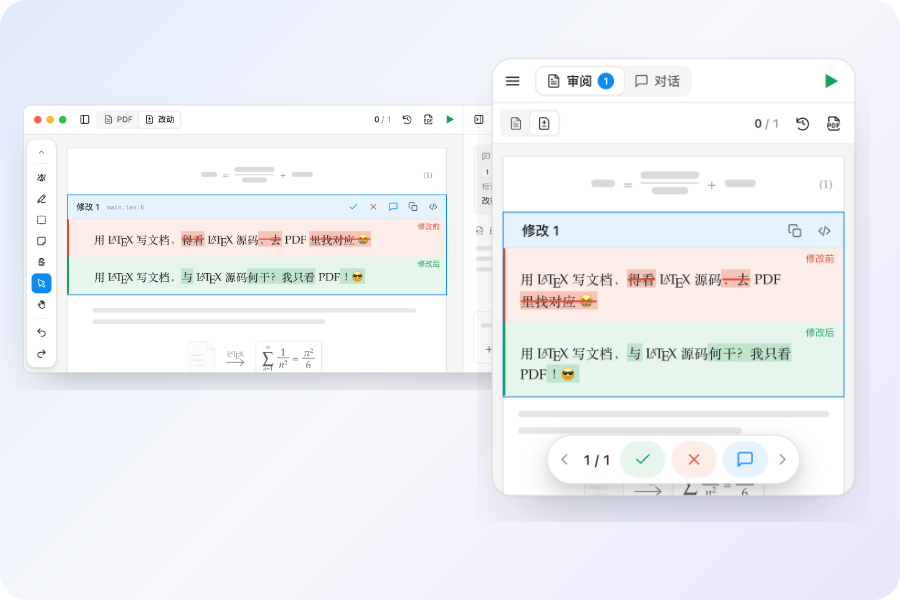

## 手机与平板远程访问的工作原理

Papilot 服务端在你的主机电脑（Mac、Windows 或 Linux）上**仅绑定本地回环地址 `127.0.0.1`**。你的 `.tex` 源文件、Git 工作树、TeX 发行版与智能体登录状态全部留在主机上；手机或平板只需通过私有的 **Tailscale** 连接（或 SSH 隧道），用 Safari 或 Chrome 打开同一个工作区。

所有任务、对话草稿、PDF 批注与待审阅改动都保存在主机端，因此你可以在书桌前发起修改，走到路上拿出手机阅读排版对比、补一条批注或直接点 **Accept** 拍板。

## 配置私有 Tailscale 访问

1. 在运行 Papilot 的电脑与手机/平板上都安装 [Tailscale](https://tailscale.com/)，并登录同一个 tailnet 账号网络。
2. 查看主机的 MagicDNS 域名（如 `macbook.tailnet-name.ts.net`）以及你的 Tailscale 登录账号邮箱（可通过 `tailscale status` 或客户端查看）。
3. 为 Papilot 配置**完全一致的浏览器访问源（Origin）**与**允许访问的 Tailscale 账号**，再用 `tailscale serve` 将本地 `127.0.0.1:7274` 暴露给私有 tailnet：

```sh
export PAPILOT_PUBLIC_ORIGIN=https://your-host.your-tailnet.ts.net:8443
export PAPILOT_TAILSCALE_LOGIN=you@example.com
papilot service install   # macOS 注册后台常驻服务（其他系统可带着这两个变量启动 papilot）
tailscale serve --bg --https=8443 http://127.0.0.1:7274
```

4. 在手机或平板浏览器中打开 `https://your-host.your-tailnet.ts.net:8443` 即可使用。

### 安全与网络注意事项

- **切勿开启 Tailscale Funnel**：到达该端点的请求等同于你本人的本地操作权限。Papilot 会逐一核验本地 Tailscale 代理注入的 `Host`、`Origin` 与 Tailscale 身份标头，并**主动拒绝一切公网 Funnel 流量**。
- **加密 tailnet 内的 HTTP 备选方案**：若当前网络无法向 Let's Encrypt 申请证书，也可在加密 tailnet 内部改用 HTTP（设置 `PAPILOT_PUBLIC_ORIGIN=http://your-host.your-tailnet.ts.net:8081` 并执行 `tailscale serve --bg --http=8081 http://127.0.0.1:7274`）。阅读、批注与审阅功能均可正常使用，但依赖浏览器安全上下文（HTTPS）的特性（如推送通知和一键复制按钮）仅在 HTTPS 下可用。
- **macOS 防休眠与服务日志**：`papilot service install` 登录后自动启动并通过 `caffeinate -i` 防止系统空闲休眠中断任务（`papilot service stop` 可停止服务；日志位于 `~/.papilot/service.log` 与 `service.error.log`）。
- **不使用 Tailscale 时的 SSH 端口转发**：在客户端电脑执行 `ssh -N -L 7274:127.0.0.1:7274 user@your-host` 并保持终端开启，随后在浏览器访问 `http://localhost:7274`。

## 在手机或平板上阅读与审阅



- **紧凑标签切换**：窄屏下，**Manuscript** 顶部可在 **PDF**、**Notes** 与 **Git** 之间一键切换；打开具体任务后则在顶部切换 **Review** 与 **Chat**。
- **单手友好的审阅控制**：当前改动的 **Accept**、**Reject** 与 **Comment** 操作栏固定在屏幕底部，菜单以底部抽屉展开；使用 **Crop margins**（或审阅菜单中的 **Fit**）裁掉页边距后，正文字号会自动铺满手机屏幕宽度。
- **触屏输入与完成通知**：在触屏软键盘上按 **Enter** 默认换行，避免写到一半误点发送——写完后轻点右侧发送按钮即可。通过 HTTPS 访问时开启 **Settings → Notifications**，智能体提问或审阅就绪时即可收到推送提醒。
- **平台验证说明**：移动端布局、底部面板、触控选词与 Tailscale 权限校验均已通过 320 px 与 390 px 视口的 Chromium/WebKit 自动化测试；部分 iOS/Android 真机软键盘与手势边界场景仍在持续扩充实机验证。
