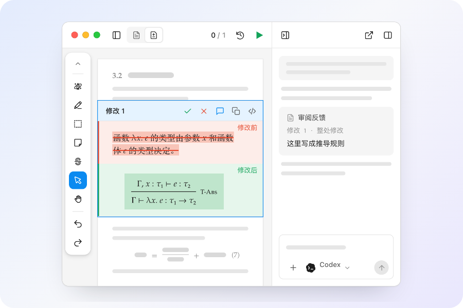

## 审阅排版后的改动

智能体在独立 Git 工作树中改完代码后，Papilot 会自动编译论文并打开 **Review** 审阅界面（桌面端支持 **Review**、**Split**、**Chat** 三种布局；手机端在顶部切换 **Review** 与 **Chat**）：

- **逐条拍板或批量决定**：修改会直接在完整 PDF 原位展示并配全篇改动导航条，每张改动卡片展示排版后的 **Before**（修改前）与 **After**（修改后）版面对比及可展开的 **LaTeX** 源码差异；包含多处编辑的卡片顶部提供编号芯片（`1`、`2`……）支持逐小项独立接受或拒绝。审阅工具栏上的 **Accept all** 与 **Reject all** 只作用于**尚未决定**的改动——你已经接受、拒绝或评论过的条目保持不变，且按一次 **Undo**（`⌘Z` / `Ctrl+Z`）即可整批撤回。
- **双页并排全文对比**：在桌面宽屏（≥ 720 px）的审阅工具栏点击双页按钮，即可将修改前后的完整页面按内容对齐左右并排展示（左删红、右增绿，中间列展示带编号的改动条）；点击改动条或对应修改可同时高亮双侧行并展开接受、拒绝、评论与 LaTeX 源码操作，再次点击或按 `Escape` 取消选中。Papilot 会记住你的布局选择，并在切换时保持当前阅读页、目录、缩放与查找状态同步。
- **参考文献自动核验**：`.bib` 条目的增删改会按完整条目审阅，并自动向 doi.org、arXiv、Crossref 和 DBLP 核对标题、作者与年份（标记为 **Verified**、**Differs from the record**、**Not verified** 或 **Could not check**；可在 **Settings → Review preferences → Check references online** 开关，或随时在侧边栏 **Research Tools → Reference check** 检查全篇文献）。带警告的条目不会被 **Accept all** 自动放行，可核实后手动确认或标记 **I checked it myself**。
- **间接影响追踪与备选改法**：开启 **Settings → Review preferences → Track indirect changes** 后，Papilot 会额外编译检测宏重定义、公式重编号等波及他处的版面变化（显示为 **Affects N places**）；开启 **Prepare alternatives for PDF notes** 则会让智能体在卡片内同时提供可切换预览的备选改法。

## 关键区别：Accept、Apply、Commit 与 Sync

看清改动在每一步所处的位置，就能放心地在正式论文和多人协作项目中使用 AI：

| 操作 | 任务工作树（隔离副本） | 磁盘上的论文原稿文件 | 本地 Git 提交历史 | 远端 Git 仓库 / Overleaf |
| --- | --- | --- | --- | --- |
| **1. 智能体完成本轮修改** | 已写入副本 | 毫发无损 | 未改动 | 未改动 |
| **2. 在卡片上点击 `Accept`** | 在本任务中标为已接受 | **依然未改动** | 未改动 | 未改动 |
| **3. 点击 `Apply`（`Apply to workspace`）** | 任务标为已应用 | **写入原稿文件** | 作为未提交的工作区改动 | 若已关联 **Overleaf** 约 1 秒同步；Git 远端未改动 |
| **4. 点击 `Commit`（`Commit to manuscript`）** | 任务标为已提交 | **写入原稿文件** | 在当前分支**新增一条提交**（仅含本任务已接受改动） | 若已关联 **Overleaf** 约 1 秒同步；**Git 远端依然未推送** |
| **5. `Version Management → Sync`（或 `Push`）** | 不变 | 不变 | 如有远端更新先拉取合并 | **推送到远端 Git 仓库**（如 GitHub） |

**具体示例**：假设你让 Codex 重写第 3 节（共产生 3 处改动），你接受了其中 2 处、拒绝了 1 处。在点击 **Apply** 或 **Commit** 之前，你论文目录里的 `section3.tex` 没有任何变化。点击 **Apply** 会只把那 2 处已接受的修改写进 `section3.tex`（Overleaf 合作者或外部编辑器立刻可见），同时完全保留你在 `intro.tex` 里尚未提交的手写改动；若点击 **Commit**，则会把这 2 处修改写进 `section3.tex` 并单独生成一条干净的 Git commit，依然不会误把 `intro.tex` 一起提交，也不会在你前往 [Git 与版本历史](git-and-history.md)点击 **Sync** 或 **Push** 之前自动推送到 GitHub。

## 对结果不满意时再改一轮，以及被拒绝改动的处理

当某一处修改还不理想时，可以按意图选择**继续打磨**或**直接拒绝**：

- **要求再改一轮（`Comment` → `Send feedback`）**：在卡片上点击 **Comment** 写明具体改法（例如*「把这段话改写成 T-Abs 推导规则」*），然后点击 **Send feedback**（或在聊天框发送补充说明）；你也可以直接在 **After** 预览条上补加批注。如果你把这一轮的所有改动全部点成了 **Reject**，底部同样会出现 **Send feedback**，方便说明原因让智能体在同一任务里重做一轮。
- **点击 `Reject` 后原稿批注去哪了（`0.12.1+`）**：
  1. 被拒绝的改动不会进入论文，审阅卡片恢复显示干净的原文版面。
  2. 与该处改动关联的原稿批注会**自动飞回侧边栏的 `Manuscript` 计数中**——即使拒绝了 AI 的某次尝试，你当初写的批注也绝不会白费或遗失。
  3. 在聊天记录和卡片上，已退回的批注会变淡并显示浅色批注图标：点击该图标可把它重新拉回当前任务继续处理；或者在审阅界面按 `⌘Z` / `Ctrl+Z` 撤销刚才的拒绝，改动与关联批注会一并恢复。
  4. 如果某条批注被智能体遗漏，你也可以在聊天或卡片批注栏上点击带勾的批注图标，手动将它退回 **Manuscript**（按 `⌘Z` / `Ctrl+Z` 可撤销退回），之后随时发给新任务。

## 自己动手修改 LaTeX 源码

遇到改一个词或补一个括号的小事，完全不必再跑一轮智能体：

- **在任务审阅中直接改**：展开任意改动卡片下方的 **LaTeX** 区域，点击文件名旁的**铅笔图标（`Edit`）**，即可在带语法高亮的完整段落源码中直接修改；点击**对勾（`Save and update PDF`，`⌘Enter` / `Ctrl+Enter`）**后，Papilot 会直接保存到任务工作树并立即重新编译排版对比，全程不调用智能体。点 **×** 关闭会保留草稿，点弯箭头（**Reset to saved source**）则放弃草稿恢复已保存源码。
- **在原稿中直接改**：在 Manuscript PDF 工具栏选 **Edit source（`E`）** 点击页面段落，或点击侧边栏 **Manuscript** 下的主文件名打开 **Files** 选择任意文本文件，即可在 PDF 旁的 **Source** 标签页直接编辑保存并触发自动编译。
