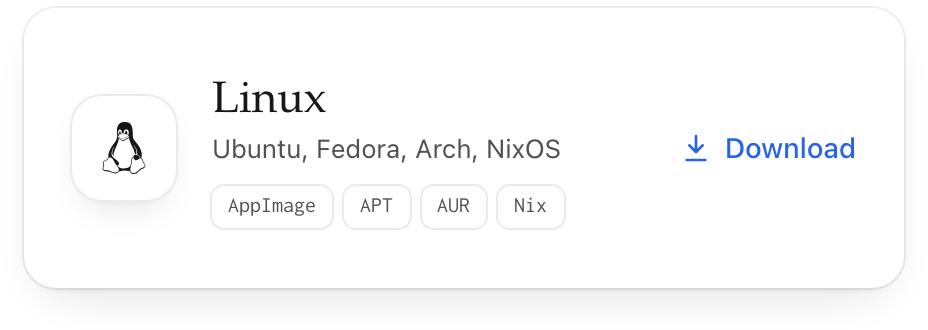

 **KI-gestützter LaTeX-Editor der nächsten Generation**

<h3>Kein&nbsp;Lesen&nbsp;oder&nbsp;Schreiben&nbsp;von&nbsp;<code>.tex</code>&emsp; Arbeiten&nbsp;Sie&nbsp;direkt&nbsp;im&nbsp;</h3>

<a href="https://papilot.ai"><b>papilot.ai</b></a>&emsp;<a href="https://papilot.ai/demo">Online-Demo</a>&emsp;<a href="#get-started">Erste Schritte</a>&emsp;<a href="#agents">Agenten</a>&emsp;<a href="#how-it-works">Funktionsweise</a>

<!-- BEGIN BADGES -->

<!-- END BADGES -->

<a href="../../README.md">English</a>&emsp;<a href="README.zh-CN.md">简体中文</a>&emsp;<a href="README.zh-Hant.md">繁體中文</a>&emsp;<a href="README.ja.md">日本語</a>&emsp;<a href="README.ko.md">한국어</a>&emsp;<a href="README.de.md">Deutsch</a>&emsp;<a href="README.fr.md">Français</a>&emsp;<a href="README.es.md">Español</a>&emsp;<a href="README.pt.md">Português</a>&emsp;<a href="README.it.md">Italiano</a>&emsp;<a href="README.sv.md">Svenska</a>

<a href="https://papilot.ai">
<picture>
  <source media="(prefers-color-scheme: dark) and (max-width: 600px)" srcset="../assets/readme-showcase/hero-compact-dark.png">
  <source media="(prefers-color-scheme: dark)" srcset="../assets/readme-showcase/hero-dark.png">
  <source media="(max-width: 600px)" srcset="../assets/readme-showcase/hero-compact.png">
  
</picture>
</a>

## Warum Papilot

<table>
<tr>
<td width="50%" valign="top">
<picture><source media="(prefers-color-scheme: dark)" srcset="../assets/readme-showcase/why-annotate-dark.png"></picture> 
<b>Direkt auf der Seite markieren</b> 
Markieren Sie einen Satz oder rahmen Sie eine Gleichung bzw. Abbildung ein und schreiben Sie, was geändert werden soll. Ihr Agent erhält die exakten Quellzeilen – unabhängig davon, in welcher Datei sie liegen.
</td>
<td width="50%" valign="top">
<picture><source media="(prefers-color-scheme: dark)" srcset="../assets/readme-showcase/why-review-dark.png"></picture> 
<b>Jede Änderung fertig gesetzt überprüfen</b> 
Jede Bearbeitung wird als Vorher-Nachher-Vergleich im PDF angezeigt. Übernehmen, ablehnen oder kommentieren Sie den Vorschlag – nichts gelangt in Ihren Artikel, bevor Sie es übernehmen.
</td>
</tr>
<tr>
<td width="50%" valign="top">
<picture><source media="(prefers-color-scheme: dark)" srcset="../assets/readme-showcase/why-overleaf-dark.png"></picture> 
<b><picture><source media="(prefers-color-scheme: dark)" srcset="../assets/readme-icons/overleaf-dark.svg"></picture>&nbsp;Live-Synchronisierung mit Overleaf</b> 
Mitautoren schreiben wie gewohnt in Overleaf weiter. Ihre übernommenen Änderungen kommen dort in etwa einer Sekunde an, und deren Änderungen erscheinen mit Namen in Ihren Dateien und im PDF.
</td>
<td width="50%" valign="top">
<picture><source media="(prefers-color-scheme: dark)" srcset="../assets/readme-showcase/why-agents-dark.png"></picture> 
<b>Jeder Agent, jedes Modell</b> 
Wählen Sie unter dem Chat ein Modell eines beliebigen verbundenen Agenten aus. Wechseln Sie zu einem anderen Agenten, und Papilot führt Ihre Anfrage erneut damit aus.
</td>
</tr>
<tr>
<td width="50%" valign="top">
<picture><source media="(prefers-color-scheme: dark)" srcset="../assets/readme-showcase/why-record-dark.png"></picture> 
<b>Jede Änderung nachvollziehbar</b> 
Jede Aufgabe läuft in ihrem eigenen Git-Arbeitsbaum, getrennt von Ihren Dateien. Das Committen übernommener Änderungen ist ein separater Schritt, und jede Änderung bleibt in Ihrem Git-Verlauf erhalten.
</td>
<td width="50%" valign="top">
<picture><source media="(prefers-color-scheme: dark)" srcset="../assets/readme-showcase/why-phone-dark.png"></picture> 
<b>Überprüfung auf dem Smartphone</b> 
Öffnen Sie Papilot auf Ihrem Smartphone oder Tablet über <a href="../guide.md#remote-access-with-tailscale">Tailscale</a>, um das PDF unterwegs zu lesen, mit Anmerkungen zu versehen und Änderungen zu übernehmen.
</td>
</tr>
<tr>
<td colspan="2" valign="top">
<picture><source media="(prefers-color-scheme: dark)" srcset="../assets/readme-showcase/why-universe-dark.png"></picture> 
<b>Mit einer Vorlage beginnen</b> 
<a href="https://papilot.ai/universe/">Papilot Universe</a> bietet Vorlagen für Abschlussarbeiten, Fachzeitschriften, Konferenzen, Präsentationen, Poster, Lebensläufe und Bücher und verknüpft über 400 Konferenzen direkt mit der im jeweiligen Call for Papers geforderten Vorlage. Wählen Sie eine Vorlage aus, und Papilot erstellt den Artikel kompilierfertig.
</td>
</tr>
</table>

## Erste Schritte

<a href="https://papilot.ai/#download"><picture><source media="(prefers-color-scheme: dark) and (max-width: 600px)" srcset="../assets/readme-downloads/mac-compact-dark.png"><source media="(prefers-color-scheme: dark)" srcset="../assets/readme-downloads/mac-dark.png"><source media="(max-width: 600px)" srcset="../assets/readme-downloads/mac-compact.png"></picture></a>
<a href="https://papilot.ai/#download"><picture><source media="(prefers-color-scheme: dark) and (max-width: 600px)" srcset="../assets/readme-downloads/windows-compact-dark.png"><source media="(prefers-color-scheme: dark)" srcset="../assets/readme-downloads/windows-dark.png"><source media="(max-width: 600px)" srcset="../assets/readme-downloads/windows-compact.png"></picture></a>
<a href="https://papilot.ai/#download"><picture><source media="(prefers-color-scheme: dark) and (max-width: 600px)" srcset="../assets/readme-downloads/linux-compact-dark.png"><source media="(prefers-color-scheme: dark)" srcset="../assets/readme-downloads/linux-dark.png"><source media="(max-width: 600px)" srcset="../assets/readme-downloads/linux-compact.png"></picture></a>
<a href="../guide.md#install-and-run"><picture><source media="(prefers-color-scheme: dark) and (max-width: 600px)" srcset="../assets/readme-downloads/terminal-compact-dark.png"><source media="(prefers-color-scheme: dark)" srcset="../assets/readme-downloads/terminal-dark.png"><source media="(max-width: 600px)" srcset="../assets/readme-downloads/terminal-compact.png"></picture></a>

Kostenlos und Open Source. Erfordert Git, eine TeX-Distribution und einen angemeldeten <a href="#agents">Agenten</a>.

## Funktioniert mit Ihrem Agenten

  <a href="../guide.md#agents">
    <picture>
      <source media="(prefers-color-scheme: dark) and (max-width: 600px)" srcset="../assets/readme-agents/grid-compact-dark.png">
      <source media="(prefers-color-scheme: dark)" srcset="../assets/readme-agents/grid-dark.png">
      <source media="(max-width: 600px)" srcset="../assets/readme-agents/grid-compact.png">
      
    </picture>
  </a>

Nutzen Sie Ihr vorhandenes Konto bzw. Ihren API-Schlüssel oder verwenden Sie den integrierten Papilot Writer. <a href="../guide.md#agents">Einrichtung</a>

## Funktionsweise

  <picture>
    <source media="(prefers-color-scheme: dark) and (max-width: 600px)" srcset="../assets/readme-showcase/flow-compact-dark.png">
    <source media="(prefers-color-scheme: dark)" srcset="../assets/readme-showcase/flow-dark.png">
    <source media="(max-width: 600px)" srcset="../assets/readme-showcase/flow-compact.png">
    
  </picture>

## Community

<a href="https://github.com/PapilotAI/papilot/issues/new/choose"><picture><source media="(prefers-color-scheme: dark) and (max-width: 600px)" srcset="../assets/readme-community/issue-compact-dark.png"><source media="(prefers-color-scheme: dark)" srcset="../assets/readme-community/issue-dark.png"><source media="(max-width: 600px)" srcset="../assets/readme-community/issue-compact.png"></picture></a>
<a href="https://github.com/PapilotAI/papilot/discussions"><picture><source media="(prefers-color-scheme: dark) and (max-width: 600px)" srcset="../assets/readme-community/discussion-compact-dark.png"><source media="(prefers-color-scheme: dark)" srcset="../assets/readme-community/discussion-dark.png"><source media="(max-width: 600px)" srcset="../assets/readme-community/discussion-compact.png"></picture></a>
<a href="https://discord.gg/WdgZDDAvwj"><picture><source media="(prefers-color-scheme: dark) and (max-width: 600px)" srcset="../assets/readme-community/discord-compact-dark.png"><source media="(prefers-color-scheme: dark)" srcset="../assets/readme-community/discord-dark.png"><source media="(max-width: 600px)" srcset="../assets/readme-community/discord-compact.png"></picture></a>
<a href="../../.github/CONTRIBUTING.md"><picture><source media="(prefers-color-scheme: dark) and (max-width: 600px)" srcset="../assets/readme-community/contribute-compact-dark.png"><source media="(prefers-color-scheme: dark)" srcset="../assets/readme-community/contribute-dark.png"><source media="(max-width: 600px)" srcset="../assets/readme-community/contribute-compact.png"></picture></a>

Papilot veröffentlicht regelmäßig Updates: siehe das [Änderungsprotokoll](../../CHANGELOG.md).

## Mitwirkende

  <a href="https://github.com/PapilotAI/papilot/graphs/contributors">
    <picture>
      <source media="(max-width: 600px)" srcset="https://papilot.ai/readme-contributors/compact.svg">
      
    </picture>
  </a>

## Star-Verlauf

Wenn Papilot Ihnen Zeit spart, hilft ein Star anderen Forschenden, das Projekt zu finden.

<a href="https://www.star-history.com/?repos=papilotai%2Fpapilot&type=date&legend=bottom-right">
 <picture>
   <source media="(prefers-color-scheme: dark)" srcset="https://api.star-history.com/chart?repos=papilotai/papilot&type=date&theme=dark&legend=bottom-right" />
   <source media="(prefers-color-scheme: light)" srcset="https://api.star-history.com/chart?repos=papilotai/papilot&type=date&legend=bottom-right" />
   
 </picture>
</a>

---

<a href="../../LICENSE">MIT</a> © 2026 PapilotAI. Vielen Dank an unsere Freunde bei <a href="https://linux.do/">LINUX DO</a>.

