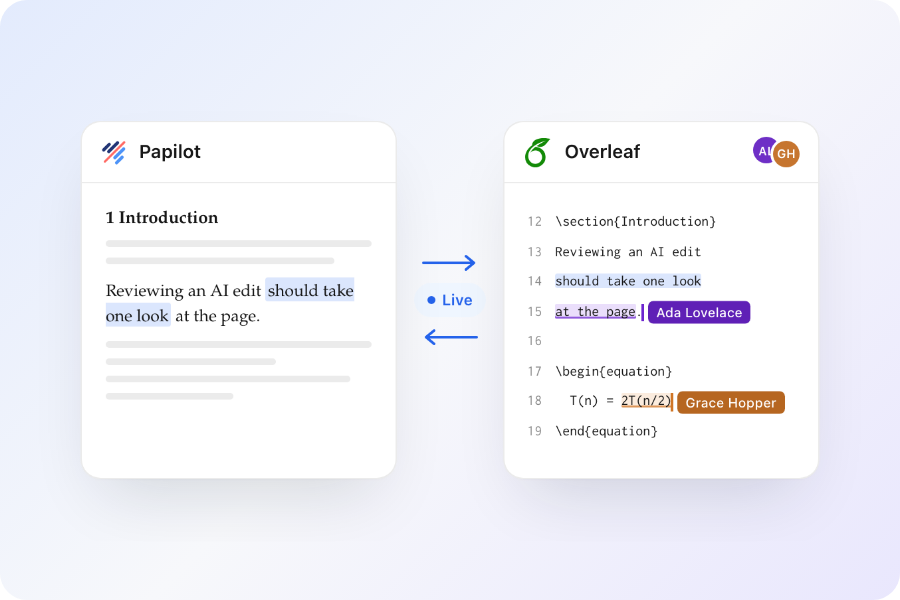

<div align="center">

<br>**Editor de LaTeX con IA de nueva generación**

<h3>No&nbsp;leas&nbsp;ni&nbsp;escribas&nbsp;<code>.tex</code>&emsp; Trabaja&nbsp;directamente&nbsp;sobre&nbsp;el&nbsp;</h3>

<a href="https://papilot.ai"><b>papilot.ai</b></a>&emsp;<a href="https://papilot.ai/demo">Demo en línea</a>&emsp;<a href="#get-started">Primeros pasos</a>&emsp;<a href="#agents">Agentes</a>&emsp;<a href="#how-it-works">Cómo funciona</a>

<!-- BEGIN BADGES -->
[](../../LICENSE)
[](https://github.com/PapilotAI/papilot/actions/workflows/ci.yml)
[](https://github.com/PapilotAI/papilot/releases/latest)
[](https://github.com/PapilotAI/papilot/releases)
[](https://www.npmjs.com/package/papilot)
[](https://github.com/PapilotAI/papilot/stargazers)
[](https://discord.gg/WdgZDDAvwj)
<!-- END BADGES -->

<p data-language-switcher><sub><a href="../../README.md">English</a>&emsp;<a href="README.zh-CN.md">简体中文</a>&emsp;<a href="README.zh-Hant.md">繁體中文</a>&emsp;<a href="README.ja.md">日本語</a>&emsp;<a href="README.ko.md">한국어</a>&emsp;<a href="README.de.md">Deutsch</a>&emsp;<a href="README.fr.md">Français</a>&emsp;<a href="README.es.md">Español</a>&emsp;<a href="README.pt.md">Português</a>&emsp;<a href="README.it.md">Italiano</a>&emsp;<a href="README.sv.md">Svenska</a></sub></p>

</div>

<p align="center">
<a href="https://papilot.ai">
<picture>
  <source media="(prefers-color-scheme: dark) and (max-width: 600px)" srcset="../assets/readme-showcase/hero-compact-dark.png">
  <source media="(prefers-color-scheme: dark)" srcset="../assets/readme-showcase/hero-dark.png">
  <source media="(max-width: 600px)" srcset="../assets/readme-showcase/hero-compact.png">
  
</picture>
</a>
</p>

<a id="features"></a>

<a id="why-papilot"></a>

## Por qué Papilot

<table>
<tr>
<td width="50%" valign="top">
<picture><source media="(prefers-color-scheme: dark)" srcset="../assets/readme-showcase/why-annotate-dark.png"></picture><br>
<b>Señala en la página</b><br>
Selecciona una frase o enmarca una ecuación o una figura, y escribe qué debe cambiar. Tu agente recibe las líneas exactas del código fuente, estén en el archivo que estén.
</td>
<td width="50%" valign="top">
<picture><source media="(prefers-color-scheme: dark)" srcset="../assets/readme-showcase/why-review-dark.png"></picture><br>
<b>Revisa cada cambio ya compuesto</b><br>
Cada edición vuelve como un antes y después sobre el PDF. Acéptala, recházala o coméntala; nada llega a tu artículo hasta que lo aceptas.
</td>
</tr>
<tr>
<td width="50%" valign="top">
<picture><source media="(prefers-color-scheme: dark)" srcset="../assets/readme-showcase/why-overleaf-dark.png"></picture><br>
<b><picture><source media="(prefers-color-scheme: dark)" srcset="../assets/readme-icons/overleaf-dark.svg"></picture>&nbsp;Sincronización en vivo con Overleaf</b><br>
Los coautores siguen escribiendo en Overleaf. Tus cambios aceptados les llegan en alrededor de un segundo, y los suyos aparecen en tus archivos y en el PDF con sus nombres.
</td>
<td width="50%" valign="top">
<picture><source media="(prefers-color-scheme: dark)" srcset="../assets/readme-showcase/why-agents-dark.png"></picture><br>
<b>Cualquier agente, cualquier modelo</b><br>
Elige un modelo de cualquier agente conectado debajo del chat. Cambia a otro agente y Papilot vuelve a ejecutar tu solicitud con él.
</td>
</tr>
<tr>
<td width="50%" valign="top">
<picture><source media="(prefers-color-scheme: dark)" srcset="../assets/readme-showcase/why-record-dark.png"></picture><br>
<b>Cada cambio queda registrado</b><br>
Cada tarea se ejecuta en su propio árbol de trabajo de Git, separada de tus archivos. Confirmar los cambios aceptados es un paso independiente, y cada cambio permanece en tu historial de Git.
</td>
<td width="50%" valign="top">
<picture><source media="(prefers-color-scheme: dark)" srcset="../assets/readme-showcase/why-phone-dark.png"></picture><br>
<b>Revisa desde el móvil</b><br>
Abre Papilot en tu teléfono o tableta mediante <a href="../guide.md#remote-access-with-tailscale">Tailscale</a> y luego lee el PDF, añade anotaciones y acepta cambios lejos de tu escritorio.
</td>
</tr>
<tr>
<td colspan="2" valign="top">
<picture><source media="(prefers-color-scheme: dark)" srcset="../assets/readme-showcase/why-universe-dark.png"></picture><br>
<b>Empieza desde una plantilla</b><br>
<a href="https://papilot.ai/universe/">Papilot Universe</a> incluye tesis, paquetes para revistas y congresos, presentaciones, pósteres, CV y libros, y vincula más de 400 congresos con la plantilla exigida en su convocatoria de artículos. Elige una y Papilot creará el artículo, listo para compilar.
</td>
</tr>
</table>

<a id="quick-start"></a>
<a id="get-started"></a>
<a id="downloads"></a>

<a id="get-started"></a>

## Primeros pasos

<p align="center">
<a href="https://papilot.ai/#download"><picture><source media="(prefers-color-scheme: dark) and (max-width: 600px)" srcset="../assets/readme-downloads/mac-compact-dark.png"><source media="(prefers-color-scheme: dark)" srcset="../assets/readme-downloads/mac-dark.png"><source media="(max-width: 600px)" srcset="../assets/readme-downloads/mac-compact.png"></picture></a>
<a href="https://papilot.ai/#download"><picture><source media="(prefers-color-scheme: dark) and (max-width: 600px)" srcset="../assets/readme-downloads/windows-compact-dark.png"><source media="(prefers-color-scheme: dark)" srcset="../assets/readme-downloads/windows-dark.png"><source media="(max-width: 600px)" srcset="../assets/readme-downloads/windows-compact.png"></picture></a>
<a href="https://papilot.ai/#download"><picture><source media="(prefers-color-scheme: dark) and (max-width: 600px)" srcset="../assets/readme-downloads/linux-compact-dark.png"><source media="(prefers-color-scheme: dark)" srcset="../assets/readme-downloads/linux-dark.png"><source media="(max-width: 600px)" srcset="../assets/readme-downloads/linux-compact.png"></picture></a>
<a href="../guide.md#install-and-run"><picture><source media="(prefers-color-scheme: dark) and (max-width: 600px)" srcset="../assets/readme-downloads/terminal-compact-dark.png"><source media="(prefers-color-scheme: dark)" srcset="../assets/readme-downloads/terminal-dark.png"><source media="(max-width: 600px)" srcset="../assets/readme-downloads/terminal-compact.png"></picture></a>
</p>

<details>
<summary><picture><source media="(prefers-color-scheme: dark) and (max-width: 600px)" srcset="../assets/readme-downloads/pm-bar-compact-dark.png"><source media="(prefers-color-scheme: dark)" srcset="../assets/readme-downloads/pm-bar-dark.png"><source media="(max-width: 600px)" srcset="../assets/readme-downloads/pm-bar-compact.png"></picture></summary>

<table>
<tr>
<td width="50%" valign="top">
<picture><source media="(prefers-color-scheme: dark)" srcset="../assets/readme-icons/homebrew-dark.svg"></picture>&nbsp;<b>macOS</b> · <a href="https://github.com/PapilotAI/homebrew-tap">Homebrew</a>

```sh
brew tap PapilotAI/tap
brew trust PapilotAI/tap
brew install --cask PapilotAI/tap/papilot
```

<sub>Sin firma — permite la app en Privacidad y seguridad al abrirla por primera vez (<a href="https://github.com/PapilotAI/homebrew-tap#gatekeeper-note">detalles</a>).</sub>
</td>
<td width="50%" valign="top">
<picture><source media="(prefers-color-scheme: dark)" srcset="../assets/readme-icons/scoop-dark.svg"></picture>&nbsp;<b>Windows</b> · <a href="https://github.com/PapilotAI/scoop-bucket">Scoop</a>

```powershell
scoop bucket add papilot https://github.com/PapilotAI/scoop-bucket
scoop install papilot/papilot
```

<sub>Actualiza en cualquier momento con <code>scoop update papilot</code>.</sub>
</td>
</tr>
<tr>
<td width="50%" valign="top">
<picture><source media="(prefers-color-scheme: dark)" srcset="../assets/readme-icons/debian-dark.svg"></picture>&nbsp;<picture><source media="(prefers-color-scheme: dark)" srcset="../assets/readme-icons/ubuntu-dark.svg"></picture>&nbsp;<b>Debian / Ubuntu</b> · <a href="../apt.md">APT</a>

```sh
curl -fsSL https://papilot.ai/apt/gpg.key | \
  sudo gpg --dearmor -o /etc/apt/keyrings/papilot.gpg
echo "deb [arch=amd64 signed-by=/etc/apt/keyrings/papilot.gpg] https://papilot.ai/apt stable main" | \
  sudo tee /etc/apt/sources.list.d/papilot.list
sudo apt update && sudo apt install papilot
```

<sub>Repositorio firmado — verifica la huella en la <a href="../apt.md">guía de APT</a>.</sub>
</td>
<td width="50%" valign="top">
<picture><source media="(prefers-color-scheme: dark)" srcset="../assets/readme-icons/archlinux-dark.svg"></picture>&nbsp;<b>Arch</b> · <a href="../aur.md">AUR</a> &nbsp;&amp;&nbsp; <picture><source media="(prefers-color-scheme: dark)" srcset="../assets/readme-icons/nixos-dark.svg"></picture>&nbsp;<b>Nix</b> · <a href="../nix.md">Flake</a>

```sh
# Arch Linux (AUR)
paru -S papilot-bin

# Nix
nix run github:PapilotAI/papilot -- demo
```

<sub>Consulta la <a href="../aur.md">guía de Arch</a> y la <a href="../nix.md">guía de Nix</a>.</sub>
</td>
</tr>
</table>

</details>

<p align="center"><sub>Gratuito y de código abierto. Requiere Git, una distribución de TeX y un <a href="#agents">agente</a> con sesión iniciada.</sub></p>

<a id="agents"></a>

<a id="works-with-your-agent"></a>

## Funciona con tu agente

<p align="center">
  <a href="../guide.md#agents">
    <picture>
      <source media="(prefers-color-scheme: dark) and (max-width: 600px)" srcset="../assets/readme-agents/grid-compact-dark.png">
      <source media="(prefers-color-scheme: dark)" srcset="../assets/readme-agents/grid-dark.png">
      <source media="(max-width: 600px)" srcset="../assets/readme-agents/grid-compact.png">
      
    </picture>
  </a>
</p>

<p align="center"><sub>Usa la cuenta o clave de API que ya tengas, o utiliza el Papilot Writer integrado. <a href="../guide.md#agents">Configuración</a></sub></p>

<a id="how-it-works"></a>

<a id="how-it-works"></a>

## Cómo funciona

<p align="center">
  <picture>
    <source media="(prefers-color-scheme: dark) and (max-width: 600px)" srcset="../assets/readme-showcase/flow-compact-dark.png">
    <source media="(prefers-color-scheme: dark)" srcset="../assets/readme-showcase/flow-dark.png">
    <source media="(max-width: 600px)" srcset="../assets/readme-showcase/flow-compact.png">
    
  </picture>
</p>

<a id="documentation-and-community"></a>

<a id="community"></a>

## Comunidad

<p align="center">
<a href="https://github.com/PapilotAI/papilot/issues/new/choose"><picture><source media="(prefers-color-scheme: dark) and (max-width: 600px)" srcset="../assets/readme-community/issue-compact-dark.png"><source media="(prefers-color-scheme: dark)" srcset="../assets/readme-community/issue-dark.png"><source media="(max-width: 600px)" srcset="../assets/readme-community/issue-compact.png"></picture></a>
<a href="https://github.com/PapilotAI/papilot/discussions"><picture><source media="(prefers-color-scheme: dark) and (max-width: 600px)" srcset="../assets/readme-community/discussion-compact-dark.png"><source media="(prefers-color-scheme: dark)" srcset="../assets/readme-community/discussion-dark.png"><source media="(max-width: 600px)" srcset="../assets/readme-community/discussion-compact.png"></picture></a>
<a href="https://discord.gg/WdgZDDAvwj"><picture><source media="(prefers-color-scheme: dark) and (max-width: 600px)" srcset="../assets/readme-community/discord-compact-dark.png"><source media="(prefers-color-scheme: dark)" srcset="../assets/readme-community/discord-dark.png"><source media="(max-width: 600px)" srcset="../assets/readme-community/discord-compact.png"></picture></a>
<a href="../../.github/CONTRIBUTING.md"><picture><source media="(prefers-color-scheme: dark) and (max-width: 600px)" srcset="../assets/readme-community/contribute-compact-dark.png"><source media="(prefers-color-scheme: dark)" srcset="../assets/readme-community/contribute-dark.png"><source media="(max-width: 600px)" srcset="../assets/readme-community/contribute-compact.png"></picture></a>
</p>

Papilot publica actualizaciones con frecuencia: consulta el [registro de cambios](../../CHANGELOG.md).

<a id="contributors"></a>

## Colaboradores

<p>
  <a href="https://github.com/PapilotAI/papilot/graphs/contributors">
    <picture>
      <source media="(max-width: 600px)" srcset="https://papilot.ai/readme-contributors/compact.svg">
      
    </picture>
  </a>
</p>

<a id="star-history"></a>

## Historial de estrellas

Si Papilot te ahorra tiempo, una estrella ayuda a que otros investigadores lo descubran.

<a href="https://www.star-history.com/?repos=papilotai%2Fpapilot&type=date&legend=bottom-right">
 <picture>
   <source media="(prefers-color-scheme: dark)" srcset="https://api.star-history.com/chart?repos=papilotai/papilot&type=date&theme=dark&legend=bottom-right" />
   <source media="(prefers-color-scheme: light)" srcset="https://api.star-history.com/chart?repos=papilotai/papilot&type=date&legend=bottom-right" />
   
 </picture>
</a>

---

<p align="center"><sub><a href="../../LICENSE">MIT</a> © 2026 PapilotAI. Gracias a nuestros amigos de <a href="https://linux.do/">LINUX DO</a>.</sub></p>
