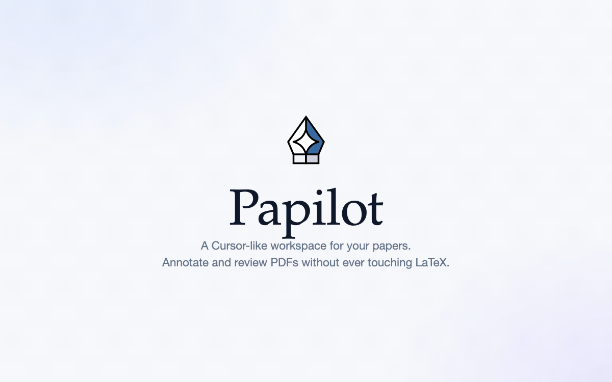
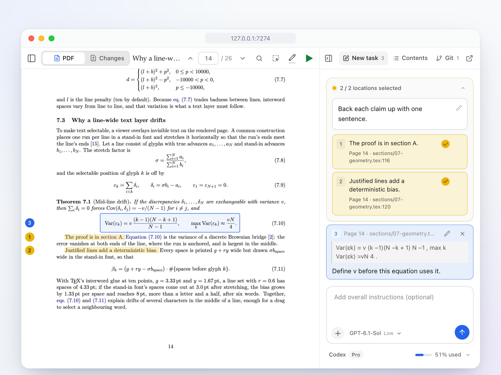
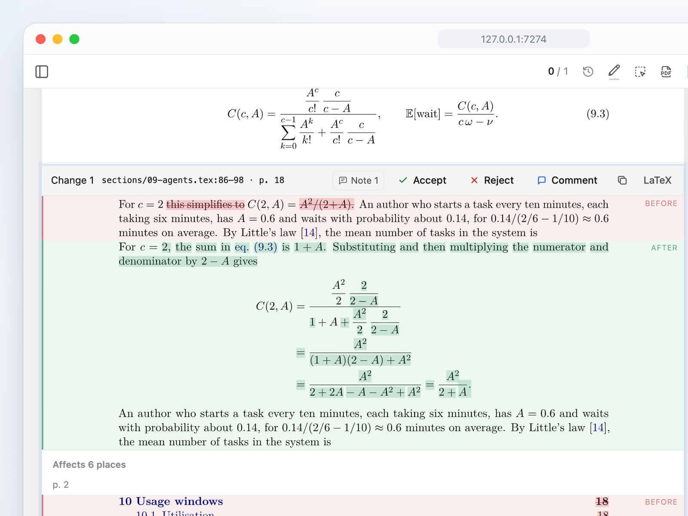
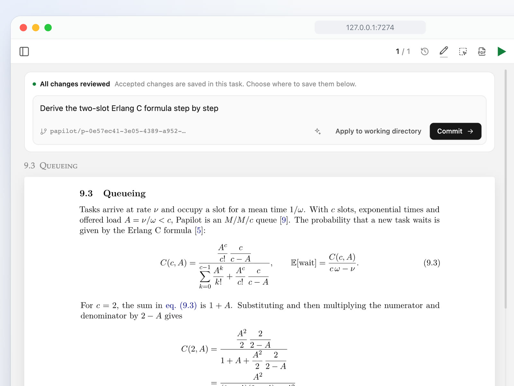
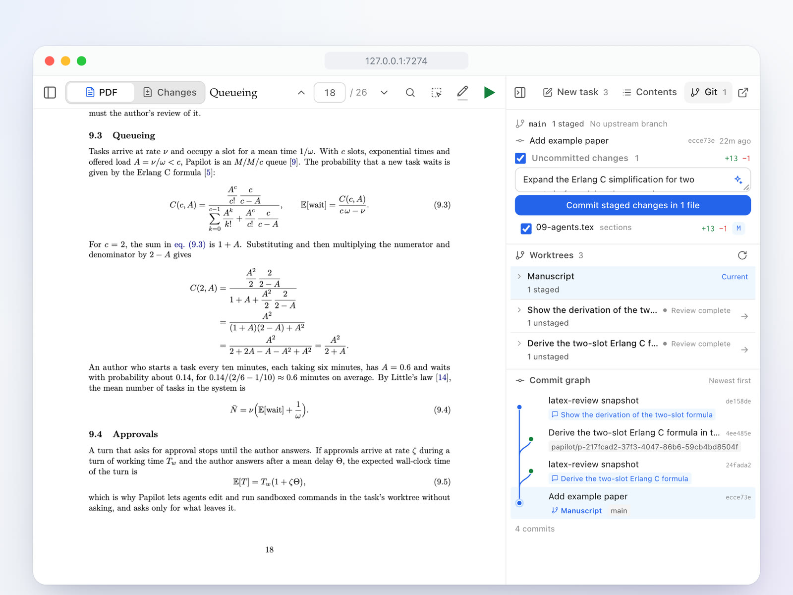
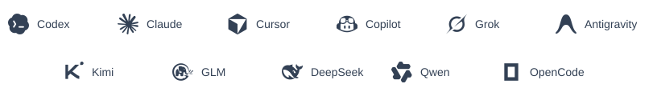

<div align="center">

<h1>
  
  
</h1>

<p><b>Edita artículos en LaTeX con IA y revisa los cambios en el PDF.</b></p>

<p><a href="https://papilot.ai">Sitio web</a> · <a href="../guide.md">Documentación</a></p>

<p data-language-switcher><a href="../../README.md">English</a> · <a href="README.zh-CN.md">简体中文</a> · <a href="README.zh-Hant.md">繁體中文</a> · <a href="README.ja.md">日本語</a> · <a href="README.ko.md">한국어</a> · <a href="README.de.md">Deutsch</a> · <a href="README.fr.md">Français</a> · <a href="README.es.md">Español</a> · <a href="README.pt.md">Português</a> · <a href="README.it.md">Italiano</a> · <a href="README.sv.md">Svenska</a></p>

[](https://github.com/PapilotAI/papilot/actions/workflows/ci.yml)
[](https://www.npmjs.com/package/papilot)
[](../../LICENSE)

<p></p>

</div>

Papilot es un espacio de trabajo local para redactar y editar artículos en LaTeX con agentes de IA. Marca pasajes y ecuaciones en el PDF, deja que un agente edite una copia independiente del código fuente y luego revisa los cambios maquetados y elige cuáles conservar.

<a id="features"></a>

## Características

<table>
<tr>
<td width="50%" valign="top">
<a href="../assets/readme-note.jpg"></a>
<h3>Anota el PDF</h3>
Selecciona una oración o enmarca una ecuación e indica qué debe cambiar. Agrupa las anotaciones relacionadas por color para dar una misma instrucción a varios pasajes.
</td>
<td width="50%" valign="top">
<a href="../assets/readme-review.jpg"></a>
<h3>Revisa cada cambio</h3>
Compara las páginas maquetadas antes y después, incluidos los cambios en otras partes como ecuaciones renumeradas. Acepta, rechaza o comenta cada edición, y deshaz decisiones durante la revisión.
</td>
</tr>
<tr>
<td width="50%" valign="top">
<a href="../assets/readme-deliver.jpg"></a>
<h3>Elige adónde van las ediciones</h3>
Cada nueva tarea trabaja en su propia copia del artículo. Revisa las ediciones y luego elige **Confirmar en el manuscrito** para guardar esta tarea como una confirmación en tu rama actual, o **Aplicar al espacio de trabajo** para dejar las ediciones sin confirmar. Si el mismo pasaje cambió mientras tanto, la IA resuelve el conflicto automáticamente y solo te pregunta cuando el contenido previsto no está claro. Revisa el PDF fusionado antes de guardar. Sube los cambios desde el panel de Git cuando estés listo.
</td>
<td width="50%" valign="top">
<a href="../assets/readme-git.jpg"></a>
<h3>Trabaja con Git</h3>
Prepara y confirma archivos, descarga y sube cambios desde el espacio de trabajo. Un agente puede redactar mensajes de confirmación y ayudar a resolver conflictos de fusión; el gráfico de confirmaciones muestra el árbol de trabajo de cada tarea.
</td>
</tr>
</table>

- **[Habilidades](../guide.md#skills) y [archivos adjuntos](../guide.md#task-attachments):** Ejecuta habilidades con `/` para pulir la prosa, corregir el texto o verificar las matemáticas, define habilidades personalizadas en Configuración y adjunta archivos o imágenes de referencia a tareas y mensajes.
- **Lectura y espacio de trabajo:** Navega por los manuscritos con la tabla de contenido del PDF y la búsqueda de texto completo, con temas claro y oscuro y una interfaz en inglés o chino.

<a id="quick-start"></a>

## Inicio rápido

Para las aplicaciones de escritorio de macOS y Linux y las instrucciones de compilación local, consulta [Papilot Desktop](../../desktop/README.md). La CI de escritorio genera instaladores para Mac con Apple Silicon e Intel, además de paquetes AppImage y deb para Linux x64.

Papilot requiere **Node.js 22.22+**, **Git** y una distribución completa de **TeX** con `latexmk` y `synctex` ([MacTeX](https://www.tug.org/mactex/) o [TeX Live](https://www.tug.org/texlive/)). Editar un artículo también requiere al menos un [agente](#agents) configurado.

```sh
npm install -g papilot
papilot demo
```

Abre [http://127.0.0.1:7274](http://127.0.0.1:7274) y selecciona **Manuscrito** en la barra lateral para explorar el artículo de ejemplo incluido.

Para trabajar en tu propio manuscrito, ejecuta `papilot` y elige **Añadir artículo…** para abrir una carpeta local de LaTeX o un archivo ZIP. Papilot busca el archivo `.tex` principal, prepara el historial de Git cuando es necesario e intenta la compilación. Si el archivo principal es ambiguo o la compilación falla, el diálogo de importación te ayuda a elegir un archivo o solucionar el problema.

Comprueba tu configuración en **Configuración → Entorno de ejecución**, en **Agentes** o **LaTeX**. Ejecuta `papilot doctor` para comprobar el entorno, o `papilot doctor --repo /path/to/paper` para comprobar también un manuscrito ([diagnóstico](../guide.md#diagnostics)).

<a id="agents"></a>

## Agentes

<!-- BEGIN AGENT ICONS -->
<p align="center">
  <a href="../guide.md#agents">
    <picture>
      <source media="(prefers-color-scheme: dark) and (max-width: 600px)" srcset="../assets/readme-agents/compact-dark.svg">
      <source media="(prefers-color-scheme: dark)" srcset="../assets/readme-agents/desktop-dark.svg">
      <source media="(max-width: 600px)" srcset="../assets/readme-agents/compact.svg">
      
    </picture>
  </a>
</p>
<!-- END AGENT ICONS -->

Puedes elegir un agente y un modelo para cada tarea. Según la integración, Papilot ejecuta los agentes mediante su inicio de sesión en la CLI local o con las credenciales de API del proveedor que proporciones, sin almacenar tus claves.

Abre **Configuración → Entorno de ejecución → Agentes** para consultar el estado, los modelos y las instrucciones de configuración (como `papilot codex login`). Haz clic en **Reconectar** después de instalar o iniciar sesión en un agente mientras Papilot está en ejecución, o reinicia `papilot` tras cambiar las variables de entorno. Consulta la [guía de agentes](../guide.md#agents) para ver los requisitos y capacidades de cada agente.

<a id="documentation-and-community"></a>

## Documentación y comunidad

- **Documentación:** Lee la [Guía del usuario](../guide.md) para conocer los flujos de trabajo del espacio de trabajo, la configuración, las [actualizaciones desde la aplicación](../guide.md#updates), el [acceso remoto con Tailscale](../guide.md#remote-access-with-tailscale) y el [uso compartido de llaves de acceso para colaboradores](../guide.md#collaborators).
- **Diseño e historia:** Explora [`examples/papilot-paper`](../../examples/papilot-paper) para ver el artículo formal de diseño y las demostraciones, y consulta el [Registro de cambios](../../CHANGELOG.md) para ver las notas de la versión.
- **Comunidad y soporte:** Haz preguntas en [Debates](https://github.com/PapilotAI/papilot/discussions), informa de errores en [Incidencias](https://github.com/PapilotAI/papilot/issues) o lee [CONTRIBUTING.md](../../.github/CONTRIBUTING.md) para contribuir.

---

[MIT](../../LICENSE) © 2026 PapilotAI

Amigos: [LINUX DO](https://linux.do/).
