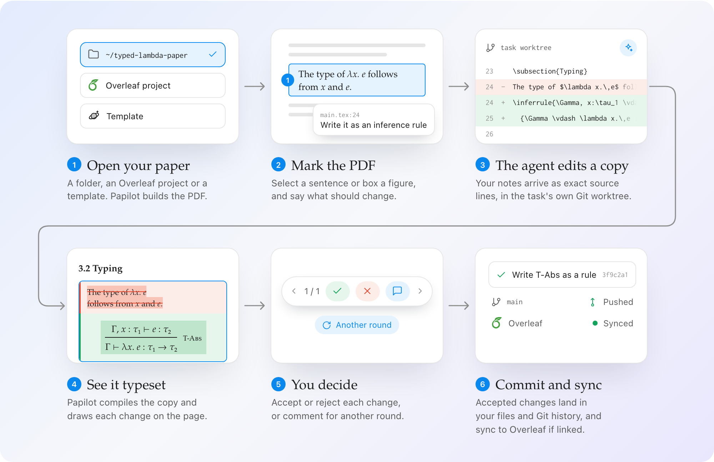

 **Éditeur LaTeX IA de nouvelle génération**

<h3>Ne&nbsp;lisez&nbsp;et&nbsp;n'écrivez&nbsp;plus&nbsp;de&nbsp;<code>.tex</code>&emsp; Travaillez&nbsp;directement&nbsp;sur&nbsp;le&nbsp;</h3>

<a href="https://papilot.ai"><b>papilot.ai</b></a>&emsp;<a href="https://papilot.ai/demo">Démo en ligne</a>&emsp;<a href="#get-started">Prise en main</a>&emsp;<a href="#agents">Agents</a>&emsp;<a href="#how-it-works">Fonctionnement</a>

<!-- BEGIN BADGES -->

<!-- END BADGES -->

<a href="../../README.md">English</a>&emsp;<a href="README.zh-CN.md">简体中文</a>&emsp;<a href="README.zh-Hant.md">繁體中文</a>&emsp;<a href="README.ja.md">日本語</a>&emsp;<a href="README.ko.md">한국어</a>&emsp;<a href="README.de.md">Deutsch</a>&emsp;<a href="README.fr.md">Français</a>&emsp;<a href="README.es.md">Español</a>&emsp;<a href="README.pt.md">Português</a>&emsp;<a href="README.it.md">Italiano</a>&emsp;<a href="README.sv.md">Svenska</a>

<a href="https://papilot.ai">
<picture>
  <source media="(prefers-color-scheme: dark) and (max-width: 600px)" srcset="../assets/readme-showcase/hero-compact-dark.png">
  <source media="(prefers-color-scheme: dark)" srcset="../assets/readme-showcase/hero-dark.png">
  <source media="(max-width: 600px)" srcset="../assets/readme-showcase/hero-compact.png">
  
</picture>
</a>

## Pourquoi Papilot

<table>
<tr>
<td width="50%" valign="top">
<picture><source media="(prefers-color-scheme: dark)" srcset="../assets/readme-showcase/why-annotate-dark.png"></picture> 
<b>Pointez directement sur la page</b> 
Sélectionnez une phrase ou encadrez une équation ou une figure, puis indiquez la modification souhaitée. Votre agent reçoit les lignes sources exactes, quel que soit le fichier où elles se trouvent.
</td>
<td width="50%" valign="top">
<picture><source media="(prefers-color-scheme: dark)" srcset="../assets/readme-showcase/why-review-dark.png"></picture> 
<b>Faites la révision de chaque modification composée</b> 
Chaque modification revient sous forme de comparatif avant/après sur le PDF. Acceptez-la, rejetez-la ou commentez-la ; rien n'est intégré à votre article tant que vous ne l'avez pas accepté.
</td>
</tr>
<tr>
<td width="50%" valign="top">
<picture><source media="(prefers-color-scheme: dark)" srcset="../assets/readme-showcase/why-overleaf-dark.png"></picture> 
<b><picture><source media="(prefers-color-scheme: dark)" srcset="../assets/readme-icons/overleaf-dark.svg"></picture>&nbsp;Synchronisation en temps réel avec Overleaf</b> 
Vos coauteurs continuent d'écrire dans Overleaf. Vos modifications acceptées leur parviennent en une seconde environ, et les leurs apparaissent dans vos fichiers et votre PDF avec leur nom.
</td>
<td width="50%" valign="top">
<picture><source media="(prefers-color-scheme: dark)" srcset="../assets/readme-showcase/why-agents-dark.png"></picture> 
<b>N'importe quel agent, n'importe quel modèle</b> 
Choisissez un modèle parmi tous les agents connectés sous la discussion. Passez à un autre agent et Papilot relance votre demande avec celui-ci.
</td>
</tr>
<tr>
<td width="50%" valign="top">
<picture><source media="(prefers-color-scheme: dark)" srcset="../assets/readme-showcase/why-record-dark.png"></picture> 
<b>Chaque modification est tracée</b> 
Chaque tâche s'exécute dans son propre arbre de travail Git, à l'écart de vos fichiers. La validation des modifications acceptées est une étape distincte, et chaque changement reste conservé dans votre historique Git.
</td>
<td width="50%" valign="top">
<picture><source media="(prefers-color-scheme: dark)" srcset="../assets/readme-showcase/why-phone-dark.png"></picture> 
<b>Faites vos révisions depuis votre téléphone</b> 
Ouvrez Papilot sur votre téléphone ou votre tablette via <a href="../guide.md#remote-access-with-tailscale">Tailscale</a>, puis lisez le PDF, ajoutez des annotations et acceptez des modifications loin de votre bureau.
</td>
</tr>
<tr>
<td colspan="2" valign="top">
<picture><source media="(prefers-color-scheme: dark)" srcset="../assets/readme-showcase/why-universe-dark.png"></picture> 
<b>Démarrez à partir d'un modèle</b> 
<a href="https://papilot.ai/universe/">Papilot Universe</a> propose des modèles de thèses, des kits pour revues et conférences, des présentations, des posters, des CV et des livres, et associe plus de 400 conférences au modèle exigé par leur appel à communications. Choisissez-en un et Papilot crée l'article, prêt à être compilé.
</td>
</tr>
</table>

## Prise en main

<a href="https://papilot.ai/#download"><picture><source media="(prefers-color-scheme: dark) and (max-width: 600px)" srcset="../assets/readme-downloads/mac-compact-dark.png"><source media="(prefers-color-scheme: dark)" srcset="../assets/readme-downloads/mac-dark.png"><source media="(max-width: 600px)" srcset="../assets/readme-downloads/mac-compact.png"></picture></a>
<a href="https://papilot.ai/#download"><picture><source media="(prefers-color-scheme: dark) and (max-width: 600px)" srcset="../assets/readme-downloads/windows-compact-dark.png"><source media="(prefers-color-scheme: dark)" srcset="../assets/readme-downloads/windows-dark.png"><source media="(max-width: 600px)" srcset="../assets/readme-downloads/windows-compact.png"></picture></a>
<a href="https://papilot.ai/#download"><picture><source media="(prefers-color-scheme: dark) and (max-width: 600px)" srcset="../assets/readme-downloads/linux-compact-dark.png"><source media="(prefers-color-scheme: dark)" srcset="../assets/readme-downloads/linux-dark.png"><source media="(max-width: 600px)" srcset="../assets/readme-downloads/linux-compact.png"></picture></a>
<a href="../guide.md#install-and-run"><picture><source media="(prefers-color-scheme: dark) and (max-width: 600px)" srcset="../assets/readme-downloads/terminal-compact-dark.png"><source media="(prefers-color-scheme: dark)" srcset="../assets/readme-downloads/terminal-dark.png"><source media="(max-width: 600px)" srcset="../assets/readme-downloads/terminal-compact.png"></picture></a>

Gratuit et open source. Nécessite Git, une distribution TeX et un <a href="#agents">agent</a> connecté.

## Fonctionne avec votre agent

  <a href="../guide.md#agents">
    <picture>
      <source media="(prefers-color-scheme: dark) and (max-width: 600px)" srcset="../assets/readme-agents/grid-compact-dark.png">
      <source media="(prefers-color-scheme: dark)" srcset="../assets/readme-agents/grid-dark.png">
      <source media="(max-width: 600px)" srcset="../assets/readme-agents/grid-compact.png">
      
    </picture>
  </a>

Utilisez le compte ou la clé API dont vous disposez déjà, ou utilisez l'agent intégré Papilot Writer. <a href="../guide.md#agents">Configuration</a>

## Fonctionnement

  <picture>
    <source media="(prefers-color-scheme: dark) and (max-width: 600px)" srcset="../assets/readme-showcase/flow-compact-dark.png">
    <source media="(prefers-color-scheme: dark)" srcset="../assets/readme-showcase/flow-dark.png">
    <source media="(max-width: 600px)" srcset="../assets/readme-showcase/flow-compact.png">
    
  </picture>

## Communauté

<a href="https://github.com/PapilotAI/papilot/issues/new/choose"><picture><source media="(prefers-color-scheme: dark) and (max-width: 600px)" srcset="../assets/readme-community/issue-compact-dark.png"><source media="(prefers-color-scheme: dark)" srcset="../assets/readme-community/issue-dark.png"><source media="(max-width: 600px)" srcset="../assets/readme-community/issue-compact.png"></picture></a>
<a href="https://github.com/PapilotAI/papilot/discussions"><picture><source media="(prefers-color-scheme: dark) and (max-width: 600px)" srcset="../assets/readme-community/discussion-compact-dark.png"><source media="(prefers-color-scheme: dark)" srcset="../assets/readme-community/discussion-dark.png"><source media="(max-width: 600px)" srcset="../assets/readme-community/discussion-compact.png"></picture></a>
<a href="https://discord.gg/WdgZDDAvwj"><picture><source media="(prefers-color-scheme: dark) and (max-width: 600px)" srcset="../assets/readme-community/discord-compact-dark.png"><source media="(prefers-color-scheme: dark)" srcset="../assets/readme-community/discord-dark.png"><source media="(max-width: 600px)" srcset="../assets/readme-community/discord-compact.png"></picture></a>
<a href="../../.github/CONTRIBUTING.md"><picture><source media="(prefers-color-scheme: dark) and (max-width: 600px)" srcset="../assets/readme-community/contribute-compact-dark.png"><source media="(prefers-color-scheme: dark)" srcset="../assets/readme-community/contribute-dark.png"><source media="(max-width: 600px)" srcset="../assets/readme-community/contribute-compact.png"></picture></a>

Papilot évolue fréquemment : consultez le [journal des modifications](../../CHANGELOG.md).

## Contributeurs

  <a href="https://github.com/PapilotAI/papilot/graphs/contributors">
    <picture>
      <source media="(max-width: 600px)" srcset="https://papilot.ai/readme-contributors/compact.svg">
      
    </picture>
  </a>

## Historique des étoiles

Si Papilot vous fait gagner du temps, une étoile aide d'autres chercheurs à le découvrir.

<a href="https://www.star-history.com/?repos=papilotai%2Fpapilot&type=date&legend=bottom-right">
 <picture>
   <source media="(prefers-color-scheme: dark)" srcset="https://api.star-history.com/chart?repos=papilotai/papilot&type=date&theme=dark&legend=bottom-right" />
   <source media="(prefers-color-scheme: light)" srcset="https://api.star-history.com/chart?repos=papilotai/papilot&type=date&legend=bottom-right" />
   
 </picture>
</a>

---

<a href="../../LICENSE">MIT</a> © 2026 PapilotAI. Merci à nos amis de <a href="https://linux.do/">LINUX DO</a>.

