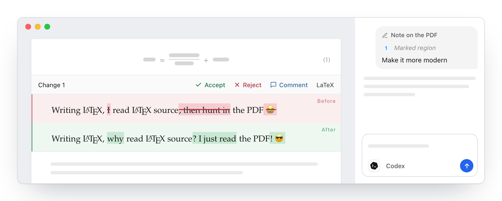
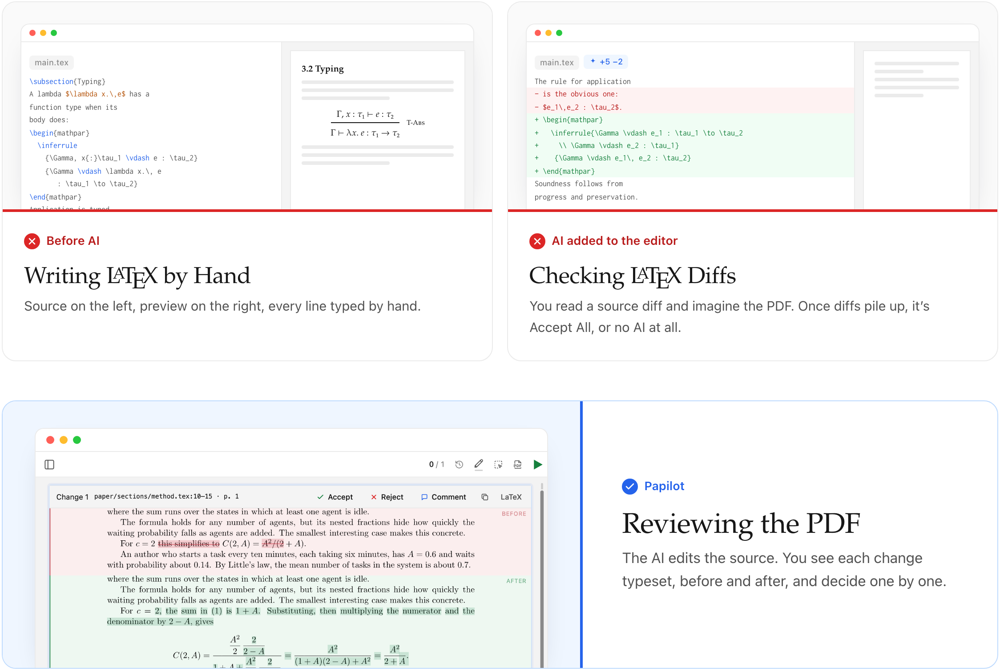
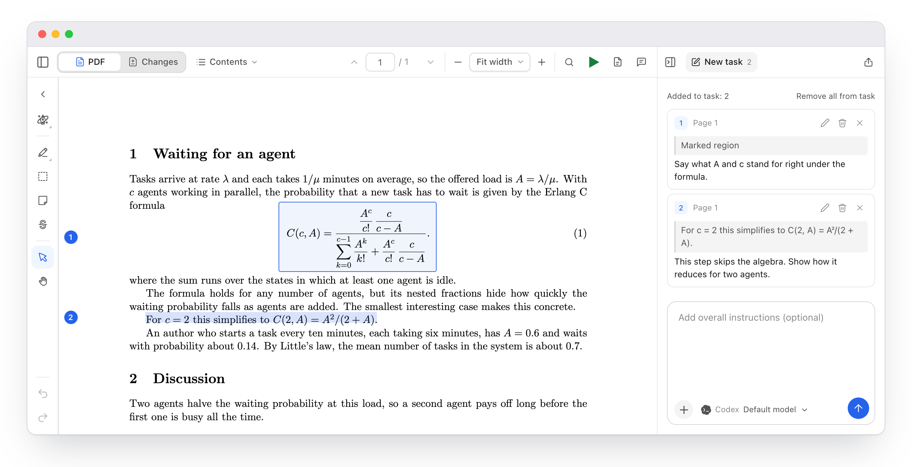

 **차세대 AI LaTeX 편집기**

# `.tex`을 읽거나 직접 작성하지 마세요 그저  위에서 작업하세요

AI와 함께하는 책임감 있는 집필 및 조판의 **새로운 패러다임**.

<picture><source media="(prefers-color-scheme: dark)" srcset="../assets/readme-icons/apple-dark.svg"></picture>&nbsp;macOS(Apple&nbsp;Silicon&nbsp;/&nbsp;Intel) 및 <picture><source media="(prefers-color-scheme: dark)" srcset="../assets/readme-icons/linux-dark.svg"></picture>&nbsp;Linux(AppImage / &nbsp;Ubuntu / &nbsp;Debian / &nbsp;NixOS)용 **[Papilot 다운로드](https://github.com/PapilotAI/papilot/releases/latest)**, 또는 `npm install -g papilot`을 실행하세요.

<a href="https://papilot.ai">
<picture>
  <source media="(prefers-color-scheme: dark) and (max-width: 600px)" srcset="../assets/readme-showcase/hero-compact-dark.png">
  <source media="(prefers-color-scheme: dark)" srcset="../assets/readme-showcase/hero-dark.png">
  <source media="(max-width: 600px)" srcset="../assets/readme-showcase/hero-compact.png">
  
</picture>
</a>

## 📄 중요한 것은 PDF입니다 그 이면의 `.tex` 코드가 아닙니다

논문, 학위논문, 서적, 슬라이드까지 독자가 보는 것은 오직 조판된 페이지뿐입니다. 
**따라서 작업하는 곳 역시 페이지 위여야 합니다.**

  <picture>
    <source media="(prefers-color-scheme: dark) and (max-width: 600px)" srcset="../assets/readme-showcase/paradigm-compact-dark.png">
    <source media="(prefers-color-scheme: dark)" srcset="../assets/readme-showcase/paradigm-dark.png">
    <source media="(max-width: 600px)" srcset="../assets/readme-showcase/paradigm-compact.png">
    
  </picture>

**더 이상 머릿속으로 변경 내역을 컴파일하지 마세요.** 
소스 코드 비교는 PDF 결과를 *상상*하게 만들지만, Papilot은 조판된 결과를 직접 *보여줍니다*.

## 👉 페이지에서 원하는 곳을 가리키고 지시하세요

문장, 수식 또는 그림을 표시하고 주석을 작성하세요. 
**에이전트가 소스 위치를 찾아냅니다. `.tex` 파일을 열 필요가 전혀 없습니다.**

  <picture>
    <source media="(prefers-color-scheme: dark) and (max-width: 600px)" srcset="../assets/readme-showcase/notes-app-compact-dark.png">
    <source media="(prefers-color-scheme: dark)" srcset="../assets/readme-showcase/notes-app-dark.png">
    <source media="(max-width: 600px)" srcset="../assets/readme-showcase/notes-app-compact.png">
    
  </picture>

## 🔒 파일의 소유권은 온전히 사용자에게 있습니다

 &nbsp;**로컬 기기의 일반 파일.** 모든 변경 사항은 Git 기록에 남습니다.

 &nbsp;**Git을 통한 공동 저자와의 동기화.** 풀(pull)하고 푸시(push)하며, 충돌 해결은 에이전트에게 맡기세요.

 &nbsp;**무료 및 오픈 소스.** MIT 라이선스로 macOS 및 Linux를 지원합니다.

## 🤖 기존에 사용하던 AI 에이전트를 그대로 연결하세요

<!-- BEGIN AGENT ICONS -->

  <a href="../guide.md#agents">
    <picture>
      <source media="(prefers-color-scheme: dark) and (max-width: 600px)" srcset="../assets/readme-agents/compact-dark.svg">
      <source media="(prefers-color-scheme: dark)" srcset="../assets/readme-agents/desktop-dark.svg">
      <source media="(max-width: 600px)" srcset="../assets/readme-agents/compact.svg">
      
    </picture>
  </a>

<!-- END AGENT ICONS -->

## 🚀 시작하기

1. **설치.** macOS 또는 Linux용 [앱을 다운로드](https://github.com/PapilotAI/papilot/releases/latest)하거나 `npm install -g papilot`(Node.js 22.22+)을 실행하세요. 또한 Git과 TeX Live 또는 MacTeX이 필요합니다.
2. **프로젝트 열기.** `.tex` 파일이 있는 폴더를 선택하세요. Papilot이 PDF를 빌드합니다.
3. **에이전트 선택.** 이미 보유한 CLI 로그인이나 API 키를 사용한 뒤, 페이지에 표시를 남기세요.

샘플을 먼저 체험해 보고 싶으신가요? `papilot demo`를 실행해 보세요. 자세한 내용은 [가이드](../guide.md#install-and-run)에 있습니다.

## 🤝 커뮤니티

 &nbsp;**버그를 발견하셨거나 필요한 기능이 있나요?** 간단한 내용이라도 좋으니 [이슈를 등록](https://github.com/PapilotAI/papilot/issues/new/choose)해 주세요.

 &nbsp;**질문이나 아이디어가 있으신가요?** [토론을 시작](https://github.com/PapilotAI/papilot/discussions)해 보세요.

 &nbsp;**기여자가 되어 주세요.** AI 에이전트와 함께 작성한 풀 리퀘스트(PR)를 포함하여 모든 기여를 환영합니다. [기여 가이드](../../.github/CONTRIBUTING.md)부터 확인해 보세요.

---

<a href="../../README.md">English</a>&nbsp;· <a href="README.zh-CN.md">简体中文</a>&nbsp;· <a href="README.zh-Hant.md">繁體中文</a>&nbsp;· <a href="README.ja.md">日本語</a>&nbsp;· <a href="README.ko.md">한국어</a>&nbsp;· <a href="README.de.md">Deutsch</a>&nbsp;· <a href="README.fr.md">Français</a>&nbsp;· <a href="README.es.md">Español</a>&nbsp;· <a href="README.pt.md">Português</a>&nbsp;· <a href="README.it.md">Italiano</a>&nbsp;· <a href="README.sv.md">Svenska</a>

<a href="../../LICENSE">MIT</a> © 2026 PapilotAI. <a href="https://linux.do/">LINUX DO</a>의 동료들에게 감사드립니다.

