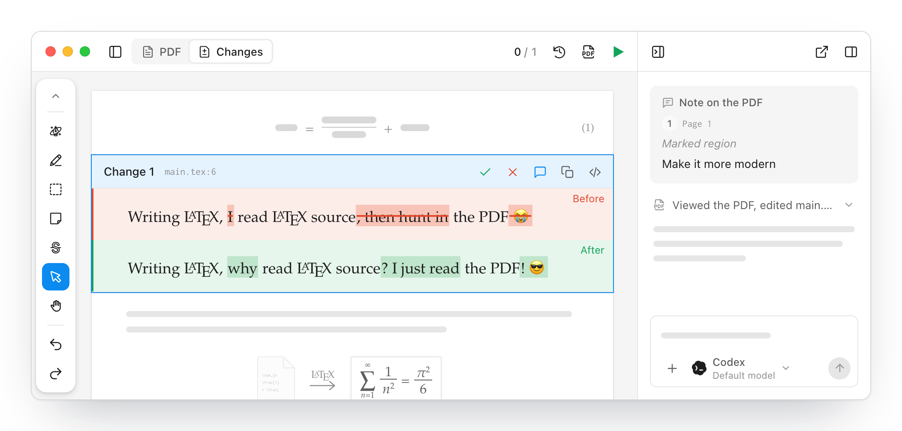

<div align="center">

<br>**차세대 AI LaTeX 편집기**

<h3><code>.tex</code>를&nbsp;직접&nbsp;읽거나&nbsp;쓰지&nbsp;마세요&emsp; &nbsp;위에서&nbsp;바로&nbsp;작업하세요</h3>

<a href="https://papilot.ai"><b>papilot.ai</b></a>&emsp;<a href="https://papilot.ai/demo">온라인 데모</a>&emsp;<a href="#get-started">시작하기</a>&emsp;<a href="#agents">에이전트</a>&emsp;<a href="#how-it-works">작동 방식</a>

<!-- BEGIN BADGES -->
[](../../LICENSE)
[](https://github.com/PapilotAI/papilot/actions/workflows/ci.yml)
[](https://github.com/PapilotAI/papilot/releases/latest)
[](https://github.com/PapilotAI/papilot/releases)
[](https://www.npmjs.com/package/papilot)
[](https://github.com/PapilotAI/papilot/stargazers)
[](https://discord.gg/WdgZDDAvwj)
<!-- END BADGES -->

<p data-language-switcher><sub><a href="../../README.md">English</a>&emsp;<a href="README.zh-CN.md">简体中文</a>&emsp;<a href="README.zh-Hant.md">繁體中文</a>&emsp;<a href="README.ja.md">日本語</a>&emsp;<a href="README.ko.md">한국어</a>&emsp;<a href="README.de.md">Deutsch</a>&emsp;<a href="README.fr.md">Français</a>&emsp;<a href="README.es.md">Español</a>&emsp;<a href="README.pt.md">Português</a>&emsp;<a href="README.it.md">Italiano</a>&emsp;<a href="README.sv.md">Svenska</a></sub></p>

</div>

<p align="center">
<a href="https://papilot.ai">
<picture>
  <source media="(prefers-color-scheme: dark) and (max-width: 600px)" srcset="../assets/readme-showcase/hero-compact-dark.png">
  <source media="(prefers-color-scheme: dark)" srcset="../assets/readme-showcase/hero-dark.png">
  <source media="(max-width: 600px)" srcset="../assets/readme-showcase/hero-compact.png">
  
</picture>
</a>
</p>

<a id="features"></a>

<a id="why-papilot"></a>

## 왜 Papilot인가

<table>
<tr>
<td width="50%" valign="top">
<picture><source media="(prefers-color-scheme: dark)" srcset="../assets/readme-showcase/why-annotate-dark.png"></picture><br>
<b>페이지 위에서 바로 지정</b><br>
문장을 선택하거나 수식 또는 그림을 영역으로 지정한 뒤 수정할 내용을 적어 보세요. 어느 파일에 있든 에이전트가 정확한 소스 줄을 전달받습니다.
</td>
<td width="50%" valign="top">
<picture><source media="(prefers-color-scheme: dark)" srcset="../assets/readme-showcase/why-review-dark.png"></picture><br>
<b>조판된 화면으로 모든 변경 사항 검토</b><br>
각 수정 사항은 PDF 위에서 조판된 전후 비교로 표시됩니다. 수락, 거절하거나 댓글을 남기세요. 직접 수락하기 전까지는 논문에 반영되지 않습니다.
</td>
</tr>
<tr>
<td width="50%" valign="top">
<picture><source media="(prefers-color-scheme: dark)" srcset="../assets/readme-showcase/why-overleaf-dark.png"></picture><br>
<b><picture><source media="(prefers-color-scheme: dark)" srcset="../assets/readme-icons/overleaf-dark.svg"></picture>&nbsp;Overleaf 실시간 동기화</b><br>
공동 저자는 계속 Overleaf에서 집필할 수 있습니다. 수락한 변경 사항은 약 1초 만에 전달되며, 공동 저자의 수정 사항도 작성자 이름과 함께 내 파일과 PDF에 반영됩니다.
</td>
<td width="50%" valign="top">
<picture><source media="(prefers-color-scheme: dark)" srcset="../assets/readme-showcase/why-agents-dark.png"></picture><br>
<b>원하는 에이전트, 원하는 모델</b><br>
채팅창 아래에서 연결된 에이전트의 모델을 선택하세요. 다른 에이전트로 전환하면 Papilot이 해당 에이전트로 요청을 다시 실행합니다.
</td>
</tr>
<tr>
<td width="50%" valign="top">
<picture><source media="(prefers-color-scheme: dark)" srcset="../assets/readme-showcase/why-record-dark.png"></picture><br>
<b>모든 변경 사항을 기록으로 보존</b><br>
각 작업은 원본 파일과 분리된 독립적인 Git 작업 트리에서 실행됩니다. 수락한 변경 사항을 커밋하는 과정이 별도 단계로 분리되어 있으며, 모든 변경 내역은 Git 기록에 남습니다.
</td>
<td width="50%" valign="top">
<picture><source media="(prefers-color-scheme: dark)" srcset="../assets/readme-showcase/why-phone-dark.png"></picture><br>
<b>스마트폰에서 검토</b><br>
<a href="../guide.md#remote-access-with-tailscale">Tailscale</a>을 통해 스마트폰이나 태블릿에서 Papilot을 열고, 자리에서 떨어져 있을 때도 PDF를 읽고 표시하며 변경 사항을 수락할 수 있습니다.
</td>
</tr>
<tr>
<td colspan="2" valign="top">
<picture><source media="(prefers-color-scheme: dark)" srcset="../assets/readme-showcase/why-universe-dark.png"></picture><br>
<b>템플릿으로 시작하기</b><br>
<a href="https://papilot.ai/universe/">Papilot Universe</a>는 학위논문, 저널 및 학술대회 양식, 슬라이드, 포스터, 이력서(CV), 단행본 템플릿을 제공하며, 400개 이상의 학술대회에 대해 논문 모집 공고(CFP)에서 요구하는 템플릿을 연결해 줍니다. 원하는 템플릿을 선택하면 Papilot이 즉시 컴파일 가능한 논문을 생성합니다.
</td>
</tr>
</table>

<a id="quick-start"></a>
<a id="get-started"></a>
<a id="downloads"></a>

<a id="get-started"></a>

## 시작하기

<p align="center">
<a href="https://papilot.ai/#download"><picture><source media="(prefers-color-scheme: dark) and (max-width: 600px)" srcset="../assets/readme-downloads/mac-compact-dark.png"><source media="(prefers-color-scheme: dark)" srcset="../assets/readme-downloads/mac-dark.png"><source media="(max-width: 600px)" srcset="../assets/readme-downloads/mac-compact.png"></picture></a>
<a href="https://papilot.ai/#download"><picture><source media="(prefers-color-scheme: dark) and (max-width: 600px)" srcset="../assets/readme-downloads/windows-compact-dark.png"><source media="(prefers-color-scheme: dark)" srcset="../assets/readme-downloads/windows-dark.png"><source media="(max-width: 600px)" srcset="../assets/readme-downloads/windows-compact.png"></picture></a>
<a href="https://papilot.ai/#download"><picture><source media="(prefers-color-scheme: dark) and (max-width: 600px)" srcset="../assets/readme-downloads/linux-compact-dark.png"><source media="(prefers-color-scheme: dark)" srcset="../assets/readme-downloads/linux-dark.png"><source media="(max-width: 600px)" srcset="../assets/readme-downloads/linux-compact.png"></picture></a>
<a href="../guide.md#install-and-run"><picture><source media="(prefers-color-scheme: dark) and (max-width: 600px)" srcset="../assets/readme-downloads/terminal-compact-dark.png"><source media="(prefers-color-scheme: dark)" srcset="../assets/readme-downloads/terminal-dark.png"><source media="(max-width: 600px)" srcset="../assets/readme-downloads/terminal-compact.png"></picture></a>
</p>

<details>
<summary><picture><source media="(prefers-color-scheme: dark) and (max-width: 600px)" srcset="../assets/readme-downloads/pm-bar-compact-dark.png"><source media="(prefers-color-scheme: dark)" srcset="../assets/readme-downloads/pm-bar-dark.png"><source media="(max-width: 600px)" srcset="../assets/readme-downloads/pm-bar-compact.png"></picture></summary>

<br>

<picture><source media="(prefers-color-scheme: dark)" srcset="../assets/readme-icons/homebrew-dark.svg"></picture>&nbsp;**macOS · [Homebrew](https://github.com/PapilotAI/homebrew-tap)**

```sh
brew tap PapilotAI/tap
brew trust PapilotAI/tap
brew install --cask PapilotAI/tap/papilot
```

<sub>미서명 — 첫 실행 시 개인정보 보호 및 보안에서 허용하세요 (<a href="https://github.com/PapilotAI/homebrew-tap#gatekeeper-note">자세히</a>).</sub>

<picture><source media="(prefers-color-scheme: dark)" srcset="../assets/readme-icons/scoop-dark.svg"></picture>&nbsp;**Windows · [Scoop](https://github.com/PapilotAI/scoop-bucket)**

```powershell
scoop bucket add papilot https://github.com/PapilotAI/scoop-bucket
scoop install papilot/papilot
```

<sub>언제든 <code>scoop update papilot</code>으로 업그레이드하세요.</sub>

<picture><source media="(prefers-color-scheme: dark)" srcset="../assets/readme-icons/debian-dark.svg"></picture>&nbsp;<picture><source media="(prefers-color-scheme: dark)" srcset="../assets/readme-icons/ubuntu-dark.svg"></picture>&nbsp;**Debian / Ubuntu · [APT](../apt.md)**

```sh
curl -fsSL https://papilot.ai/apt/gpg.key | sudo gpg --dearmor -o /etc/apt/keyrings/papilot.gpg
echo "deb [arch=amd64 signed-by=/etc/apt/keyrings/papilot.gpg] https://papilot.ai/apt stable main" |
  sudo tee /etc/apt/sources.list.d/papilot.list
sudo apt update && sudo apt install papilot
```

<sub>서명된 저장소 — 지문 확인은 <a href="../apt.md">APT 가이드</a>를 참고하세요.</sub>

<picture><source media="(prefers-color-scheme: dark)" srcset="../assets/readme-icons/archlinux-dark.svg"></picture>&nbsp;**Arch Linux · [AUR](../aur.md)**

```sh
paru -S papilot-bin
```

<sub><code>makepkg -si</code>로 직접 빌드할 수도 있습니다 — <a href="../aur.md">Arch 가이드</a> 참고.</sub>

<picture><source media="(prefers-color-scheme: dark)" srcset="../assets/readme-icons/nixos-dark.svg"></picture>&nbsp;**Nix · [Flake](../nix.md)**

```sh
nix run github:PapilotAI/papilot -- demo
```

<sub>Flake, 프로필 및 개발 셸은 <a href="../nix.md">Nix 가이드</a>를 참고하세요.</sub>

</details>

<p align="center"><sub>무료 오픈 소스입니다. Git, TeX 배포판 및 로그인된 <a href="#agents">에이전트</a>가 필요합니다.</sub></p>

<a id="agents"></a>

<a id="works-with-your-agent"></a>

## 사용 중인 에이전트와 연동

<p align="center">
  <a href="../guide.md#agents">
    <picture>
      <source media="(prefers-color-scheme: dark) and (max-width: 600px)" srcset="../assets/readme-agents/grid-compact-dark.png">
      <source media="(prefers-color-scheme: dark)" srcset="../assets/readme-agents/grid-dark.png">
      <source media="(max-width: 600px)" srcset="../assets/readme-agents/grid-compact.png">
      
    </picture>
  </a>
</p>

<p align="center"><sub>기존 계정이나 API 키를 그대로 사용하거나, 내장된 Papilot Writer를 사용하세요. <a href="../guide.md#agents">설정 안내</a></sub></p>

<a id="how-it-works"></a>

<a id="how-it-works"></a>

## 작동 방식

<p align="center">
  <picture>
    <source media="(prefers-color-scheme: dark) and (max-width: 600px)" srcset="../assets/readme-showcase/flow-compact-dark.png">
    <source media="(prefers-color-scheme: dark)" srcset="../assets/readme-showcase/flow-dark.png">
    <source media="(max-width: 600px)" srcset="../assets/readme-showcase/flow-compact.png">
    
  </picture>
</p>

<a id="documentation-and-community"></a>

<a id="community"></a>

## 커뮤니티

<p align="center">
<a href="https://github.com/PapilotAI/papilot/issues/new/choose"><picture><source media="(prefers-color-scheme: dark) and (max-width: 600px)" srcset="../assets/readme-community/issue-compact-dark.png"><source media="(prefers-color-scheme: dark)" srcset="../assets/readme-community/issue-dark.png"><source media="(max-width: 600px)" srcset="../assets/readme-community/issue-compact.png"></picture></a>
<a href="https://github.com/PapilotAI/papilot/discussions"><picture><source media="(prefers-color-scheme: dark) and (max-width: 600px)" srcset="../assets/readme-community/discussion-compact-dark.png"><source media="(prefers-color-scheme: dark)" srcset="../assets/readme-community/discussion-dark.png"><source media="(max-width: 600px)" srcset="../assets/readme-community/discussion-compact.png"></picture></a>
<a href="https://discord.gg/WdgZDDAvwj"><picture><source media="(prefers-color-scheme: dark) and (max-width: 600px)" srcset="../assets/readme-community/discord-compact-dark.png"><source media="(prefers-color-scheme: dark)" srcset="../assets/readme-community/discord-dark.png"><source media="(max-width: 600px)" srcset="../assets/readme-community/discord-compact.png"></picture></a>
<a href="../../.github/CONTRIBUTING.md"><picture><source media="(prefers-color-scheme: dark) and (max-width: 600px)" srcset="../assets/readme-community/contribute-compact-dark.png"><source media="(prefers-color-scheme: dark)" srcset="../assets/readme-community/contribute-dark.png"><source media="(max-width: 600px)" srcset="../assets/readme-community/contribute-compact.png"></picture></a>
</p>

Papilot은 자주 업데이트됩니다. 자세한 내용은 [변경 로그](../../CHANGELOG.md)를 확인하세요.

<a id="contributors"></a>

## 기여자

<p>
  <a href="https://github.com/PapilotAI/papilot/graphs/contributors">
    <picture>
      <source media="(max-width: 600px)" srcset="https://papilot.ai/readme-contributors/compact.svg">
      
    </picture>
  </a>
</p>

<a id="star-history"></a>

## 스타 추이

Papilot이 시간을 아껴 주었다면, 다른 연구자들도 찾을 수 있도록 스타를 눌러 주세요.

<a href="https://www.star-history.com/?repos=papilotai%2Fpapilot&type=date&legend=bottom-right">
 <picture>
   <source media="(prefers-color-scheme: dark)" srcset="https://api.star-history.com/chart?repos=papilotai/papilot&type=date&theme=dark&legend=bottom-right" />
   <source media="(prefers-color-scheme: light)" srcset="https://api.star-history.com/chart?repos=papilotai/papilot&type=date&legend=bottom-right" />
   
 </picture>
</a>

---

<p align="center"><sub><a href="../../LICENSE">MIT</a> © 2026 PapilotAI. <a href="https://linux.do/">LINUX DO</a>의 친구들에게 감사드립니다.</sub></p>
