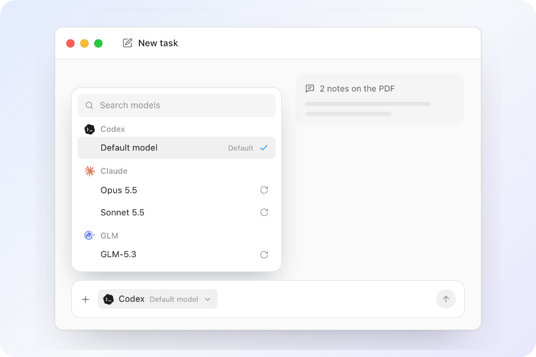
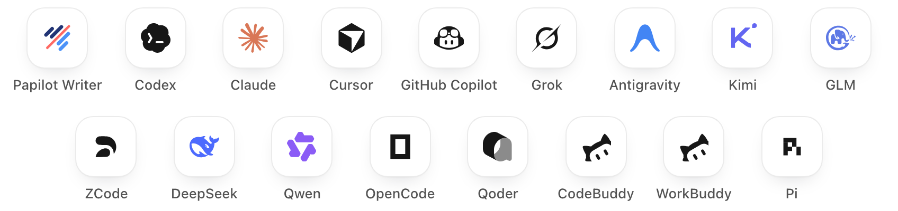

<div align="center">

<br>**Editor LaTeX de nova geração com IA**

<h3>Não&nbsp;leia&nbsp;nem&nbsp;escreva&nbsp;<code>.tex</code>&emsp; Trabalhe&nbsp;diretamente&nbsp;no&nbsp;</h3>

<a href="https://papilot.ai"><b>papilot.ai</b></a>&emsp;<a href="https://papilot.ai/demo">Demonstração online</a>&emsp;<a href="#get-started">Primeiros passos</a>&emsp;<a href="#agents">Agentes</a>&emsp;<a href="#how-it-works">Como funciona</a>

<!-- BEGIN BADGES -->
[](../../LICENSE)
[](https://github.com/PapilotAI/papilot/actions/workflows/ci.yml)
[](https://github.com/PapilotAI/papilot/releases/latest)
[](https://github.com/PapilotAI/papilot/releases)
[](https://www.npmjs.com/package/papilot)
[](https://github.com/PapilotAI/papilot/stargazers)
[](https://discord.gg/WdgZDDAvwj)
<!-- END BADGES -->

<p data-language-switcher><sub><a href="../../README.md">English</a>&emsp;<a href="README.zh-CN.md">简体中文</a>&emsp;<a href="README.zh-Hant.md">繁體中文</a>&emsp;<a href="README.ja.md">日本語</a>&emsp;<a href="README.ko.md">한국어</a>&emsp;<a href="README.de.md">Deutsch</a>&emsp;<a href="README.fr.md">Français</a>&emsp;<a href="README.es.md">Español</a>&emsp;<a href="README.pt.md">Português</a>&emsp;<a href="README.it.md">Italiano</a>&emsp;<a href="README.sv.md">Svenska</a></sub></p>

</div>

<p align="center">
<a href="https://papilot.ai">
<picture>
  <source media="(prefers-color-scheme: dark) and (max-width: 600px)" srcset="../assets/readme-showcase/hero-compact-dark.png">
  <source media="(prefers-color-scheme: dark)" srcset="../assets/readme-showcase/hero-dark.png">
  <source media="(max-width: 600px)" srcset="../assets/readme-showcase/hero-compact.png">
  
</picture>
</a>
</p>

<a id="features"></a>

<a id="why-papilot"></a>

## Por que o Papilot

<table>
<tr>
<td width="50%" valign="top">
<picture><source media="(prefers-color-scheme: dark)" srcset="../assets/readme-showcase/why-annotate-dark.png"></picture><br>
<b>Aponte na página</b><br>
Selecione uma frase ou demarque uma equação ou figura e escreva o que deve mudar. Seu agente recebe as linhas exatas do código-fonte, em qualquer arquivo em que estejam.
</td>
<td width="50%" valign="top">
<picture><source media="(prefers-color-scheme: dark)" srcset="../assets/readme-showcase/why-review-dark.png"></picture><br>
<b>Revise cada alteração já diagramada</b><br>
Cada edição retorna como um antes e depois no PDF. Aceite, rejeite ou comente; nada entra no seu artigo até que você aceite.
</td>
</tr>
<tr>
<td width="50%" valign="top">
<picture><source media="(prefers-color-scheme: dark)" srcset="../assets/readme-showcase/why-overleaf-dark.png"></picture><br>
<b><picture><source media="(prefers-color-scheme: dark)" srcset="../assets/readme-icons/overleaf-dark.svg"></picture>&nbsp;Sincronização em tempo real com o Overleaf</b><br>
Os coautores continuam escrevendo no Overleaf. Suas alterações aceitas chegam até eles em cerca de um segundo, e as deles aparecem nos seus arquivos e no PDF com os respectivos nomes.
</td>
<td width="50%" valign="top">
<picture><source media="(prefers-color-scheme: dark)" srcset="../assets/readme-showcase/why-agents-dark.png"></picture><br>
<b>Qualquer agente, qualquer modelo</b><br>
Escolha um modelo de qualquer agente conectado abaixo do chat. Mude para outro agente e o Papilot executa novamente sua solicitação com ele.
</td>
</tr>
<tr>
<td width="50%" valign="top">
<picture><source media="(prefers-color-scheme: dark)" srcset="../assets/readme-showcase/why-record-dark.png"></picture><br>
<b>Cada alteração registrada</b><br>
Cada tarefa é executada em sua própria árvore de trabalho do Git, separada dos seus arquivos. Confirmar as alterações aceitas é uma etapa à parte, e cada modificação permanece no seu histórico do Git.
</td>
<td width="50%" valign="top">
<picture><source media="(prefers-color-scheme: dark)" srcset="../assets/readme-showcase/why-phone-dark.png"></picture><br>
<b>Revise pelo celular</b><br>
Abra o Papilot no seu celular ou tablet via <a href="../guide.md#remote-access-with-tailscale">Tailscale</a> para ler o PDF, fazer marcações e aceitar alterações longe da sua mesa.
</td>
</tr>
<tr>
<td colspan="2" valign="top">
<picture><source media="(prefers-color-scheme: dark)" srcset="../assets/readme-showcase/why-universe-dark.png"></picture><br>
<b>Comece a partir de um modelo</b><br>
O <a href="https://papilot.ai/universe/">Papilot Universe</a> reúne modelos para teses, pacotes de periódicos e conferências, slides, pôsteres, currículos e livros, além de associar mais de 400 conferências ao modelo exigido em suas chamadas de artigos. Escolha um e o Papilot cria o artigo, pronto para compilar.
</td>
</tr>
</table>

<a id="quick-start"></a>
<a id="get-started"></a>
<a id="downloads"></a>

<a id="get-started"></a>

## Primeiros passos

<p align="center">
<a href="https://papilot.ai/#download"><picture><source media="(prefers-color-scheme: dark) and (max-width: 600px)" srcset="../assets/readme-downloads/mac-compact-dark.png"><source media="(prefers-color-scheme: dark)" srcset="../assets/readme-downloads/mac-dark.png"><source media="(max-width: 600px)" srcset="../assets/readme-downloads/mac-compact.png"></picture></a>
<a href="https://papilot.ai/#download"><picture><source media="(prefers-color-scheme: dark) and (max-width: 600px)" srcset="../assets/readme-downloads/windows-compact-dark.png"><source media="(prefers-color-scheme: dark)" srcset="../assets/readme-downloads/windows-dark.png"><source media="(max-width: 600px)" srcset="../assets/readme-downloads/windows-compact.png"></picture></a>
<a href="https://papilot.ai/#download"><picture><source media="(prefers-color-scheme: dark) and (max-width: 600px)" srcset="../assets/readme-downloads/linux-compact-dark.png"><source media="(prefers-color-scheme: dark)" srcset="../assets/readme-downloads/linux-dark.png"><source media="(max-width: 600px)" srcset="../assets/readme-downloads/linux-compact.png"></picture></a>
<a href="../guide.md#install-and-run"><picture><source media="(prefers-color-scheme: dark) and (max-width: 600px)" srcset="../assets/readme-downloads/terminal-compact-dark.png"><source media="(prefers-color-scheme: dark)" srcset="../assets/readme-downloads/terminal-dark.png"><source media="(max-width: 600px)" srcset="../assets/readme-downloads/terminal-compact.png"></picture></a>
</p>

<details>
<summary><picture><source media="(prefers-color-scheme: dark) and (max-width: 600px)" srcset="../assets/readme-downloads/pm-bar-compact-dark.png"><source media="(prefers-color-scheme: dark)" srcset="../assets/readme-downloads/pm-bar-dark.png"><source media="(max-width: 600px)" srcset="../assets/readme-downloads/pm-bar-compact.png"></picture></summary>

<table>
<tr>
<td width="50%" valign="top">
<picture><source media="(prefers-color-scheme: dark)" srcset="../assets/readme-icons/homebrew-dark.svg"></picture>&nbsp;<b>macOS</b> · <a href="https://github.com/PapilotAI/homebrew-tap">Homebrew</a>

```sh
brew tap PapilotAI/tap
brew trust PapilotAI/tap
brew install --cask PapilotAI/tap/papilot
```

<sub>Sem assinatura — permita em Privacidade e Segurança na primeira execução (<a href="https://github.com/PapilotAI/homebrew-tap#gatekeeper-note">detalhes</a>).</sub>
</td>
<td width="50%" valign="top">
<picture><source media="(prefers-color-scheme: dark)" srcset="../assets/readme-icons/scoop-dark.svg"></picture>&nbsp;<b>Windows</b> · <a href="https://github.com/PapilotAI/scoop-bucket">Scoop</a>

```powershell
scoop bucket add papilot https://github.com/PapilotAI/scoop-bucket
scoop install papilot/papilot
```

<sub>Atualize quando quiser com <code>scoop update papilot</code>.</sub>
</td>
</tr>
<tr>
<td width="50%" valign="top">
<picture><source media="(prefers-color-scheme: dark)" srcset="../assets/readme-icons/debian-dark.svg"></picture>&nbsp;<picture><source media="(prefers-color-scheme: dark)" srcset="../assets/readme-icons/ubuntu-dark.svg"></picture>&nbsp;<b>Debian / Ubuntu</b> · <a href="../apt.md">APT</a>

```sh
curl -fsSL https://papilot.ai/apt/gpg.key | \
  sudo gpg --dearmor -o /etc/apt/keyrings/papilot.gpg
echo "deb [arch=amd64 signed-by=/etc/apt/keyrings/papilot.gpg] https://papilot.ai/apt stable main" | \
  sudo tee /etc/apt/sources.list.d/papilot.list
sudo apt update && sudo apt install papilot
```

<sub>Repositório assinado — verifique a impressão digital no <a href="../apt.md">guia APT</a>.</sub>
</td>
<td width="50%" valign="top">
<picture><source media="(prefers-color-scheme: dark)" srcset="../assets/readme-icons/archlinux-dark.svg"></picture>&nbsp;<b>Arch</b> · <a href="../aur.md">AUR</a> &nbsp;&amp;&nbsp; <picture><source media="(prefers-color-scheme: dark)" srcset="../assets/readme-icons/nixos-dark.svg"></picture>&nbsp;<b>Nix</b> · <a href="../nix.md">Flake</a>

```sh
# Arch Linux (AUR)
paru -S papilot-bin

# Nix
nix run github:PapilotAI/papilot -- demo
```

<sub>Veja o <a href="../aur.md">guia Arch</a> e o <a href="../nix.md">guia Nix</a>.</sub>
</td>
</tr>
</table>

</details>

<p align="center"><sub>Gratuito e de código aberto. Requer Git, uma distribuição TeX e um <a href="#agents">agente</a> autenticado.</sub></p>

<a id="agents"></a>

<a id="works-with-your-agent"></a>

## Funciona com o seu agente

<p align="center">
  <a href="../guide.md#agents">
    <picture>
      <source media="(prefers-color-scheme: dark) and (max-width: 600px)" srcset="../assets/readme-agents/grid-compact-dark.png">
      <source media="(prefers-color-scheme: dark)" srcset="../assets/readme-agents/grid-dark.png">
      <source media="(max-width: 600px)" srcset="../assets/readme-agents/grid-compact.png">
      
    </picture>
  </a>
</p>

<p align="center"><sub>Use a conta ou chave de API que você já possui, ou utilize o Papilot Writer integrado. <a href="../guide.md#agents">Configuração</a></sub></p>

<a id="how-it-works"></a>

<a id="how-it-works"></a>

## Como funciona

<p align="center">
  <picture>
    <source media="(prefers-color-scheme: dark) and (max-width: 600px)" srcset="../assets/readme-showcase/flow-compact-dark.png">
    <source media="(prefers-color-scheme: dark)" srcset="../assets/readme-showcase/flow-dark.png">
    <source media="(max-width: 600px)" srcset="../assets/readme-showcase/flow-compact.png">
    
  </picture>
</p>

<a id="documentation-and-community"></a>

<a id="community"></a>

## Comunidade

<p align="center">
<a href="https://github.com/PapilotAI/papilot/issues/new/choose"><picture><source media="(prefers-color-scheme: dark) and (max-width: 600px)" srcset="../assets/readme-community/issue-compact-dark.png"><source media="(prefers-color-scheme: dark)" srcset="../assets/readme-community/issue-dark.png"><source media="(max-width: 600px)" srcset="../assets/readme-community/issue-compact.png"></picture></a>
<a href="https://github.com/PapilotAI/papilot/discussions"><picture><source media="(prefers-color-scheme: dark) and (max-width: 600px)" srcset="../assets/readme-community/discussion-compact-dark.png"><source media="(prefers-color-scheme: dark)" srcset="../assets/readme-community/discussion-dark.png"><source media="(max-width: 600px)" srcset="../assets/readme-community/discussion-compact.png"></picture></a>
<a href="https://discord.gg/WdgZDDAvwj"><picture><source media="(prefers-color-scheme: dark) and (max-width: 600px)" srcset="../assets/readme-community/discord-compact-dark.png"><source media="(prefers-color-scheme: dark)" srcset="../assets/readme-community/discord-dark.png"><source media="(max-width: 600px)" srcset="../assets/readme-community/discord-compact.png"></picture></a>
<a href="../../.github/CONTRIBUTING.md"><picture><source media="(prefers-color-scheme: dark) and (max-width: 600px)" srcset="../assets/readme-community/contribute-compact-dark.png"><source media="(prefers-color-scheme: dark)" srcset="../assets/readme-community/contribute-dark.png"><source media="(max-width: 600px)" srcset="../assets/readme-community/contribute-compact.png"></picture></a>
</p>

O Papilot recebe atualizações frequentes: consulte o [histórico de alterações](../../CHANGELOG.md).

<a id="contributors"></a>

## Contribuidores

<p>
  <a href="https://github.com/PapilotAI/papilot/graphs/contributors">
    <picture>
      <source media="(max-width: 600px)" srcset="https://papilot.ai/readme-contributors/compact.svg">
      
    </picture>
  </a>
</p>

<a id="star-history"></a>

## Histórico de estrelas

Se o Papilot economiza seu tempo, uma estrela ajuda outros pesquisadores a encontrá-lo.

<a href="https://www.star-history.com/?repos=papilotai%2Fpapilot&type=date&legend=bottom-right">
 <picture>
   <source media="(prefers-color-scheme: dark)" srcset="https://api.star-history.com/chart?repos=papilotai/papilot&type=date&theme=dark&legend=bottom-right" />
   <source media="(prefers-color-scheme: light)" srcset="https://api.star-history.com/chart?repos=papilotai/papilot&type=date&legend=bottom-right" />
   
 </picture>
</a>

---

<p align="center"><sub><a href="../../LICENSE">MIT</a> © 2026 PapilotAI. Agradecimentos aos nossos amigos da <a href="https://linux.do/">LINUX DO</a>.</sub></p>
