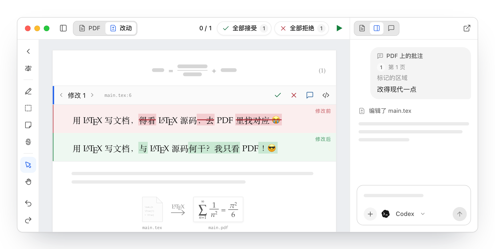
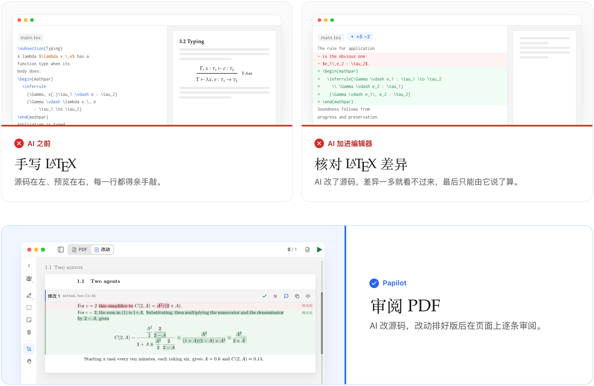
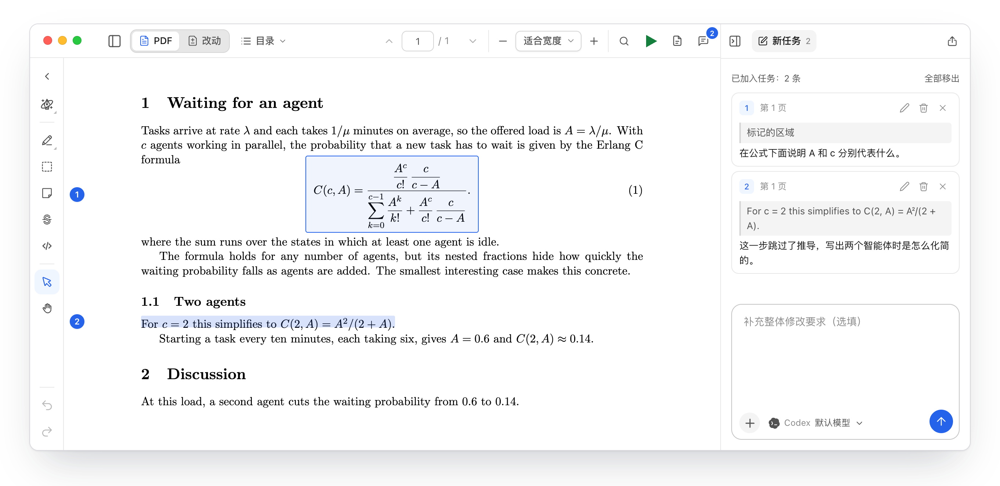

 **下一代 AI LaTeX 编辑器**

# 不必读写 `.tex` 直接在  上工作

用 AI 负责任地写作与排版的**新范式**。

<!-- BEGIN BADGES -->

<!-- END BADGES -->

<a href="../../README.md">English</a>&nbsp;· <a href="README.zh-CN.md">简体中文</a>&nbsp;· <a href="README.zh-Hant.md">繁體中文</a>&nbsp;· <a href="README.ja.md">日本語</a>&nbsp;· <a href="README.ko.md">한국어</a>&nbsp;· <a href="README.de.md">Deutsch</a>&nbsp;· <a href="README.fr.md">Français</a>&nbsp;· <a href="README.es.md">Español</a>&nbsp;· <a href="README.pt.md">Português</a>&nbsp;· <a href="README.it.md">Italiano</a>&nbsp;· <a href="README.sv.md">Svenska</a>

<a href="https://papilot.ai">
<picture>
  <source media="(prefers-color-scheme: dark) and (max-width: 600px)" srcset="../assets/readme-showcase/hero-compact-dark.zh-CN.png">
  <source media="(prefers-color-scheme: dark)" srcset="../assets/readme-showcase/hero-dark.zh-CN.png">
  <source media="(max-width: 600px)" srcset="../assets/readme-showcase/hero-compact.zh-CN.png">
  
</picture>
</a>

## 📄 你在乎的是 PDF 不是背后的 `.tex`

论文、学位论文、书稿、幻灯片，读者看到的永远只是排好版的页面。 
**所以，你也应该在页面上工作。**

  <picture>
    <source media="(prefers-color-scheme: dark) and (max-width: 600px)" srcset="../assets/readme-showcase/paradigm-compact-dark.zh-CN.png">
    <source media="(prefers-color-scheme: dark)" srcset="../assets/readme-showcase/paradigm-dark.zh-CN.png">
    <source media="(max-width: 600px)" srcset="../assets/readme-showcase/paradigm-compact.zh-CN.png">
    
  </picture>

**不用再在脑子里编译 diff。** 
源码 diff 只能让你*想象* PDF 的样子，Papilot 直接把排好版的结果*摆在*你面前。

## 👉 指着页面，说出你想怎么改

选中一句话、一个公式或一张图，写下批注。 
**智能体自己找到源码，你永远不用打开 `.tex` 文件。**

  <picture>
    <source media="(prefers-color-scheme: dark) and (max-width: 600px)" srcset="../assets/readme-showcase/notes-app-compact-dark.zh-CN.png">
    <source media="(prefers-color-scheme: dark)" srcset="../assets/readme-showcase/notes-app-dark.zh-CN.png">
    <source media="(max-width: 600px)" srcset="../assets/readme-showcase/notes-app-compact.zh-CN.png">
    
  </picture>

## 🔒 你的文件始终属于你

 &nbsp;**文件就在你的电脑上。** 每处改动都留在你的 Git 历史里。

 &nbsp;**通过 Git 与合作者同步。** 拉取、推送，冲突交给智能体解决。

 &nbsp;**免费开源。** MIT 许可，支持 macOS、Linux 和 Windows。

## 🤖 带上你已经在用的 AI 智能体

<!-- BEGIN AGENT ICONS -->

  <a href="../guide.md#agents">
    <picture>
      <source media="(prefers-color-scheme: dark) and (max-width: 600px)" srcset="../assets/readme-agents/compact-dark.svg">
      <source media="(prefers-color-scheme: dark)" srcset="../assets/readme-agents/desktop-dark.svg">
      <source media="(max-width: 600px)" srcset="../assets/readme-agents/compact.svg">
      
    </picture>
  </a>

<!-- END AGENT ICONS -->

## 📥 下载

<!-- BEGIN DOWNLOADS -->
| 系统 / 发行版 | 下载 / 软件包 | 安装 / 运行 |
| --- | --- | --- |
| <picture><source media="(prefers-color-scheme: dark)" srcset="../assets/readme-icons/apple-dark.svg"></picture> **macOS** | [Apple Silicon](https://github.com/PapilotAI/papilot/releases/latest) · [Intel](https://github.com/PapilotAI/papilot/releases/latest) DMG / ZIP | 打开 DMG，将 Papilot 拖入“应用程序”。 |
| <picture><source media="(prefers-color-scheme: dark)" srcset="../assets/readme-icons/windows-dark.svg"></picture> **Windows** | [安装版](https://github.com/PapilotAI/papilot/releases/latest) · [便携版](https://github.com/PapilotAI/papilot/releases/latest) x64 | 运行安装程序，或直接打开便携版。 |
|   **Ubuntu / Debian / Linux Mint** | [.deb](https://github.com/PapilotAI/papilot/releases/latest) | `sudo apt install ./Papilot-*.deb` |
| <picture><source media="(prefers-color-scheme: dark)" srcset="../assets/readme-icons/linux-dark.svg"></picture> **Fedora / Arch / openSUSE** | [AppImage](https://github.com/PapilotAI/papilot/releases/latest) | `chmod +x Papilot-*.AppImage` `./Papilot-*.AppImage` |
|  **NixOS** | [Nix flake](../nix.md#nixos-flake) | [加入 `flake.nix`](../nix.md#nixos-flake) |
| **macOS / Linux / Windows (CLI)** | [npm](https://www.npmjs.com/package/papilot) | `npm install -g papilot` |

Linux 安装包为 x86_64，已在 Ubuntu 22.04 上测试。依赖项及 AppImage/FUSE 使用说明见[桌面版安装指南](../../desktop/README.md#build-and-run)。

npm 版本使用浏览器界面，需要 Node.js 22.22+。Nix 需要启用 flakes，详见 [Nix 安装指南](../nix.md#nixos-flake)。
<!-- END DOWNLOADS -->

## 🚀 快速开始

1. **安装。** [下载应用](#downloads)（macOS、Linux 或 Windows），或运行 `npm install -g papilot`（需要 Node.js 22.22+）。另外还需要 Git 和 TeX Live 或 MacTeX。
2. **打开你的项目。** 选择存放 `.tex` 文件的文件夹，Papilot 会编译出 PDF。
3. **选择智能体。** 直接用你已有的 CLI 登录或 API 密钥，然后就可以在页面上批注了。

想先看个示例？运行 `papilot demo`。详细说明见[使用指南](../guide.md#install-and-run)。

## 🤝 社区

 &nbsp;**发现了 bug，或者缺少某个功能？** [提一个 issue](https://github.com/PapilotAI/papilot/issues/new/choose)，写得粗略也没关系。

 &nbsp;**有问题或想法？** [发起讨论](https://github.com/PapilotAI/papilot/discussions)。

 &nbsp;**成为贡献者。** 非常欢迎提交 pull request，用 AI 智能体写的也一样欢迎。先看看[贡献指南](../../.github/CONTRIBUTING.md)。

## 贡献者

  <a href="https://github.com/PapilotAI/papilot/graphs/contributors">
    <picture>
      <source media="(max-width: 600px)" srcset="../assets/readme-contributors/compact.svg">
      
    </picture>
  </a>

## Star 历史

<a href="https://www.star-history.com/?repos=papilotai%2Fpapilot&type=date&logscale=&legend=bottom-right">
 <picture>
   <source media="(prefers-color-scheme: dark)" srcset="https://api.star-history.com/chart?repos=papilotai/papilot&type=date&theme=dark&legend=bottom-right" />
   <source media="(prefers-color-scheme: light)" srcset="https://api.star-history.com/chart?repos=papilotai/papilot&type=date&legend=bottom-right" />
   
 </picture>
</a>

---

<a href="../../LICENSE">MIT</a> © 2026 PapilotAI。感谢朋友 <a href="https://linux.do/">LINUX DO</a>。

