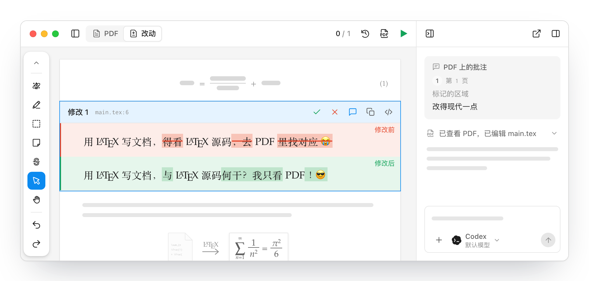
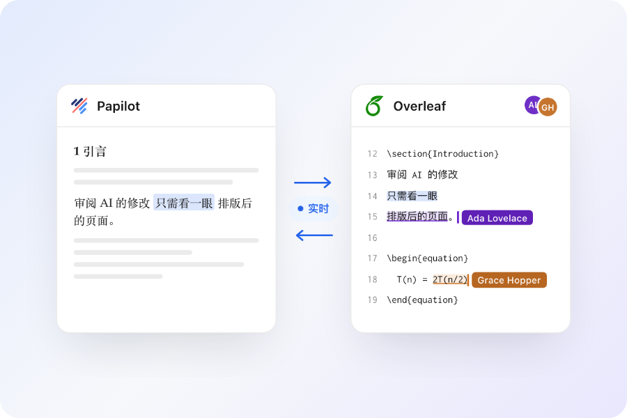
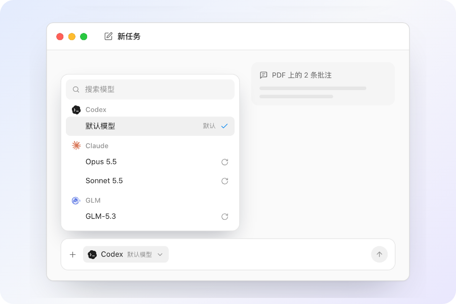
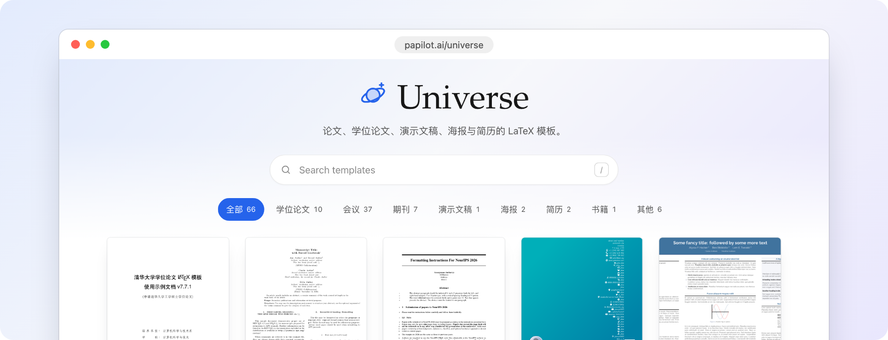
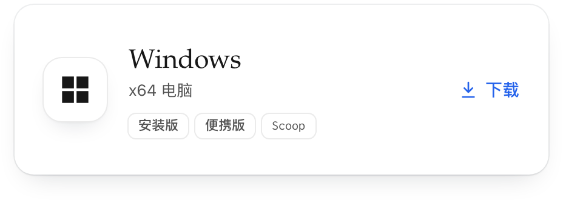
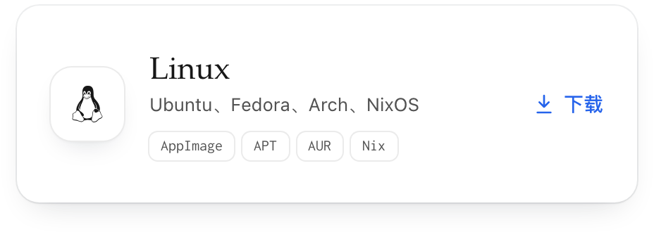

 **新一代 AI LaTeX 编辑器**

<h3>无需读写&nbsp;<code>.tex</code>&emsp; 直接在&nbsp;&nbsp;上修改</h3>

<a href="https://papilot.ai"><b>papilot.ai</b></a>&emsp;<a href="https://papilot.ai/demo">在线演示</a>&emsp;<a href="#get-started">快速上手</a>&emsp;<a href="#agents">智能体</a>&emsp;<a href="#how-it-works">工作原理</a>

<!-- BEGIN BADGES -->

<!-- END BADGES -->

<a href="../../README.md">English</a>&emsp;<a href="README.zh-CN.md">简体中文</a>&emsp;<a href="README.zh-Hant.md">繁體中文</a>&emsp;<a href="README.ja.md">日本語</a>&emsp;<a href="README.ko.md">한국어</a>&emsp;<a href="README.de.md">Deutsch</a>&emsp;<a href="README.fr.md">Français</a>&emsp;<a href="README.es.md">Español</a>&emsp;<a href="README.pt.md">Português</a>&emsp;<a href="README.it.md">Italiano</a>&emsp;<a href="README.sv.md">Svenska</a>

<a href="https://papilot.ai">
<picture>
  <source media="(prefers-color-scheme: dark) and (max-width: 600px)" srcset="../assets/readme-showcase/hero-compact-dark.zh-CN.png">
  <source media="(prefers-color-scheme: dark)" srcset="../assets/readme-showcase/hero-dark.zh-CN.png">
  <source media="(max-width: 600px)" srcset="../assets/readme-showcase/hero-compact.zh-CN.png">
  
</picture>
</a>

## 为什么选择 Papilot

<table>
<tr>
<td width="50%" valign="top">
<picture><source media="(prefers-color-scheme: dark)" srcset="../assets/readme-showcase/why-annotate-dark.zh-CN.png"></picture> 
<b>在页面上直接指点</b> 
划选句子，或框选公式与图表，写下修改要求。无论源码在哪个文件中，智能体都能准确定位到对应的源码行。
</td>
<td width="50%" valign="top">
<picture><source media="(prefers-color-scheme: dark)" srcset="../assets/readme-showcase/why-review-dark.zh-CN.png"></picture> 
<b>以排版效果审阅每处修改</b> 
每次修改都会在 PDF 上呈现排版后的前后对比。你可以接受、拒绝或发表评论；在点击接受前，任何改动都不会写入你的论文。
</td>
</tr>
<tr>
<td width="50%" valign="top">
<picture><source media="(prefers-color-scheme: dark)" srcset="../assets/readme-showcase/why-overleaf-dark.zh-CN.png"></picture> 
<b><picture><source media="(prefers-color-scheme: dark)" srcset="../assets/readme-icons/overleaf-dark.svg"></picture>&nbsp;与 Overleaf 实时同步</b> 
合作者可以继续在 Overleaf 中写作。你接受的修改约一秒即可同步给他们，而他们的改动也会署着各自的名字实时更新到你的文件和 PDF 中。
</td>
<td width="50%" valign="top">
<picture><source media="(prefers-color-scheme: dark)" srcset="../assets/readme-showcase/why-agents-dark.zh-CN.png"></picture> 
<b>任意智能体，任意模型</b> 
在聊天框下方从已连接的任意智能体中选择模型。切换到其他智能体时，Papilot 会使用新智能体重新运行你的请求。
</td>
</tr>
<tr>
<td width="50%" valign="top">
<picture><source media="(prefers-color-scheme: dark)" srcset="../assets/readme-showcase/why-record-dark.zh-CN.png"></picture> 
<b>每处改动皆有记录</b> 
每个任务都在各自独立的 Git 工作树中运行，不会直接触碰你的文件。提交已接受的修改是独立的一步，每次改动都会保存在你的 Git 历史中。
</td>
<td width="50%" valign="top">
<picture><source media="(prefers-color-scheme: dark)" srcset="../assets/readme-showcase/why-phone-dark.zh-CN.png"></picture> 
<b>在手机上审阅</b> 
通过 <a href="../guide.md#remote-access-with-tailscale">Tailscale</a> 在手机或平板上打开 Papilot，即使不在桌前，也能阅读 PDF、添加标记并接受修改。
</td>
</tr>
<tr>
<td colspan="2" valign="top">
<picture><source media="(prefers-color-scheme: dark)" srcset="../assets/readme-showcase/why-universe-dark.zh-CN.png"></picture> 
<b>从模板开始</b> 
<a href="https://papilot.ai/universe/">Papilot Universe</a> 汇集了学位论文、期刊与会议套件、幻灯片、海报、简历和书籍模板，并为 400 多个学术会议匹配了征稿通知所要求的模板。任选其一，Papilot 即可创建可直接编译的论文。
</td>
</tr>
</table>

## 快速上手

<a href="https://papilot.ai/#download"><picture><source media="(prefers-color-scheme: dark) and (max-width: 600px)" srcset="../assets/readme-downloads/mac-compact-dark.zh-CN.png"><source media="(prefers-color-scheme: dark)" srcset="../assets/readme-downloads/mac-dark.zh-CN.png"><source media="(max-width: 600px)" srcset="../assets/readme-downloads/mac-compact.zh-CN.png"></picture></a>
<a href="https://papilot.ai/#download"><picture><source media="(prefers-color-scheme: dark) and (max-width: 600px)" srcset="../assets/readme-downloads/windows-compact-dark.zh-CN.png"><source media="(prefers-color-scheme: dark)" srcset="../assets/readme-downloads/windows-dark.zh-CN.png"><source media="(max-width: 600px)" srcset="../assets/readme-downloads/windows-compact.zh-CN.png"></picture></a>
<a href="https://papilot.ai/#download"><picture><source media="(prefers-color-scheme: dark) and (max-width: 600px)" srcset="../assets/readme-downloads/linux-compact-dark.zh-CN.png"><source media="(prefers-color-scheme: dark)" srcset="../assets/readme-downloads/linux-dark.zh-CN.png"><source media="(max-width: 600px)" srcset="../assets/readme-downloads/linux-compact.zh-CN.png"></picture></a>
<a href="../guide.md#install-and-run"><picture><source media="(prefers-color-scheme: dark) and (max-width: 600px)" srcset="../assets/readme-downloads/terminal-compact-dark.zh-CN.png"><source media="(prefers-color-scheme: dark)" srcset="../assets/readme-downloads/terminal-dark.zh-CN.png"><source media="(max-width: 600px)" srcset="../assets/readme-downloads/terminal-compact.zh-CN.png"></picture></a>

免费且开源。需要 Git、TeX 发行版以及已登录的<a href="#agents">智能体</a>。

## 支持你常用的智能体

  <a href="../guide.md#agents">
    <picture>
      <source media="(prefers-color-scheme: dark) and (max-width: 600px)" srcset="../assets/readme-agents/grid-compact-dark.png">
      <source media="(prefers-color-scheme: dark)" srcset="../assets/readme-agents/grid-dark.png">
      <source media="(max-width: 600px)" srcset="../assets/readme-agents/grid-compact.png">
      
    </picture>
  </a>

可直接使用你现有的账号登录或 API 密钥，也可使用内置的 Papilot Writer。<a href="../guide.md#agents">配置指南</a>

## 工作原理

  <picture>
    <source media="(prefers-color-scheme: dark) and (max-width: 600px)" srcset="../assets/readme-showcase/flow-compact-dark.zh-CN.png">
    <source media="(prefers-color-scheme: dark)" srcset="../assets/readme-showcase/flow-dark.zh-CN.png">
    <source media="(max-width: 600px)" srcset="../assets/readme-showcase/flow-compact.zh-CN.png">
    
  </picture>

## 社区

<a href="https://github.com/PapilotAI/papilot/issues/new/choose"><picture><source media="(prefers-color-scheme: dark) and (max-width: 600px)" srcset="../assets/readme-community/issue-compact-dark.zh-CN.png"><source media="(prefers-color-scheme: dark)" srcset="../assets/readme-community/issue-dark.zh-CN.png"><source media="(max-width: 600px)" srcset="../assets/readme-community/issue-compact.zh-CN.png"></picture></a>
<a href="https://github.com/PapilotAI/papilot/discussions"><picture><source media="(prefers-color-scheme: dark) and (max-width: 600px)" srcset="../assets/readme-community/discussion-compact-dark.zh-CN.png"><source media="(prefers-color-scheme: dark)" srcset="../assets/readme-community/discussion-dark.zh-CN.png"><source media="(max-width: 600px)" srcset="../assets/readme-community/discussion-compact.zh-CN.png"></picture></a>
<a href="https://discord.gg/WdgZDDAvwj"><picture><source media="(prefers-color-scheme: dark) and (max-width: 600px)" srcset="../assets/readme-community/discord-compact-dark.zh-CN.png"><source media="(prefers-color-scheme: dark)" srcset="../assets/readme-community/discord-dark.zh-CN.png"><source media="(max-width: 600px)" srcset="../assets/readme-community/discord-compact.zh-CN.png"></picture></a>
<a href="../../.github/CONTRIBUTING.md"><picture><source media="(prefers-color-scheme: dark) and (max-width: 600px)" srcset="../assets/readme-community/contribute-compact-dark.zh-CN.png"><source media="(prefers-color-scheme: dark)" srcset="../assets/readme-community/contribute-dark.zh-CN.png"><source media="(max-width: 600px)" srcset="../assets/readme-community/contribute-compact.zh-CN.png"></picture></a>

Papilot 更新频繁：请查看[更新日志](../../CHANGELOG.md)。

## 贡献者

  <a href="https://github.com/PapilotAI/papilot/graphs/contributors">
    <picture>
      <source media="(max-width: 600px)" srcset="https://papilot.ai/readme-contributors/compact.svg">
      
    </picture>
  </a>

## Star 历史

如果 Papilot 为你节省了时间，欢迎点亮一颗 Star，帮助更多研究者发现它。

<a href="https://www.star-history.com/?repos=papilotai%2Fpapilot&type=date&legend=bottom-right">
 <picture>
   <source media="(prefers-color-scheme: dark)" srcset="https://api.star-history.com/chart?repos=papilotai/papilot&type=date&theme=dark&legend=bottom-right" />
   <source media="(prefers-color-scheme: light)" srcset="https://api.star-history.com/chart?repos=papilotai/papilot&type=date&legend=bottom-right" />
   
 </picture>
</a>

---

<a href="../../LICENSE">MIT</a> © 2026 PapilotAI. 感谢 <a href="https://linux.do/">LINUX DO</a> 社区伙伴们的支持。

