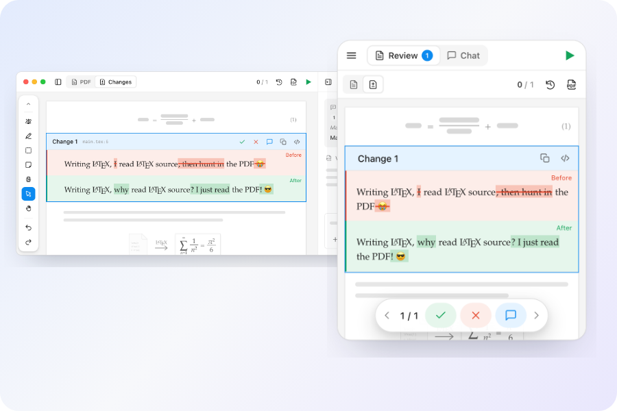
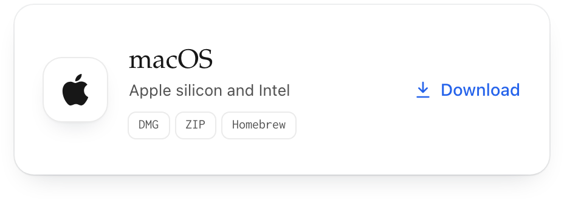

<div align="center">

<br>**新世代 AI LaTeX 編輯器**

<h3>無須讀寫&nbsp;<code>.tex</code>&emsp; 直接在&nbsp;&nbsp;上操作</h3>

<a href="https://papilot.ai"><b>papilot.ai</b></a>&emsp;<a href="https://papilot.ai/demo">線上體驗</a>&emsp;<a href="#get-started">快速上手</a>&emsp;<a href="#agents">智慧代理</a>&emsp;<a href="#how-it-works">運作方式</a>

<!-- BEGIN BADGES -->
[](../../LICENSE)
[](https://github.com/PapilotAI/papilot/actions/workflows/ci.yml)
[](https://github.com/PapilotAI/papilot/releases/latest)
[](https://github.com/PapilotAI/papilot/releases)
[](https://www.npmjs.com/package/papilot)
[](https://github.com/PapilotAI/papilot/stargazers)
[](https://discord.gg/WdgZDDAvwj)
<!-- END BADGES -->

<p data-language-switcher><sub><a href="../../README.md">English</a>&emsp;<a href="README.zh-CN.md">简体中文</a>&emsp;<a href="README.zh-Hant.md">繁體中文</a>&emsp;<a href="README.ja.md">日本語</a>&emsp;<a href="README.ko.md">한국어</a>&emsp;<a href="README.de.md">Deutsch</a>&emsp;<a href="README.fr.md">Français</a>&emsp;<a href="README.es.md">Español</a>&emsp;<a href="README.pt.md">Português</a>&emsp;<a href="README.it.md">Italiano</a>&emsp;<a href="README.sv.md">Svenska</a></sub></p>

</div>

<p align="center">
<a href="https://papilot.ai">
<picture>
  <source media="(prefers-color-scheme: dark) and (max-width: 600px)" srcset="../assets/readme-showcase/hero-compact-dark.png">
  <source media="(prefers-color-scheme: dark)" srcset="../assets/readme-showcase/hero-dark.png">
  <source media="(max-width: 600px)" srcset="../assets/readme-showcase/hero-compact.png">
  
</picture>
</a>
</p>

<a id="features"></a>

<a id="why-papilot"></a>

## 為什麼選擇 Papilot

<table>
<tr>
<td width="50%" valign="top">
<picture><source media="(prefers-color-scheme: dark)" srcset="../assets/readme-showcase/why-annotate-dark.png"></picture><br>
<b>直接點選頁面</b><br>
選取句子，或框選公式與圖表，並寫下修改需求。無論內容位於哪個檔案，智慧代理都能精準取得對應的原始碼行。
</td>
<td width="50%" valign="top">
<picture><source media="(prefers-color-scheme: dark)" srcset="../assets/readme-showcase/why-review-dark.png"></picture><br>
<b>審閱排版後的每項變更</b><br>
每次修改都會在 PDF 上以排版前後對照呈現。您可以接受、拒絕或留言；在您接受之前，任何變更都不會寫入論文。
</td>
</tr>
<tr>
<td width="50%" valign="top">
<picture><source media="(prefers-color-scheme: dark)" srcset="../assets/readme-showcase/why-overleaf-dark.png"></picture><br>
<b><picture><source media="(prefers-color-scheme: dark)" srcset="../assets/readme-icons/overleaf-dark.svg"></picture>&nbsp;與 Overleaf 即時同步</b><br>
共同作者可繼續在 Overleaf 中撰寫。您接受的變更約一秒內就會同步給他們，而他們的修改也會附上署名，自動同步至您的檔案與 PDF。
</td>
<td width="50%" valign="top">
<picture><source media="(prefers-color-scheme: dark)" srcset="../assets/readme-showcase/why-agents-dark.png"></picture><br>
<b>不限智慧代理，不限模型</b><br>
在對話框下方從任何已連結的智慧代理中挑選模型。切換至其他智慧代理時，Papilot 會直接使用新代理重新執行您的請求。
</td>
</tr>
<tr>
<td width="50%" valign="top">
<picture><source media="(prefers-color-scheme: dark)" srcset="../assets/readme-showcase/why-record-dark.png"></picture><br>
<b>每項變更皆有跡可循</b><br>
每項任務都在各自獨立的 Git 工作樹中執行，不影響您的原始檔案。提交已接受的變更是獨立的步驟，且每項變更都會完整保留在 Git 歷史記錄中。
</td>
<td width="50%" valign="top">
<picture><source media="(prefers-color-scheme: dark)" srcset="../assets/readme-showcase/why-phone-dark.png"></picture><br>
<b>在手機上審閱</b><br>
透過 <a href="../guide.md#remote-access-with-tailscale">Tailscale</a> 在手機或平板電腦上開啟 Papilot，即使不在電腦前，也能閱讀 PDF、標記內容並接受變更。
</td>
</tr>
<tr>
<td colspan="2" valign="top">
<picture><source media="(prefers-color-scheme: dark)" srcset="../assets/readme-showcase/why-universe-dark.png"></picture><br>
<b>從範本開始</b><br>
<a href="https://papilot.ai/universe/">Papilot Universe</a> 收錄了學位論文、期刊與研討會套件、簡報、海報、履歷與書籍範本，並為超過 400 場研討會對接徵稿要求的專屬範本。只需挑選一個，Papilot 就會建立好可立即編譯的論文。
</td>
</tr>
</table>

<a id="quick-start"></a>
<a id="get-started"></a>
<a id="downloads"></a>

<a id="get-started"></a>

## 快速上手

<p align="center">
<a href="https://papilot.ai/#download"><picture><source media="(prefers-color-scheme: dark) and (max-width: 600px)" srcset="../assets/readme-downloads/mac-compact-dark.png"><source media="(prefers-color-scheme: dark)" srcset="../assets/readme-downloads/mac-dark.png"><source media="(max-width: 600px)" srcset="../assets/readme-downloads/mac-compact.png"></picture></a>
<a href="https://papilot.ai/#download"><picture><source media="(prefers-color-scheme: dark) and (max-width: 600px)" srcset="../assets/readme-downloads/windows-compact-dark.png"><source media="(prefers-color-scheme: dark)" srcset="../assets/readme-downloads/windows-dark.png"><source media="(max-width: 600px)" srcset="../assets/readme-downloads/windows-compact.png"></picture></a>
<a href="https://papilot.ai/#download"><picture><source media="(prefers-color-scheme: dark) and (max-width: 600px)" srcset="../assets/readme-downloads/linux-compact-dark.png"><source media="(prefers-color-scheme: dark)" srcset="../assets/readme-downloads/linux-dark.png"><source media="(max-width: 600px)" srcset="../assets/readme-downloads/linux-compact.png"></picture></a>
<a href="../guide.md#install-and-run"><picture><source media="(prefers-color-scheme: dark) and (max-width: 600px)" srcset="../assets/readme-downloads/terminal-compact-dark.png"><source media="(prefers-color-scheme: dark)" srcset="../assets/readme-downloads/terminal-dark.png"><source media="(max-width: 600px)" srcset="../assets/readme-downloads/terminal-compact.png"></picture></a>
</p>

<details>
<summary><picture><source media="(prefers-color-scheme: dark) and (max-width: 600px)" srcset="../assets/readme-downloads/pm-bar-compact-dark.png"><source media="(prefers-color-scheme: dark)" srcset="../assets/readme-downloads/pm-bar-dark.png"><source media="(max-width: 600px)" srcset="../assets/readme-downloads/pm-bar-compact.png"></picture></summary>

<br>

<picture><source media="(prefers-color-scheme: dark)" srcset="../assets/readme-icons/homebrew-dark.svg"></picture>&nbsp;**macOS · [Homebrew](https://github.com/PapilotAI/homebrew-tap)**

```sh
brew tap PapilotAI/tap
brew trust PapilotAI/tap
brew install --cask PapilotAI/tap/papilot
```

<sub>未簽章 — 首次啟動請在「隱私權與安全性」中允許（<a href="https://github.com/PapilotAI/homebrew-tap#gatekeeper-note">詳情</a>）。</sub>

<picture><source media="(prefers-color-scheme: dark)" srcset="../assets/readme-icons/scoop-dark.svg"></picture>&nbsp;**Windows · [Scoop](https://github.com/PapilotAI/scoop-bucket)**

```powershell
scoop bucket add papilot https://github.com/PapilotAI/scoop-bucket
scoop install papilot/papilot
```

<sub>隨時執行 <code>scoop update papilot</code> 升級。</sub>

<picture><source media="(prefers-color-scheme: dark)" srcset="../assets/readme-icons/debian-dark.svg"></picture>&nbsp;<picture><source media="(prefers-color-scheme: dark)" srcset="../assets/readme-icons/ubuntu-dark.svg"></picture>&nbsp;**Debian / Ubuntu · [APT](../apt.md)**

```sh
curl -fsSL https://papilot.ai/apt/gpg.key | sudo gpg --dearmor -o /etc/apt/keyrings/papilot.gpg
echo "deb [arch=amd64 signed-by=/etc/apt/keyrings/papilot.gpg] https://papilot.ai/apt stable main" |
  sudo tee /etc/apt/sources.list.d/papilot.list
sudo apt update && sudo apt install papilot
```

<sub>簽章軟體庫 — 指紋驗證請見 <a href="../apt.md">APT 指南</a>。</sub>

<picture><source media="(prefers-color-scheme: dark)" srcset="../assets/readme-icons/archlinux-dark.svg"></picture>&nbsp;**Arch Linux · [AUR](../aur.md)**

```sh
paru -S papilot-bin
```

<sub>亦可使用 <code>makepkg -si</code> 建置 — 見 <a href="../aur.md">Arch 指南</a>。</sub>

<picture><source media="(prefers-color-scheme: dark)" srcset="../assets/readme-icons/nixos-dark.svg"></picture>&nbsp;**Nix · [Flake](../nix.md)**

```sh
nix run github:PapilotAI/papilot -- demo
```

<sub>Flake、Profile 與開發環境見 <a href="../nix.md">Nix 指南</a>。</sub>

</details>

<p align="center"><sub>免費且開源。需安裝 Git、TeX 發行版，以及已登入的<a href="#agents">智慧代理</a>。</sub></p>

<a id="agents"></a>

<a id="works-with-your-agent"></a>

## 支援您慣用的智慧代理

<p align="center">
  <a href="../guide.md#agents">
    <picture>
      <source media="(prefers-color-scheme: dark) and (max-width: 600px)" srcset="../assets/readme-agents/grid-compact-dark.png">
      <source media="(prefers-color-scheme: dark)" srcset="../assets/readme-agents/grid-dark.png">
      <source media="(max-width: 600px)" srcset="../assets/readme-agents/grid-compact.png">
      
    </picture>
  </a>
</p>

<p align="center"><sub>使用您現有的帳號或 API 金鑰，或直接使用內建的 Papilot Writer。<a href="../guide.md#agents">設定說明</a></sub></p>

<a id="how-it-works"></a>

<a id="how-it-works"></a>

## 運作方式

<p align="center">
  <picture>
    <source media="(prefers-color-scheme: dark) and (max-width: 600px)" srcset="../assets/readme-showcase/flow-compact-dark.png">
    <source media="(prefers-color-scheme: dark)" srcset="../assets/readme-showcase/flow-dark.png">
    <source media="(max-width: 600px)" srcset="../assets/readme-showcase/flow-compact.png">
    
  </picture>
</p>

<a id="documentation-and-community"></a>

<a id="community"></a>

## 社群

<p align="center">
<a href="https://github.com/PapilotAI/papilot/issues/new/choose"><picture><source media="(prefers-color-scheme: dark) and (max-width: 600px)" srcset="../assets/readme-community/issue-compact-dark.png"><source media="(prefers-color-scheme: dark)" srcset="../assets/readme-community/issue-dark.png"><source media="(max-width: 600px)" srcset="../assets/readme-community/issue-compact.png"></picture></a>
<a href="https://github.com/PapilotAI/papilot/discussions"><picture><source media="(prefers-color-scheme: dark) and (max-width: 600px)" srcset="../assets/readme-community/discussion-compact-dark.png"><source media="(prefers-color-scheme: dark)" srcset="../assets/readme-community/discussion-dark.png"><source media="(max-width: 600px)" srcset="../assets/readme-community/discussion-compact.png"></picture></a>
<a href="https://discord.gg/WdgZDDAvwj"><picture><source media="(prefers-color-scheme: dark) and (max-width: 600px)" srcset="../assets/readme-community/discord-compact-dark.png"><source media="(prefers-color-scheme: dark)" srcset="../assets/readme-community/discord-dark.png"><source media="(max-width: 600px)" srcset="../assets/readme-community/discord-compact.png"></picture></a>
<a href="../../.github/CONTRIBUTING.md"><picture><source media="(prefers-color-scheme: dark) and (max-width: 600px)" srcset="../assets/readme-community/contribute-compact-dark.png"><source media="(prefers-color-scheme: dark)" srcset="../assets/readme-community/contribute-dark.png"><source media="(max-width: 600px)" srcset="../assets/readme-community/contribute-compact.png"></picture></a>
</p>

Papilot 更新頻繁：請參閱[更新日誌](../../CHANGELOG.md)。

<a id="contributors"></a>

## 貢獻者

<p>
  <a href="https://github.com/PapilotAI/papilot/graphs/contributors">
    <picture>
      <source media="(max-width: 600px)" srcset="https://papilot.ai/readme-contributors/compact.svg">
      
    </picture>
  </a>
</p>

<a id="star-history"></a>

## Star 歷史趨勢

如果 Papilot 為您節省了寶貴時間，歡迎點亮一顆 Star，幫助更多研究者發現它。

<a href="https://www.star-history.com/?repos=papilotai%2Fpapilot&type=date&legend=bottom-right">
 <picture>
   <source media="(prefers-color-scheme: dark)" srcset="https://api.star-history.com/chart?repos=papilotai/papilot&type=date&theme=dark&legend=bottom-right" />
   <source media="(prefers-color-scheme: light)" srcset="https://api.star-history.com/chart?repos=papilotai/papilot&type=date&legend=bottom-right" />
   
 </picture>
</a>

---

<p align="center"><sub><a href="../../LICENSE">MIT</a> © 2026 PapilotAI. 感謝 <a href="https://linux.do/">LINUX DO</a> 夥伴們的支持。</sub></p>
