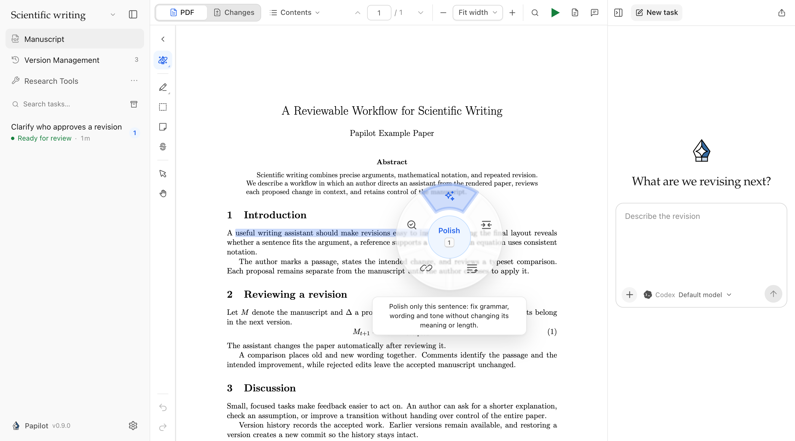
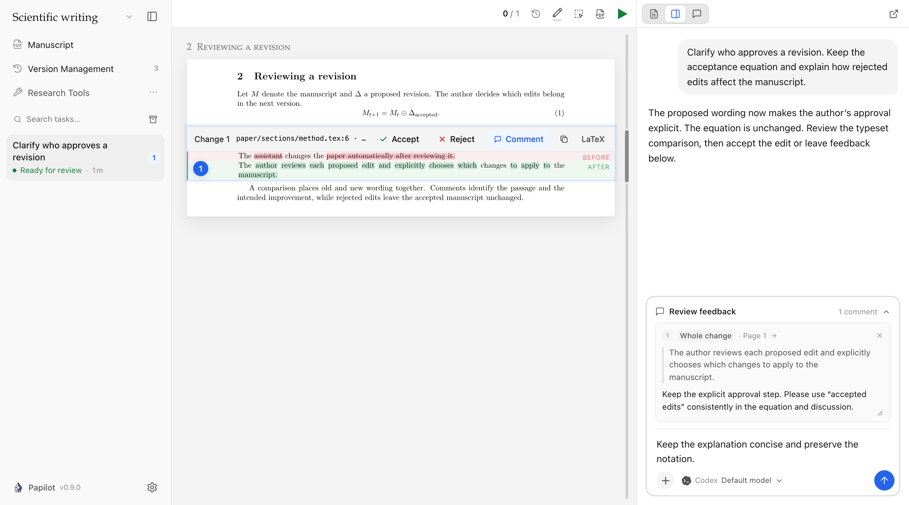
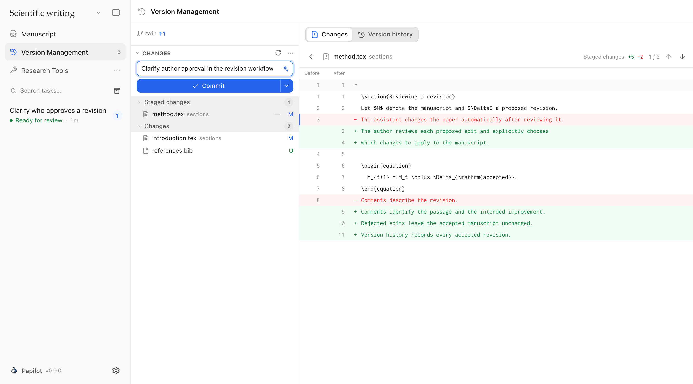

# Papilot 0.9.0：在桌面上完成论文批注、审阅和版本管理

从打开论文文件夹，到在 PDF 上提出修改要求、逐处审阅 AI 的改动，再到保存和同步稿件，Papilot 0.9.0 把这些工作连进了同一个桌面应用。

这篇发布介绍回顾 **0.8.0 → 0.9.0** 的重要改进，也包括已经在 0.8.1–0.8.9 中陆续推出的功能。

## 打开文件夹，继续写论文

Papilot 现在提供 **macOS 和 Linux 桌面应用**，首次启动可以直接试用示例论文。打开本地文件夹后，应用会识别主文件和 LaTeX 引擎，在原目录工作。切换论文或审阅页面后，阅读位置仍然保留；任务需要你处理时，可以通过原生通知回来。

桌面端支持 Stable 和 Dev 更新通道。兼容的更新只下载应用代码，启动检查失败会回退；桌面外壳发生变化时使用新安装包。Nix 用户也可以安装 CLI、审阅引擎及 Linux 桌面应用，并通过 Nix 管理更新。

## 在 PDF 上把修改要求说清楚

可折叠的批注工具栏支持文字批注、区域标记、便签、删除标记和拖动阅读。「魔法笔」可以给选中的段落套用润色、精简、衔接、核实等常用要求，也可以自定义指令。创建、删除和修改批注都能撤销、重做。

新任务面板中的批注可以直接编辑。需要分享意见时，可以导出带批注的 PDF：编号评论卡片排在页面旁边，也支持中日韩文字。

## 在全文中审阅，把反馈直接发进对话

可以在整篇论文中查看排版后的修改，也可以只看变化的部分。引用修改前或修改后的文字，或者对整处改动提意见，再与补充要求、附件和技能一起发送。草稿刷新后仍然保留，并能定位回原来的审阅轮次。需要精确调整时，还可以直接编辑该处 LaTeX，再生成 PDF 对比。

AI 审阅可使用**任意已连接的受支持 agent**，沿用它的工具和审批流程。Papilot 原先对论文长度、指令和审阅意见数量的人为上限已移除，长请求刷新后重试也会保留请求标识。各服务自身的上下文窗口和限制仍然适用。正文预览正在编译时也能启动审阅；修改进入稿件前，仍然需要你明确接受。

## 长论文少等一会儿

全文和章节编译都会复用 LaTeX 已有状态；新一轮编译的每一遍结果会逐步显示，审阅时还会提前准备接受改动后的正文 PDF。你正在等待的编译优先运行，界面在后台编译期间保持响应。

在已有的 324 页论文测量中，PDF 对比从约 **6 分半缩短至 11 秒**；在审阅停留 150 秒、提前准备正文的场景中，提交后的等待时间从 **94 秒降至 0.8 秒**。这是该论文上的测量结果，实际速度取决于项目。[查看编译说明](https://github.com/PapilotAI/papilot/blob/v0.9.0/docs/performance.md)。

对话渲染、增量轮询和 Git 状态缓存也减少了重复工作。原先跨论文、跨 agent 的两个并发任务限制已移除；间接改动追踪改为按需开启，关闭时不再为归因额外编译论文。

## 版本管理有了独立页面

从侧栏进入版本管理，查看源码差异、暂存文件、提交、同步和浏览历史。恢复历史版本会生成新的提交，保留原有记录；高级 Git 控件可以在设置中开启。

其他改进还包括 GitHub Copilot、Grok 支持，任务轮次之间切换模型，Codex、Claude、GLM 编辑任务联网查资料，11 种界面语言，48 个可搜索技能图标，以及 CJK 字体、✓/✗ 对比图片、桌面退出和更新恢复等修复。网站也新增了交互演示、隐私说明和统计退出选项。

## 感谢贡献者

- [@chengluyu](https://github.com/chengluyu)：对话渲染、时间线增量轮询和 Git 状态缓存优化（[#24](https://github.com/PapilotAI/papilot/pull/24)、[#25](https://github.com/PapilotAI/papilot/pull/25)、[#26](https://github.com/PapilotAI/papilot/pull/26)、[#27](https://github.com/PapilotAI/papilot/pull/27)、[#28](https://github.com/PapilotAI/papilot/pull/28)），以及统一选择列表（[#32](https://github.com/PapilotAI/papilot/pull/32)）。
- [@CatIIIIIIII](https://github.com/CatIIIIIIII)：已选批注的编辑和删除（[#36](https://github.com/PapilotAI/papilot/pull/36)），以及编辑任务联网（[#54](https://github.com/PapilotAI/papilot/pull/54)）。
- [@RIvance](https://github.com/RIvance)：Nix 打包基础，推进 CLI 与 NixOS 桌面支持（[#45](https://github.com/PapilotAI/papilot/pull/45)）。

[下载 0.9.0](https://github.com/PapilotAI/papilot/releases/tag/v0.9.0) · [逐版更新日志](https://github.com/PapilotAI/papilot/blob/v0.9.0/CHANGELOG.md) · [从 0.8.0 开始的全部变化](https://github.com/PapilotAI/papilot/compare/v0.8.0...v0.9.0)

CLI：`npm install -g papilot@0.9.0`，需要 Node.js 22.22+、Git 和 TeX。桌面端仍需 TeX 和 agent 登录。本版修改了桌面外壳，使用旧外壳的用户需要下载新安装包；Nix 用户通过 Nix 更新。
