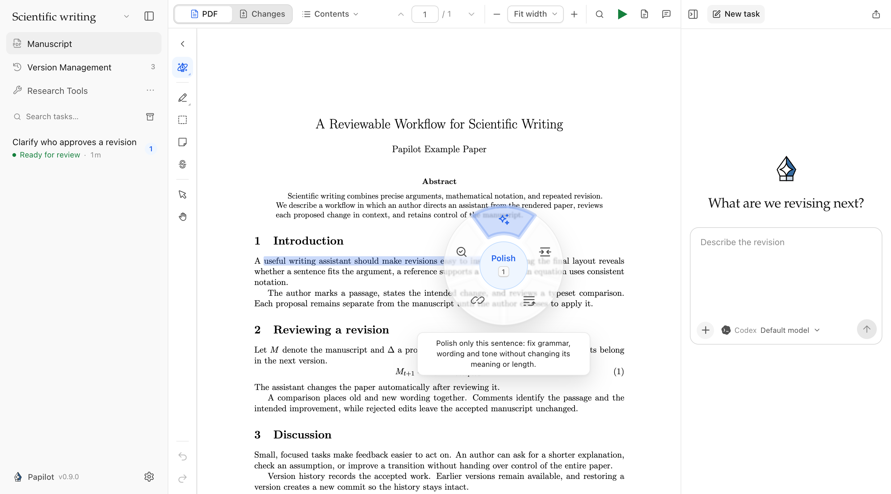
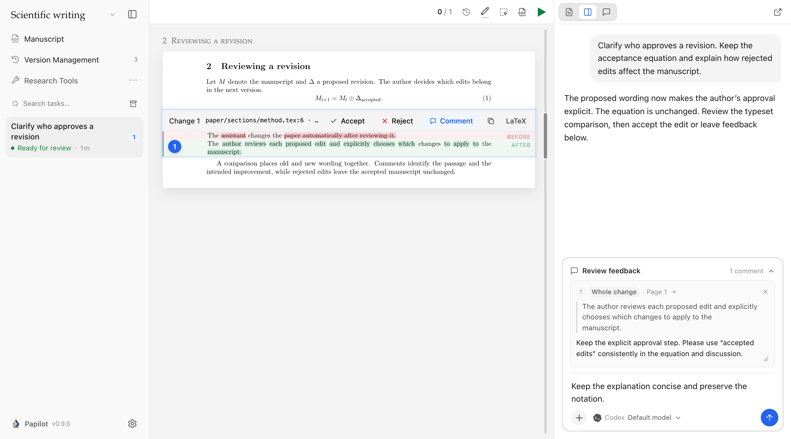
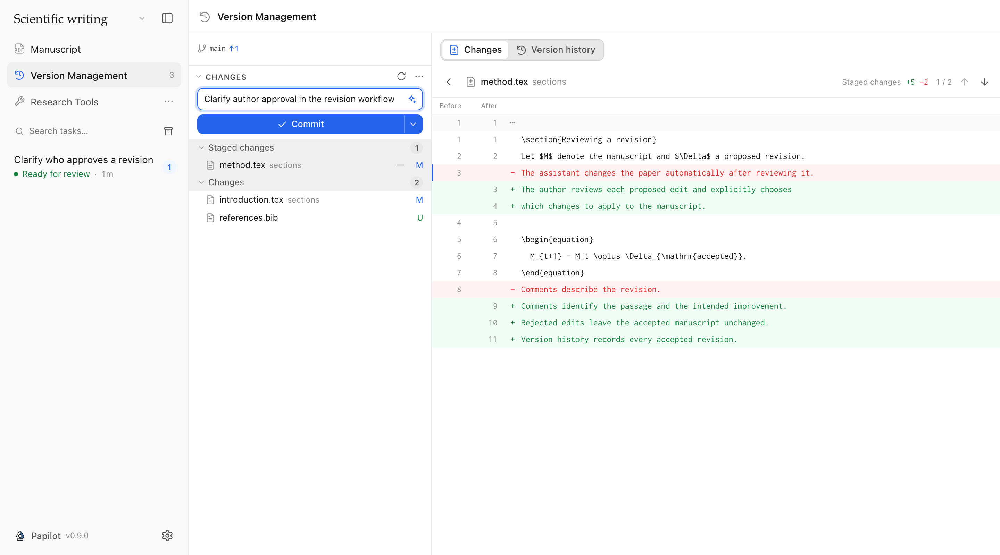

# Papilot 0.9.0 — A desktop workspace for your papers

Papilot 0.9.0 brings the PDF writing workflow into a desktop app: open your paper's folder, mark what needs attention, review typeset changes, and save the revisions you choose. This release overview covers **0.8.0 → 0.9.0**, including improvements delivered throughout 0.8.1–0.8.9.

## Open your paper and keep working

Papilot now has desktop apps for **macOS and Linux**, with an editable example paper to try on first launch. Open a local folder in place: Papilot detects its main file and LaTeX engine and prepares the PDF. Returning to a paper or review restores your reading position, and native notifications can bring you back when a task needs attention.

The desktop app offers **Stable** and **Dev** update channels. Compatible releases update the application code in place, with a startup check and rollback; changes to the desktop shell require a new installer. Nix packages provide the CLI, browser interface and review engine, plus the Electron desktop on Linux.

## Mark the PDF with the instruction you mean

A collapsible tool rail puts text notes, region marks, sticky notes, deletion marks and a hand tool beside the paper. The **Magic pen** opens a wheel of reusable instructions: polish, shorten, connect, verify, or a request you define yourself. Undo and Redo cover annotation creation, deletion and comment edits.

Edit included notes directly in the New task panel, or remove one from the task while keeping its PDF annotation. When you need to share feedback, export the PDF with numbered comment cards beside the pages, including Chinese, Japanese and Korean comments.



## Review changes in context and continue the conversation

See typeset changes within the **whole paper** or switch to **Changes** for a focused review. Quote either the before or after text, or comment on a whole change, then send feedback with instructions, attachments and skills from the chat composer. Drafts survive reloads and link back to the correct review round. For a precise correction, edit the proposed LaTeX in place and rebuild the comparison.

AI reviews can use **any connected, supported agent**, with its normal tools and approval flow. Papilot no longer imposes its former paper-length, instruction-length or finding-count caps, and long requests keep their retry IDs across reloads. Provider context windows and service limits still apply. Reviews can start while the manuscript preview is compiling; changes still need your explicit approval before they enter the manuscript.



## Spend less time waiting on a long paper

Compilations reuse LaTeX's existing state, including chapter builds. Papilot shows each TeX pass as it becomes available and prepares the accepted manuscript's PDF while you review. Builds you are waiting for take priority, while the interface remains responsive.

In the recorded 324-page thesis measurements, PDF comparison fell from about **6½ minutes to 11 seconds**, and, after a 150-second review interval, preparing the manuscript in advance reduced the wait after committing from **94 seconds to 0.8 seconds**. These are measurements from that paper, not a guarantee for every project. [Compilation details](https://github.com/PapilotAI/papilot/blob/v0.9.0/docs/performance.md).

Typing no longer redraws the whole conversation; unchanged replies retain their rendered Markdown, timeline polling reads only changed items, and Git status is reused while the manuscript stays unchanged. Connected agents can start eligible tasks without the former global two-task limit. **Track indirect changes** is now opt-in, avoiding its extra attribution compilations when disabled.

## Keep the manuscript's history within reach

**Version Management** has a permanent sidebar entry and its own workspace. Stage files, inspect source diffs, commit, sync and browse earlier versions. Restoring a version creates a new commit and preserves the existing history. Advanced Git controls remain available in Settings.



## More agents, languages and refinements

- **GitHub Copilot and Grok** join the supported agents. Change models and reasoning settings between turns; model selectors now follow the runtime's configured defaults.
- **Online lookup during editing** is enabled for Codex, Claude and GLM, subject to configured sandbox restrictions and tool approvals. Antigravity can read the image files attached to a task.
- The workspace and review viewer support **11 languages**, with consistent choice lists, dark mode and CJK PDF text support. Choose from **48 searchable skill icons**.
- The website has interactive review demos, a bilingual privacy notice and a statistics opt-out.
- Fixes cover lost review connections, desktop shutdown and update recovery, ✓/✗ symbols in review images, attachment pasting and vulnerable dependencies.

## Thanks

- [@chengluyu](https://github.com/chengluyu) — conversation rendering, incremental polling and Git-status caching ([#24](https://github.com/PapilotAI/papilot/pull/24), [#25](https://github.com/PapilotAI/papilot/pull/25), [#26](https://github.com/PapilotAI/papilot/pull/26), [#27](https://github.com/PapilotAI/papilot/pull/27), [#28](https://github.com/PapilotAI/papilot/pull/28)), plus consistent choice lists ([#32](https://github.com/PapilotAI/papilot/pull/32)).
- [@CatIIIIIIII](https://github.com/CatIIIIIIII) — editing and deleting included PDF notes ([#36](https://github.com/PapilotAI/papilot/pull/36)) and online lookup in editing tasks ([#54](https://github.com/PapilotAI/papilot/pull/54)).
- [@RIvance](https://github.com/RIvance) — the Nix packaging contribution behind the CLI and NixOS desktop support ([#45](https://github.com/PapilotAI/papilot/pull/45)).

## Get 0.9.0

Download the macOS Apple Silicon/Intel or Linux x64 installer from this release, or update the CLI:

```sh
npm install -g papilot@0.9.0
```

The CLI requires Node.js 22.22+, Git and TeX. Desktop users still need a TeX distribution and their agent sign-in. This release changes the desktop shell, so installations with an older shell need the new installer. Nix users update through Nix.

[Detailed changelog](https://github.com/PapilotAI/papilot/blob/v0.9.0/CHANGELOG.md) · [All changes since 0.8.0](https://github.com/PapilotAI/papilot/compare/v0.8.0...v0.9.0)
